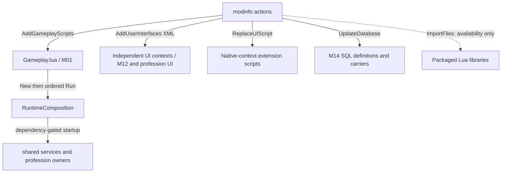
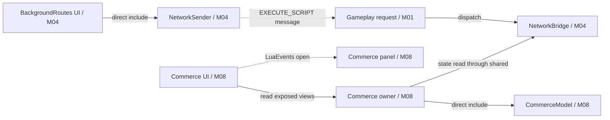
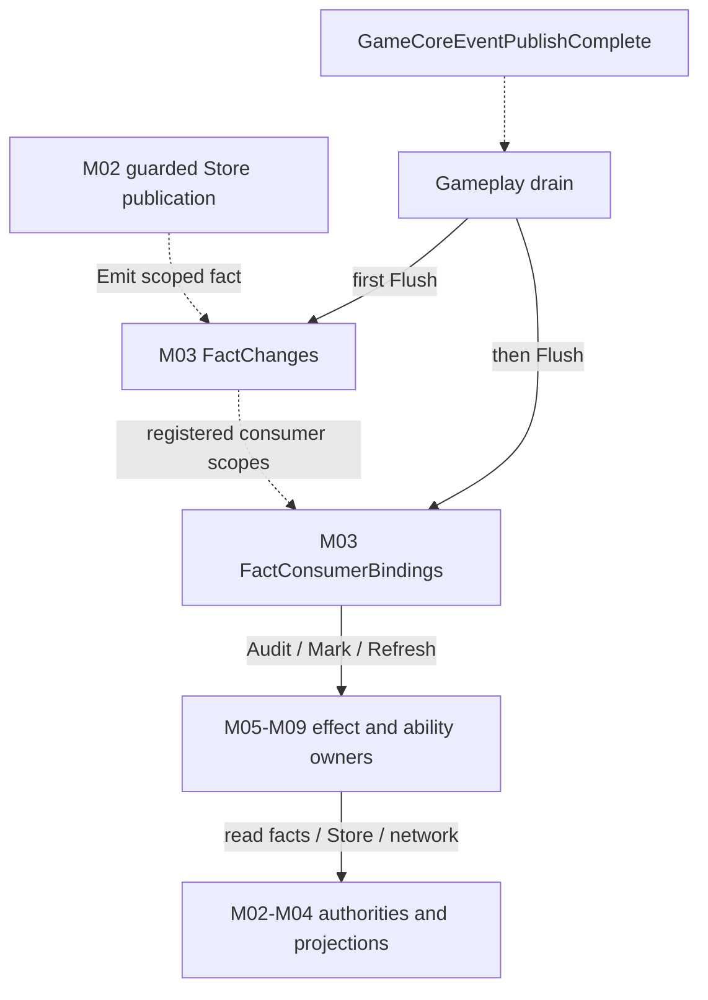
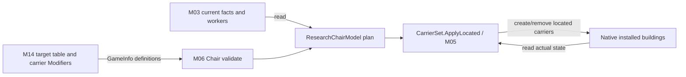

# As-Is Architecture Reconstruction

Investigation / Non-authoritative / No design decision implied

Status: Stable
Owner: Architecture Modules investigation subtask; writes paused for Primary review.
Basis: develop `19d4669d11df945afcda9d73329dfb984fe8c694`; B393.420 / D0058 / A0183 / S0850. Source observations are **STATIC_CONFIRMED**, not local simulation or native acceptance.

## What this reconstruction establishes

The package has one declared Gameplay script, several independent UI contexts and replacement scripts, plus declarative database actions. Gameplay constructs an ordered set of services in a shared context and exposes readers/views through `ExposedMembers.SPC_P0`. UI contexts collect some facts unavailable through that Gameplay path and send script operations back to Gameplay. SQL supplies definitions and effect carriers that Lua validates and reconciles. This is the observed structure; every diagram here is non-authoritative. Approved Architecture Markdown governs; diagram/contract disagreements require review, not automatic correction.

Scope includes the four current professions and partial/retired/import-only modules. [Module_Index](Module_Index.md) maps **218/218 packaged Lua files** to M01–M14. It marks 17 files with targeted excerpt tracing and the rest as inventory; this report does not claim all function paths were reviewed. No source/configuration/existing document edits, tests, deployment, external Mod/HD scans or game launch occurred.

## 1. Declared activation and startup

`ImportFiles` makes files available; it is distinct from the `AddGameplayScripts` action that names `Gameplay.lua`. UI actions either add an XML context or replace a named native context script. Examples are Commerce/Capital/Development panels, ResearchCross refresh, native CityPanel/ProductionPanel replacements and the background routes context. These are static activation declarations, not proof that the engine loaded each context successfully. Evidence: [modinfo ImportFiles:87](../../../../../Mod/SpecializationP0.modinfo#L87), [Gameplay entry:375](../../../../../Mod/SpecializationP0.modinfo#L375), [UI background entry:384](../../../../../Mod/SpecializationP0.modinfo#L384), [replacement ProductionPanel:457](../../../../../Mod/SpecializationP0.modinfo#L457).

`Gameplay.lua:1–12` includes shared helpers, initializes `ExposedMembers.SPC_P0`, and calls `SPCRuntimeComposition.New(shared)`. The file contains **86 composition.Run registrations**, including setup and late binding entries; this is not a count of active professional abilities. `Run(name,deps,exports,fn,fields)` executes in source order, skips missing/failed prerequisites, protects event and registry callbacks, and restores declared exports/hooks after failure. `Complete()` seals the startup account; the epilogue explicitly says composition completion does not assert Store/effects readiness. Evidence: [Gameplay startup:1](../../../../../Mod/Gameplay.lua#L1), [RuntimeComposition.New/Run:7](../../../../../Mod/RuntimeComposition.lua#L7), [Run failure cleanup:65](../../../../../Mod/RuntimeComposition.lua#L65), [Gameplay epilogue:1016](../../../../../Mod/Gameplay.lua#L1016).

The XML for BackgroundRoutes intentionally declares no visible controls; sampling is not conditional on opening its panel. Its same-stem Lua directly includes Probe, ShadowRouteState and NetworkSender. This proves the declared background producer exists, while successful context execution and native API behavior remain in-game questions. Evidence: [BackgroundRoutes.xml:1](../../../../../Mod/UI/BackgroundRoutes.xml#L1), [BackgroundRoutes includes:2](../../../../../Mod/UI/BackgroundRoutes.lua#L2), [collect(pid):44](../../../../../Mod/UI/BackgroundRoutes.lua#L44).

## 2. Logical module families and public surfaces

The following grouping describes the current package. A dependency in this table means a witnessed startup, read, callback or definition relationship, not a proposed new import. A family may span Gameplay, UI and SQL; it is not necessarily one runtime owner. The exhaustive file assignment is [Module_Index](Module_Index.md).

| ID / family | Responsibility and representative public surface | Reads / writes or owns | Dependencies and evidence |
|---|---|---|---|
| **M01 Startup/shared tools** | Gameplay request ingress; ordered composition; common Probe and safe callback helpers. `Run`, `Complete`, `Native`; `GameEvents.SPC_P0_Request`. | Owns StartStatus and request diagnostics; exports the shared root; delegates real profession requests. | Gameplay `request(playerID,params):36`, [ingress registration:784](../../../../../Mod/Gameplay.lua#L784); [composition registration guards:46](../../../../../Mod/RuntimeComposition.lua#L46). |
| **M02 Identity/permanent Store/lifecycle** | City binding/progression, ability subrecords, deferred lifecycle duties, restructuring and exit/return coordination. `Base`, `HistoricalReference`, `WriteCommerce`, `WriteCapital`, `WriteDevelopment`, `RegisterExit`, `RegisterReturn`. | Owns permanent progression record and guarded mutations; reads native identity and delegates fixed ability transforms. The fixed protected groups include expeditionInsights, tradition, dialogue, engineering, capital, development, claimTimer, commerce and templateLifecycle. | Direct model includes at [Store:1](../../../../../Mod/CityProgressionStore.lua#L1); [record/protection:33](../../../../../Mod/CityProgressionStore.lua#L33); [Base:368](../../../../../Mod/CityProgressionStore.lua#L368); [write surfaces:455](../../../../../Mod/CityProgressionStore.lua#L455); exit registration [1181](../../../../../Mod/CityProgressionStore.lua#L1181). |
| **M03 Facts/invalidation/native sampling** | Phase-scoped effective facts, district facts, native sampling, dirty propagation and explicit consumer binding. `FactChanges.Emit`, `Flush`; `EffectiveFacts.Read`; `RuntimeWork.New`, `Cities`; `FactBindings.Flush`. | Disposable fact/sample/index scopes and queued scalar work; reads Store/native authorities; schedules owner refresh/audit/mark rather than owning profession histories. | [Gameplay drain:824](../../../../../Mod/Gameplay.lua#L824), [binding declarations:19](../../../../../Mod/FactConsumerBindings.lua#L19), [RuntimeWork.New:4](../../../../../Mod/RuntimeWork.lua#L4). |
| **M04 Network bridge/recovery evidence** | UI route snapshot sender, Gameplay validation/provenance and recipient queries; isolated recovery codec/cell/slot adapter. `NetworkBridge.Receive`, `RefreshFacts`, `CurrentOutgoingDomestic`, `CurrentCapitalSources`; `NetworkRecoveryStore.Open`. | Bridge owns session players/proofRevisions and RouteSignalRevision; recovery adapter can access a separate derived Game Property only when explicitly opened. | [Bridge Start:7](../../../../../Mod/NetworkBridge.lua#L7), [Receive:499](../../../../../Mod/NetworkBridge.lua#L499), [recipient/source queries:647](../../../../../Mod/NetworkBridge.lua#L647), [adapter Open:15](../../../../../Mod/NetworkRecoveryStore.lua#L15). |
| **M05 Shared levels/carrier effects** | Shared level support, housing/GPP, percentages and carrier application primitives; legacy copy/discount/boost libraries coexist with new owners. `SPCCarrierSet.ApplyLocated` is used by ResearchChair. | Applies internal/native carriers through owning effects; shared family is not itself permanent profession history. | [shared startup:877](../../../../../Mod/Gameplay.lua#L877), [Lv3/Lv4:889](../../../../../Mod/Gameplay.lua#L889), [ResearchChair reconcile:67](../../../../../Mod/ResearchChair.lua#L67); retirement declarations [917](../../../../../Mod/Gameplay.lua#L917). |
| **M06 Research** | Support, infrastructure, Cross sample/model, Apply, Chair and Tradition effects; UI cross-context sampling. Typical owner surfaces: `Audit`, `Describe`; Tradition reads/ticks through Store. | Reads effective specialization/district/workers; Chair owns its carrier registry and transient errors/changes; Store owns lasting Tradition history. | [profession startup:909](../../../../../Mod/Gameplay.lua#L909), [Tradition startup:865](../../../../../Mod/Gameplay.lua#L865), [Chair inspect:34](../../../../../Mod/ResearchChair.lua#L34), [Store.ReadTradition:570](../../../../../Mod/CityProgressionStore.lua#L570). |
| **M07 Culture/Great Works/Dialogue** | Aesthetic, Meaning, Inspiration, InsightsTourism, CultureNetwork, GreatWorkFacts/catalog and Dialogue project/effect layers. `CultureNetwork.Audit`, `SourceChanged`, `Report`; Dialogue project Request/Sync. | Reads Great Works, effective/district/network facts and lasting Insights/Dialogue; owns transient effect records/carrier reconciliation. | [culture startup:935](../../../../../Mod/Gameplay.lua#L935), [DialogueProjects/Effects:980](../../../../../Mod/Gameplay.lua#L980), [CultureNetwork.Start:33](../../../../../Mod/CultureNetwork.lua#L33), [Audit:286](../../../../../Mod/CultureNetwork.lua#L286). |
| **M08 Commerce/Capital/Development** | Commercialization/domain configuration, capital contracts and development targeting; model/catalog/targets plus dedicated panels. `Commerce.Mark`, `Audit`, `Request`, `Refresh`; UI Items/Before/Publish. | Commerce owns disposable views/revision; lasting Commerce/Capital/Development subrecords go through Store; reads NetworkBridge and effective facts. | [startup:972](../../../../../Mod/Gameplay.lua#L972), [Commerce.Start:12](../../../../../Mod/Commerce.lua#L12), [Request:401](../../../../../Mod/Commerce.lua#L401), [Store writes:455](../../../../../Mod/CityProgressionStore.lua#L455), [UI.New:13](../../../../../Mod/UI/CommerceUI.lua#L13). |
| **M09 Industry/Standardization/Engineering** | Industry support/history, template selection/standardization effects, engineering study projects and wonder effects. `StandardizationEffects.Audit`, `SourceChanged`, `Describe`; engineering Request/Sync ingress. | Reads Store templates/engineering, effective facts and Bridge; owns transient standardization effect records; persistent templates/engineering remain Store writes. | [standardization startup:921](../../../../../Mod/Gameplay.lua#L921), [engineering/wonder:966](../../../../../Mod/Gameplay.lua#L966), [effects Start:8](../../../../../Mod/StandardizationEffects.lua#L8), [Audit:247](../../../../../Mod/StandardizationEffects.lua#L247), [engineering ingress:84](../../../../../Mod/Gameplay.lua#L84). |
| **M10 Timed projects/crew/unit actions** | Shared timed project readers/model/selection/display, Claim, crew precision and unit site/target/action paths. `Request`, `Sync`, `BindPermanentWrites` vary by owner. | Reads/updates project-specific Store histories and native units/projects through owners; UI selection/display stays separate from Gameplay request execution. | [unit/crew startup:895](../../../../../Mod/Gameplay.lua#L895), [readers/Claim:960](../../../../../Mod/Gameplay.lua#L960), [late crew binding:970](../../../../../Mod/Gameplay.lua#L970), [timed request ingress:112](../../../../../Mod/Gameplay.lua#L112). |
| **M11 Culture expedition/spy** | Expedition training, spy gate/store/read/UI and native espionage context extensions. This is a current Culture path, not proof of a separately implemented Military profession. | Reads progression/effective facts; gate and training exports are injected into the shared root; detailed state/native lifecycle not audited here. | [actual SpyGate/Training startup:1007](../../../../../Mod/Gameplay.lua#L1007), [native espionage replacements:30](../../../../../Mod/SpecializationP0.modinfo#L30). |
| **M12 General UI presentation/readers** | Institution overview, levels, city potential, general panel and safe/read adapters; profession UI stays in its profession group. | Reads shared projections and native selected-city facts; individual UI contexts own their view/update state. Presentation is not a second permanent Store. | [UI contexts:51](../../../../../Mod/SpecializationP0.modinfo#L51), [LevelBannerState startup:1013](../../../../../Mod/Gameplay.lua#L1013), [presentation boundary:143](../../../../../Mod/Gameplay.lua#L143). |
| **M13 Diagnostics/experiments/audit** | Probe requests, sequence/completion/storage observation, runtime audit, counters/readiness and experimental paths. Several are started automatically; several are only packaged. | Bounded evidence, diagnostics and experiment-specific state; a Probe name does not establish that the module is unused or harmless. | [startup probes:814](../../../../../Mod/Gameplay.lua#L814), [memory observation:1001](../../../../../Mod/Gameplay.lua#L1001), [retired event-order response:73](../../../../../Mod/Gameplay.lua#L73), [readiness observer:13](../../../../../Mod/Gameplay.lua#L13). |
| **M14 Declarative SQL** | Defines internal buildings, Modifiers, projects/gates, test civilization/configuration, text and graphics metadata through distinct modinfo actions. | Native database definitions; engine effect application is outside this static Lua review. | [ResearchChair SQL:2](../../../../../Mod/Data/ResearchChair.sql#L2), [database actions:10](../../../../../Mod/SpecializationP0.modinfo#L10). |

## 3. Three distinct dependency kinds

**Direct code dependency.** Literal `include` loads a definition into the relevant Lua context; examples: Commerce includes CommerceModel/CommerceCalculation/NetworkInput; Store includes all named ability models and Store lifecycle helpers. These are different from `composition.Run` prerequisites, which name previously started entries rather than source imports. Evidence: [Commerce includes:1](../../../../../Mod/Commerce.lua#L1), [Store includes:1](../../../../../Mod/CityProgressionStore.lua#L1), [Run prerequisite check:12](../../../../../Mod/RuntimeComposition.lua#L12).

**Event/message dependency.** UI NetworkSender calls `UI.RequestPlayerOperation` with `OnStart='SPC_P0_Request'` and Action NETWORK_PUSH; Gameplay registers that GameEvent and delegates actions. Fact propagation is another channel: Store emits identity/history facts; the publish-complete drain flushes facts and then bindings. These are not direct imports. Evidence: [NetworkSender send:51](../../../../../Mod/NetworkSender.lua#L51), [request handler:784](../../../../../Mod/Gameplay.lua#L784), [Store publishFact:16](../../../../../Mod/CityProgressionStore.lua#L16), [publish drain:824](../../../../../Mod/Gameplay.lua#L824).

**State dependency / injected capability.** Owners receive `(P,shared)` and read sibling services at runtime. UI Commerce reads the exposed Commerce `views`, and its action emits LuaEvents.SPC_CommerceOpen rather than queueing a native project. FactBindings resolves `shared[row.target]` and `value[row.method]` dynamically, with startup status checks; it routes D and NETWORK kinds to provider consumer registries and other kinds to FactChanges. These edges cannot be reconstructed from include alone. Evidence: [UI backend/views:10](../../../../../Mod/UI/CommerceUI.lua#L10), [UI Before:30](../../../../../Mod/UI/CommerceUI.lua#L30), [binding target:6](../../../../../Mod/FactConsumerBindings.lua#L6), [provider registration:65](../../../../../Mod/FactConsumerBindings.lua#L65), [dynamic invocation:75](../../../../../Mod/FactConsumerBindings.lua#L75).

In these diagrams solid arrows carry explicitly labeled calls/reads/imports; dashed arrows carry messages or notifications. Persistent ownership is stated in text/table, never inferred merely from arrow direction.

## 4. Representative end-to-end paths

### Facts into four-profession reconciliation

Store commit publication invalidates committed fact epochs and emits scoped identity/potential/active or history changes. Gameplay's publish-complete drain calls `FactChanges.Flush` before `FactBindings.Flush`. Bindings first synchronize restructuring/network role facts (phase 0), then collect and invoke declared target methods. The table includes ResearchSupport/Chair/Cross/Apply, Culture owners, Standardization/Engineering, Commerce/Capital/Development and shared levels. Source-local vs owner-wide behavior is explicit in the declaration/collector/invoke code; this diagram does not assert all branches have been reviewed. Evidence: [Store publishFact:16](../../../../../Mod/CityProgressionStore.lua#L16), [drain:824](../../../../../Mod/Gameplay.lua#L824), [phase 0:10](../../../../../Mod/FactConsumerBindings.lua#L10), [target declarations:19](../../../../../Mod/FactConsumerBindings.lua#L19), [Flush:109](../../../../../Mod/FactConsumerBindings.lua#L109).

### SQL carrier into Research effect

`Data/ResearchChair.sql` builds a target table, eight binary carrier definitions per target, and native `MODIFIER_BUILDING_YIELD_CHANGE` arguments bound through BuildingModifiers. ResearchChair validates the target rows and internal carrier shape, computes a pure plan from current specialization/district/workers, reads installed carriers and applies located differences through CarrierSet. Thus Lua selection/reconciliation and SQL engine definitions are both necessary; static SQL alone does not prove native numeric outcomes or AI consumption. Evidence: [SQL target/carrier/modifier:2](../../../../../Mod/Data/ResearchChair.sql#L2), [validate():20](../../../../../Mod/ResearchChair.lua#L20), [inspect():34](../../../../../Mod/ResearchChair.lua#L34), [installed/reconcile:53](../../../../../Mod/ResearchChair.lua#L53).

### Actual representative callers and independent policy

| Profession | Witnessed caller into ability entry | Entry to policy/effect path |
|---|---|---|
| Research | FactConsumerBindings declares ResearchChair.Audit, and invoke calls the resolved method with player/city scope. | `data.Audit` is wrapped by RuntimeWork.NewAudit; local audit calls reconcile → inspect → ResearchChairModel.Plan → CarrierSet.ApplyLocated. The model requires Research ACTIVE4 and current campus/building/worker facts. [binding:31](../../../../../Mod/FactConsumerBindings.lua#L31), [invoke:98](../../../../../Mod/FactConsumerBindings.lua#L98), [Audit wrapper:87](../../../../../Mod/ResearchChair.lua#L87), [audit caller:80](../../../../../Mod/ResearchChair.lua#L80), [model Plan:4](../../../../../Mod/ResearchChairModel.lua#L4). |
| Culture | FactConsumerBindings declares CultureNetwork.Audit with source-scoped network/history kinds, and invoke supplies the changed-city map. | Audit calls reconcile; reconcile runs the Culture-specific plan/retention logic, then reads installed carrier state and creates/removes differences with postchecks. [binding:40](../../../../../Mod/FactConsumerBindings.lua#L40), [invoke:93](../../../../../Mod/FactConsumerBindings.lua#L93), [Audit caller:358](../../../../../Mod/CultureNetwork.lua#L358), [reconcile:230](../../../../../Mod/CultureNetwork.lua#L230). |
| Commerce | FactConsumerBindings targets Commerce.Mark; independent Store change subscription also calls Mark. `Refresh` and `SourceChanged` explicitly call Audit. | Audit prepares/resolves plans, validates historical token/reference and applies Gold differences only under its own continuity/hold rules, then publishes views. Mark is a dirty notification, not immediate evidence that Audit completed. [binding:43](../../../../../Mod/FactConsumerBindings.lua#L43), [Mark:295](../../../../../Mod/Commerce.lua#L295), [Audit effect phase:343](../../../../../Mod/Commerce.lua#L343), [Refresh/subscription:376](../../../../../Mod/Commerce.lua#L376). |
| Industry | FactConsumerBindings declares StandardizationEffects.Audit and invokes the source-scoped method. | Audit calls reconcile; reconcile retires exact legacy carriers, reads installed state, computes the Standardization-specific plan and writes only when not held. [binding:39](../../../../../Mod/FactConsumerBindings.lua#L39), [invoke:93](../../../../../Mod/FactConsumerBindings.lua#L93), [Audit caller:289](../../../../../Mod/StandardizationEffects.lua#L289), [reconcile:227](../../../../../Mod/StandardizationEffects.lua#L227). |

Shared mechanics therefore do not imply shared gameplay policy: ResearchChair uses CarrierSet's located application helper, while CultureNetwork's shown reconciliation explicitly constructs/removes/creates its own rows and StandardizationEffects has its own target write routine. This is evidence of different current application paths, not a recommendation to merge them. [Chair helper call:70](../../../../../Mod/ResearchChair.lua#L70), [Culture carrier loop:254](../../../../../Mod/CultureNetwork.lua#L254), [Standardization write tail:95](../../../../../Mod/StandardizationEffects.lua#L95).

Legacy code also has active duties: Commerce.prepare explicitly calls retired CommerceConvergence.Withdraw before accepting legacy absence; StandardizationEffects.retire requires retired CopyYields and StandardizationDiscount and calls both Withdraw methods. Thus dependency on a retired entry can be a cleanup safety prerequisite rather than an active yield calculation. [Commerce call:181](../../../../../Mod/Commerce.lua#L181), [retired Withdraw:9](../../../../../Mod/CommerceConvergence.lua#L9), [Industry retire:100](../../../../../Mod/StandardizationEffects.lua#L100).

## 5. Current activation versus retained partial modules

- **Registered live entry, conditional readiness:** the four-profession owners are explicitly started by Gameplay, but startup dependency checks and runtime owner guards can prevent work. `INITIALIZED` is not a capability acceptance result. [Startup regions:865](../../../../../Mod/Gameplay.lua#L865), [972](../../../../../Mod/Gameplay.lua#L972), [1003](../../../../../Mod/Gameplay.lua#L1003), [epilogue:1018](../../../../../Mod/Gameplay.lua#L1018).
- **Retired compatibility or cleanup:** HalfYieldProbe, CopyYields, StandardizationDiscount, NetworkBoost, GreatWorkAdjacency, CultureInspirationProbe and CommerceConvergence receive explicit retired startup options. Dialogue is marked retired before DialogueEffects starts; the new effect failure does not restore its old writer. Retirement does not necessarily mean zero code: HalfYieldProbe returns read-only compatibility surfaces; CommerceConvergence retains removal/audit cleanup. [retired startups:917](../../../../../Mod/Gameplay.lua#L917), [931](../../../../../Mod/Gameplay.lua#L931), [941](../../../../../Mod/Gameplay.lua#L941), [949](../../../../../Mod/Gameplay.lua#L949), [Dialogue flag:982](../../../../../Mod/Gameplay.lua#L982), [Half retired return:9](../../../../../Mod/HalfYieldProbe.lua#L9), [Convergence retired branch:5](../../../../../Mod/CommerceConvergence.lua#L5).
- **Deliberately isolated legacy inheritance:** Gameplay explicitly nils CityInheritanceRead, InheritanceShadow, CityInheritance and OnPermanentCityWrite and sets InheritanceIsolation=true; their packaged presence does not prove active inheritance ownership. [isolation:952](../../../../../Mod/Gameplay.lua#L952).
- **Implemented library, no automatic production composition shown:** NetworkRecoveryModel/Cell/Store are packaged, and Store exposes NetworkRecoveryStamp, but the current Commerce/CultureNetwork/StandardizationEffects imports do not integrate the adapter. `NetworkRecoveryStore.Open` can create a guarded derived-slot cell only when called; its existence does not prove automatic cold restoration. This narrow caller check is consistent with current Status retaining S9 recovery work. [packaging:153](../../../../../Mod/SpecializationP0.modinfo#L153), [Store stamp:318](../../../../../Mod/CityProgressionStore.lua#L318), [adapter:1](../../../../../Mod/NetworkRecoveryStore.lua#L1), [Commerce includes:1](../../../../../Mod/Commerce.lua#L1), [CultureNetwork includes:1](../../../../../Mod/CultureNetwork.lua#L1), [StandardizationEffects includes:1](../../../../../Mod/StandardizationEffects.lua#L1), [Status CURRENT](../../../../Status/Specialization_P0_Status.md#current-authoritative-state).
- **Store deferred lifecycle helpers differ from the network adapter:** Store directly includes StoreDeferredLifecycle and StoreLifecycleRecovery, and uses the fixed deferred-entry protection in CreateProgressionRecord. Packaging-only descriptions of their early introduction are no longer sufficient for this baseline. This report establishes their inclusion/protection surface, not every recovery commit ordering. [Store imports/protection:11](../../../../../Mod/CityProgressionStore.lua#L11).

## 6. Evidence-backed coupling and limits

The shared root is a broad composition surface, not a uniform read-only DTO: it contains services, methods, projections, diagnostics and callbacks. Store imports ability models while started ability owners consume Store interfaces; this is a bidirectional dependency **between logical families**, not proof of a recursive Lua include cycle. RuntimeComposition also wraps specific registry methods and callback slots, so dependencies include runtime capability registration beyond source imports. [Store model imports:4](../../../../../Mod/CityProgressionStore.lua#L4), [owner Store prerequisite:972](../../../../../Mod/Gameplay.lua#L972), [registry wrapping:46](../../../../../Mod/RuntimeComposition.lua#L46).

The startup and binding declarations repeat owner names/dependencies in different roles: Gameplay names startup prerequisites; FactConsumerBindings names fact kinds and methods; each owner still owns its local policy/guard. This is demonstrated metadata overlap, not a proved bug or redundant scan. No complete dependency-cycle algorithm, all-events reachability proof, runtime cost measurement or blanket duplicate-work conclusion was performed. [startup:909](../../../../../Mod/Gameplay.lua#L909), [binding declaration:28](../../../../../Mod/FactConsumerBindings.lua#L28), [Chair local validation:20](../../../../../Mod/ResearchChair.lua#L20).

The current Profession family table is not proof that every D0058 ability is implemented, enabled or native-tested. Native engine execution, original/HD replacement conflicts, actual save/load ordering, partial startup failures, profession numerical outcomes and AI consumption remain outside this static review. No timing or memory improvement is inferred from code shape.

## Read Ledger and handoff

Stage A: root/project/investigation AGENTS, project/topic/investigation README, Workflow R9/shared boundaries/language/publication clauses, Authority versions and Status CURRENT. Stage B: modinfo activation → Gameplay includes/ordered startup/request registry → RuntimeComposition; Store publication and fixed protection → FactConsumerBindings; BackgroundRoutes → NetworkSender; ResearchChair → SQL definitions/CarrierSet call; four-profession startup and representative service surfaces. Authorized inventory extracted package membership, literal includes and function declarations for all 218 Lua files. No Stage C expansion into external Mods/HD, historical archives, save/log binaries or unrelated topics was performed.

Completed: package/file coverage, logical family map, activation distinctions, representative public/read/write surfaces and four small dependency diagrams. Gaps: most Lua paths are inventory-level; no exhaustive profession formula audit, full event catalogue, save failure-path audit or native acceptance. See companion event/state and target reports for their separately reviewed scope.

User decision: none required by this evidence handoff. User testing: none requested or performed. Primary next: review this file and Module_Index, their relative links, source baseline and evidence boundaries; follow the existing authorized Stable checkpoint process. Both files are paused for Primary review; Stable is not architecture approval or implementation permission.
