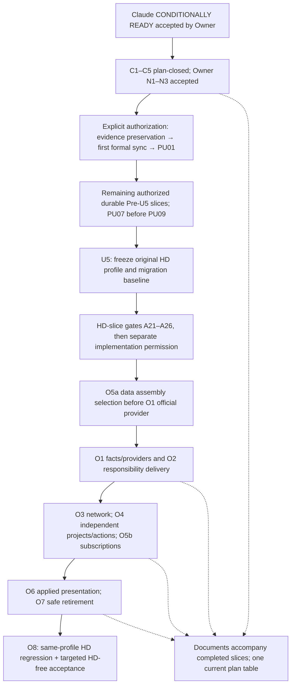

# Architecture Convergence — Integrated Roadmap DRAFT

Investigation / Non-authoritative / No implementation or design decision implied.

Status: Stable candidate — Claude C1–C5 PLAN_CLOSED, accepted by Owner; N1–N3 Owner supplements integrated. Awaiting the staged publication → formal sync → PU01 permission, 2026-11-04. Maintainer: Primary. No implementation authority.
Baseline: develop `954dc67aca007082a5a164becdbafbacbad1403a`; D0058 / A0183 / S0866. References to future LOCAL/NATIVE gates are requirements, not results.

## 1. Executive recommendation

Treat architecture convergence, HD runtime independence, and document lifecycle work as one dependency-ordered programme. Retain the existing O1–O8, PU, Finding and formal-sync identifiers for traceability; do not rename historical artifacts or append a disconnected “O9”.

**Next:** submit the single narrow staged authorization request in [Owner Gate](External_Audit_Disposition/Owner_Gate_Remaining_Decisions.md): (1) durable publication/retrieval verification, then (2) first formal synchronization, then (3) PU01 only. Claude's [Stable short re-check](../../../../Advisory/Architecture_Engineering_Audit/C1_C5_Short_Recheck.md) marks all five C items PLAN_CLOSED with no new major Pre blocker; the Owner accepts that closure and N1–N3 supplements. Do not reopen C1–C5 or request another full planning review. Each step may execute only after the previous gate passes and the Owner explicitly approves this application. No formal/code/publication permission is inferred from plan closure.

**Latest Owner Tier correction governs:** Tier is the building's position in the effective same-district upgrade chain of the loaded environment. SPC owns that definition; it should derive values from actual district/prerequisite/replacement facts, not rely on an HD-specific Tier table or a complete fixed per-environment map. An inserted **actual same-district upgrade-chain** predecessor legitimately changes a building's Tier. Outside-district buildings, virtual gates and other non-upgrade unlock conditions do not automatically increment it (N1); a predecessor absent from an HD/SPC Tier table cannot be ignored on that fact alone. The intervening proposal for cross-environment fixed Tiers is explicitly withdrawn. Missing, cyclic, ambiguous or incomplete chains never default silently to T0/T1. D formulas and approved values (including complete three-tier D6/four-tier D10) stay unchanged. See §6; no new design batch is opened.

This update changes candidate/reference documents only. Production, tests, formal Design/Architecture/Workflow/AGENTS/Status/Authority, frozen audits and prior evidence remain unchanged. No code execution test, probe, game, deployment, commit, push or deletion is performed. Read-only source/DB queries and documentation-integrity checks are evidence checks, not LOCAL_SIMULATION_PASS or USER_GAME_TEST_PASS.

Three boundaries matter:

- Core owns professional rules, identity, ACTIVE, histories, notifications and effects. Official and HD implementations provide reviewed content/input/execution mappings inside this repository, selected at explicit assembly boundaries. No universal plugin platform or scattered profession-level `if HD` branches.
- Independence means mechanisms actually work without HD. It does not mean replicating HD's economy, equating all output numbers, supporting every game/ruleset/platform, or silently disabling mechanisms.
- Document work accompanies each completed slice. It does not become a separate large audit/cleanup programme, and it does not postpone all simplification until the end. Markdown remains the final Architecture authority; this report and its diagram cannot amend it.

### Recommended dependency sequence



The arrows are dependencies between the relevant slices, not whole-package serialization. Necessary P3 production extraction happens before its first consumer, including during Pre-U5 when required. O6 can follow a ready applied-result owner without waiting for all O3/O4/O5 work. One Primary controls shared write sets; investigation may run in parallel.

## 2. Inputs, current baselines, and evidence limits

### What was actually read or checked

| Input / baseline | Current evidence and use |
|---|---|
| `Codex_Architecture_Convergence_Integrated_Roadmap_Handoff.md`, 309 lines | Fully read; SHA256 `f97af9fe970c2e775f703745cae74eedc5794d339e7026563034d277b9a926fe`. Its bounded integrated planning scope supersedes the companion's separate full-inventory scheduling. |
| `Documentation_Architecture_Lifecycle_Handoff_v2.md`, 137 lines | Fully read; SHA256 `761f30915594a1627ca6e2a3534006edf126ca50d19d332352a1e2be00dc764f`. Its historical safety and authority distinctions remain. |
| `Post_Refactor_Document_Lifecycle_Audit_Prompt.md`, 122 lines | Found and fully read; SHA256 `54a0d336a85d8b74c53b406d3840eecff38160e469a4c6f3daf9b73ad032fa2b`. Not used to reinstate “wait until all refactoring ends”. |
| Repository entry chain | Root/project/Investigation guidance, Workflow R9/W0001/W0004 and evidence policy, Authority, Status CURRENT, Architecture/Technical navigation, relevant Network and Playtest contracts. |
| Source branches | develop and origin/develop: `954dc67aca007082a5a164becdbafbacbad1403a`; main and origin/main: `bc49dab5739e7819ceaf49228de7d47310c296d8`. Tracked working tree clean on entry; no fetch or branch operation. `main...develop`: 515 files, 45,859 insertions, 3,004 deletions; not a measure of runtime cost. |
| Formal versus runtime state | Authority identifies D0058/A0183/S0866 and deployed B399.426 from `491517093de18c8b151053724e316f1e08228995`. main records B307.334/D0057/A0181. These are branch-specific versions, not a request to make main equal develop. |
| Existing convergence work | §4 below is the **sole current slice/dependency/acceptance table**. Original v3-final and the former PU/O tables are traceability inputs, not a second schedule. Existing NET, wake, P3, Finding and FS files retain bounded technical details. |
| Original external audit | The two original audit hashes still match the preceding full-read disposition: main `3394864bd5ab28606dcf1ecc321bae5a7172ebdd571b6515bec2c206e3774e31`, evidence `376ffed30181226f22147a7875113631b68068671b1f8c263975e5a00f80f041`. This round checked their identity and current dispositions; it did not repeat the entire audit or its tests. |
| External disposition handoff | Downloads original is absent. The existing [verbatim Owner copy](External_Audit_Disposition/Owner_Handoff_20261104.md) is readable and was used; recorded original SHA256 `be655cc5e99ee97ba77e51749809152cd24b164f69c4f580f70d1ff2f788b04b`. |
| Addendum now available | `Codex_Post_Audit_Discussion_Addendum.md` was fully read from the newly supplied original: 46 lines / 8,120 bytes, SHA256 `6809007e80d4547344332e0648054a14d316e5a1db45428671ee997d4f1260f6`. Raw ID OWNER-ADDENDUM preserves its exact original bytes. §10 records the actual comparison and additions. Older H1/H2/H3 originals are still unavailable for any un-restated detail; do not claim this retrospectively makes those originals read. |
| New independent review | Claude Targeted re-audit (361 lines) and [C1–C5 Short Recheck](../../../../Advisory/Architecture_Engineering_Audit/C1_C5_Short_Recheck.md) (full read). Owner accepts five PLAN_CLOSED results and N1–N3 supplements. A21–A28 stay in the existing ledger. Audit originals remain unchanged. |
| New Owner decisions | C1–C5 plan corrections; exact HD-profile regression; future scoped HD-free capture + fixed load smoke; targeted HD-free final acceptance; mandatory exits despite failed/skipped Start; latest environment-relative Tier correction. Fixed cross-environment Tier catalog proposal withdrawn. Formal recording is proposed in FS, not applied here. |
| Reference acquisition | Selected fixed-commit community files and installed official originals are acquired in ER-20261104; source IDs/versions/hashes/rights and full-file versus link-only status are explicit. No full repository clone, game copy or API encyclopedia. |
| Integrity | Read-only `python3 Specialization/Workflow/context.py check P0-H`: PASS, 344 runtime files / 1,302 guarded inputs; `implementation_authorized:false`. This is reference integrity, not a runtime/regression or native test. |

### Completed local backup: reference only

Use local source label **ENV-20261104**: `Civ6_Environment_Backup/Snapshot_2026-11-04_114101`, outside Git. This round read its metadata, not a new full hash scan or restore experiment. The existing status reports 107 copied Mods, 13,730 verified source-backed files, independent archive verification of 13,747 entries, and no restore test. The documented macOS provenance-attribute difference remains; do not promote this to all-metadata identity or native recovery PASS.

HD identity: Workshop `2465378070`, internal Mod ID `521b8777-0977-4859-a5ee-3e411a732e5c`, declared v2.2; content-tree SHA256 `e299c463de6819513966e00e5d2612bdf43a7e40e77c484bad6ca886f8ee1f65`. Engine metadata: macOS Aspyr application 1.4.6 / bundle build 376653.178, Steam build 15296837. Steam and bundle version labels are not interchangeable.

**“原版” is the Owner-designated saved Mod profile, not an HD-free environment.** It contains 72 explicitly enabled third-party/local Mods, including HD and Specialization; CityGPPProbe is disabled. Backup metadata distinguishes that profile from the DB's selected “完全纯净” group and from partial saved-game-header observations. Nothing was switched. The profile is an original playtest reference, not 72 mandatory dependencies or proof of a currently running session.

The exact deployed package was not rehashed in this task. Authority/Status and backup metadata are identified records; HEAD alone does not prove deployment.

## 3. What changes, what survives, and what must wait

The accepted OD-1–4, ODP-01=B, ODP-02=A and restated DEC/R constraints remain. No new cold-failure payment policy, universal zero reset, cross-version migration, loss compensation, automatic unit regrant, GC policy or ordinary-civilization access extension is implied.

| Existing work | Integrated disposition |
|---|---|
| A06/A07/A11/A13/A14 | Same-build support, lawful Commerce-exit reputation reset, narrow R0 provenance and money guards, durable PU first slices, and consolidated native touchpoints survive unchanged. Their plan/evidence work can continue independently of HD facts; code still requires the approval gate. |
| A01/A02/A03/A04/A05/A12 | Keep normal-cold equivalence, no writes from incomplete inputs, reliable completion, source/target independence, and no clear-all on write failure. Supply actual official/HD input availability and effect evidence before freezing the relevant interfaces or retiring D1. |
| A15/A16 | Preserve unique completion proof, independent project rules and UNKNOWN-not-cancelled. First resolve actual native signatures/call sites; do not transfer Narrative parameters or HD timing assumptions to another event/environment. Missing evidence, not a new gameplay vote, is the first action. |
| A09/A10/A17/A18/A19 | Delivery ACK, fail-closed mandatory exit, scoped admission/return, P3/Flight/GC and true diagnostic absence remain. Add only the adapter/assembly consumers actually affected; no full re-audit of every profession. |
| A08/A20 | Extend existing FS/acceptance scope with the supported environment, adapter ownership, profile-specific results and restart rules; no second authority register. |
| Old S9 derived network persistence | First accepted successor must cancel obsolete wiring instructions. Keep genuine deferred lifecycle/history obligations. Do not connect an unused derived adapter merely to finish the old checklist. |
| Carrier/Modifier audit | Reuse production-duty, exact SQL/ID, external-definition and retirement evidence where relevant. No automatic carrier-count optimization, encoding redesign or second migration programme. |

The [existing Finding ledger](External_Audit_Disposition/Audit_Finding_Disposition.md) now contains A01–A28 and the C1–C5 correction status; IDs are not renumbered. The Owner's “A21/Tier” topic reference maps to existing A21 (test basis) **and A22 (Tier)**, not a reassignment of A21. This impact table is not a new finding registry. No runtime finding is closed by planning. In particular, later absence of a Crew unit does not prove it was never created; no difference-based regrant is allowed.

### PU01 / PU03 / PU06 must be the final interface's first users

- **PU01 → O1/O3:** establish environment-independent fact/status/use projections and write-barrier ownership once. Initially bind the current HD input implementation; official mappings later implement the same reviewed contract. No temporary hold framework or new profession-local HD fallback.
- **PU03 → O2/O3:** use one actual Bridge→FactChanges→Bindings→owner responsibility/ticket chain, with same-value recovery and old-ACK protection. O2 expands that chain; HD adaptation does not add another event bus. Preserve NET-1/NET-2 and strict transaction proof.
- **PU06 → O4:** one Store→Commerce→Capital contract for confirmed/not-applicable/policy-zero/unsafe R, lawful exit, mode-specific requirements and locked terms. Later O4 work extends its owners, not a second R/provenance scheme. Preserve strict CREDIT_INTENT/CREDIT_CALLING and native outcomes.

If a final contract cannot yet be justified, defer only its dependent slice. Do not write a disposable Pre-U5 solution and call it progress.

## 4. Ordered slices, gates, and rollback boundaries

**This is the sole current plan table.** Detailed NET/W/P3/FS evidence is referenced rather than made into another schedule. All implementation rows are proposed. C1–C5 are PLAN_CLOSED at the plan level by Claude and Owner acceptance; this closes no runtime defect or native gap. N1–N3 are this short review's notes, not new batches or renumbering of the older native N0/N2 touchpoints.

| Slice / dependency | Smallest durable delivery / owner | Required gates and bounded evidence | Save / stop boundary |
|---|---|---|---|
| Reference + targeted disposition | Existing reference tranche; C1–C5, A21–A28 and residuals in the existing Finding ledger. | Read-only source/DB evidence; correct ER01/02/03/05/06/07 and fix HD profile identity. No whole-repo re-audit. | No game, formal or code change. |
| Short re-check → staged application | **Completed at plan level:** five PLAN_CLOSED, accepted by Owner; N1–N3 integrated below. | No new major Pre blocker; A21–A26 keep later evidence/authorization gates. | Current action is the publication→formal-sync→PU01 application, not another audit or automatic implementation. |
| C4 durable preservation, **before first formal sync** | Privacy-reviewed publication commit of the current integrated plan, unique decision/Finding/NET/W/P3/FS evidence and original audit main+evidence+targeted review; ordinary push/readback. Existing accepted/frozen history stays intact. | Verify unique decisions, input versions/hash/locators and retrieval from the pushed commit. Distill redundant candidates; do not add the entire candidate bundle to mandatory context. Proprietary Raw remains external. If publication is withheld, supply another approved durable archive with verified retrieval **before** formal sync. | Local ignored files, a hash or this local Raw archive are **not** durable off-machine preservation. No publication now. |
| First formal synchronization (FS01–12 affected portions + finite information/workflow set) | Accepted successor via existing D/A process and current routing. **Before PU01, complete the finite A set in FS Step2 supplement:** evidence-first conditional reference use, source roles, minimal reading, ordinary current-state/result updates, Chinese Owner summaries, safe short handoff and the §10.1 single-home norm. | Remove superseded future obligations, apply accepted contracts and check current metadata/links/guards. **Exit:** A set formally present; superseded candidates leave default reading; required evidence/test preservation remains. Step1 retrieval verified before this row; Step3 waits for its completion. | No new governance system, whole-reference reading or full-history cleanup. Historical/B cleanup remains per migration with exact deletion permission. No execution authorization from this row. |
| **PU01 → O1/O3, first Pre slice** | Real Commerce + shared-fact status/use projection and needed production kernel/write-barrier seam; initially current HD input provider. Preserve max/Floor and independent domains; final contract's first use. | Actual producer→consumer composition; UNKNOWN vs reliable negative; same-ref/second-change/write barriers; D/workers unavailable never zero; strict transaction proof unchanged. Restricted Lua/package + affected regressions. | No official provider/HD port, disposable hold framework or generic derived persistence. Report any cold-ready contract gap rather than expanding silently. |
| PU02 → O6/action owner | A prepares once and is inert when prepared; B is the sole matched confirmation; prove actual route/tag/hitbox cause. | Actual UI→Restructuring, stale plan/unit, duplicate A/B; one native action/receipt. Revalidate on official UnitPanel in O6. | U5 changed action only; unknown native outcome never replayed. |
| PU03 → O2/O3 | First real Bridge→FactChanges→Bindings→owner ticket/ACK chain; NET-1/2 retained. | false/throw/missing/FAILED/SKIPPED, old ACK, successful sibling, same-value and second-change wake; phase0 synchronous order. | No per-turn city scan or temporary transport framework. Needed P3 control owner extracted first. |
| PU04 → O1, conditional | Prove and fix reliable infrastructure-negative facts hidden by ACTIVE assertions. | Actual token/ref/phase/negative vs UNKNOWN/second-change; no forced pillage campaign. | Unproved defect stays out of Pre; no new ordinary-building ontology. |
| **PU05a → O4; C1 / A15** | Separate per-source/ref/admitted-order unresolved grant receipts from the per-project consumed high-water. Event admission = `Events.CityProjectCompleted(playerID,cityID,projectID)` bound to that city's admitted order serial/source token. | Actual Crew+Store: A unresolved CALLING must not block B's independently proved strict +1 completion; duplicate/late/reentry, binding-write failure and same-build no-replay. Preserve high-water and all exact proof checks. Snapshot provider seam lets O4 replace HD sampling once. | **Local fix is not held behind PU05b.** Keep CALLING-before-InitUnit, no counter-difference grants/refund/regrant. Receipt/order shape change → new campaign. |
| **PU05b → O4; existing S7d6 native gap** | Independent same-tier same-turn completion attribution; cumulative +2 is not proof of two unit grants. | Reuse [S7d6](../../../../../Status/Validation/Results/Refactor_S7d6_Crew_Proof_Gap.md): two same-tier cities same turn; cancel/remove at 0 and >0 progress; duplicate/late delivery. Close only with a completion-specific witness or qualified native contract distinguishing the recorded indistinguishable histories, plus actual-owner replay/duplicate tests. Existing B238 proves single-completion Gameplay delivery only. | Local synthetic nil/throw is not random native incidence. Retain accepted irreversible-proof standard; if it must relax, Owner decision. Only dependent attribution cutover waits. |
| PU06 → O4, A07/A11 | Store→Commerce→Capital final R contract: confirmed zero / not-applicable / narrow policy zero / unsafe; independent modes, locked terms, lawful reputation exit. | Actual owners and leaf/parent/dependency/deferred buckets; CREDIT_INTENT/CALLING strict; reset doesn't resurrect old age; valid siblings preserved. | Same-build signed terms not repriced. No unknown Capital reset; new quote/contract shape → new game. |
| **PU07 → PU09; C2 / A16/A17** | **Definite Claim-entry prerequisite:** stop a district event with unresolved city poisoning every unrelated UNASSIGNED root via sticky completionError. Source/ref/family scope, true first-completion evidence preserved. | Trace Store2104–2108 → HoldCompletion823–826 → active340 → ClaimState/marker. Actual Store+Claim, unrelated city, missing target, duplicate/throw and first evidence; no clearing a historical error without trustworthy cause/recovery. | Not conditional on reproducing broad U5 incidence. No invented first history or new persistent authority. |
| PU08 → O4/O7, A10/A17 | Migrate mandatory installed-carrier/exit/return duties, including ExpeditionTraining's swallowed/unconfirmed result; optional observers separate. | Failed/skipped Start **with installed old effects** cannot make exits vacuously complete; wrong endpoint/ref/third owner; confirmed absence; Training busy/throw/false result. Exact cleanup lists not rebuilt from HD catalogs. | No new ownership gameplay/campaign. Missing cleanup authority blocks affected exit, not fail-open. |
| **PU09 → O4; after PU07 and actual affected roots** | Preserve installed project marker on UNKNOWN without granting new eligibility; fix source cause, don't transplant Engineering branches blindly. | Root map: completionError→PU07; Governor/pending→PU10/O1; Store isolation→restore validation; era read→Dialogue. Actual Claim/Dialogue states, early native Claim/duplicate receipts and confirmed negatives. **Current-production availability is not a marker-removal root.** | Claim Start waits Store/LoadScreenClose; do not invent normal cold root. Dialogue pre-load Governor window/B395 is real. Optional N0 observes queued marker removal; native cancellation remains unproved. |
| PU10 → O1 | Scope actual EffectiveFacts/Governor availability roots; reliable no-governor = known level1, same-value restoration. | Six-property/init/ref/phase reads; no per-profession Governor cache. Use existing B395 evidence first. | No speculative fallback or extra polling; required before the affected PU09 path only. |
| PU11 / required P3 → O7 | Extend actual harness with package/VFS absence, transfer needed Flight/error/helpers before their first Pre consumer. | No injected diagnostic globals hiding missing files; throw and silent-nil include, actual UI+Gameplay, Flight cross-context, existing GC invariants; necessary scope/idle counters. | Unchanged GC strategy. No intentionally broken live package. |
| **Original HD U5 baseline** | Changed Pre paths plus inherited scoped acceptance; pin exact profile/package/settings/source/receipt/DB. | Necessary changed actions/READY/transactions and same-build cold recovery. Existing culture/research/route acceptance retained; no random pillage/trader-death or duplicate Claim-timer campaign. | Current-build new game. **Post-migration HD regression uses this exact profile**, not a reduced HD set. |
| A21–A26 HD readiness gates; then separate permission | Independent HD-free DB basis, Tier/assembly contracts, wrapper closure, UI hooks and HD-independent exits before adapted implementation. | Authorized future clean DB capture on official+Leugi, exact packs/ruleset, HD absent; baseline without SPC, adapted smoke with SPC after required seams. Hash/pin external fixtures; profile-parameterized and LoadOrder-faithful checks before first adapted slice. | Existing HD final DB replay cannot prove HD-free/load-order correctness. Technical unknowns do not authorize code. |
| **O5a before O1 official provider** | Explicit data-component selection, SPC-owned assembly marker, load bands and mutually exclusive/replace-row semantics in §6. | HD-only JOIN statements split from unconditional project/access definitions; final Tier mapping before all target/carrier generation; every referenced ModifierType defined. O5 owns base/environment assembly; its fixed no-HD load smoke follows that assembly gate. O6 owns specific UI callbacks/behavior acceptance, using the same environment/evidence. | O5b is later; no transient selector to throw away. No HD table-presence detector or plugin framework. |
| O1: shared facts and both input providers | Extend PU01/04/10; actual occupancy/anchor/D/ACTIVE, safe shared read phase/write invalidation; effective-chain Tier provider independent of HD Tier tables. | O5a + A21–A26 prerequisites; actual multi-consumer reuse, second change, owner/ref/write fences, no UNKNOWN-success caching; supported chain coverage and errors. | No wholesale ordinary-building ontology rewrite, hidden HD dependency or derived-history store. |
| O2: responsibility delivery | Extend PU03 through actual FC/Bindings/NewAudit/flush consumers. | Named takeover/wake, successful siblings, missing/failed target, close/exit and old ACK; preserve phase0. | No generic event-log persistence/polling. Necessary old recovery removed only after replacement proof. |
| O3: network/effects | O1/O2 and cold/effect evidence; three writers, provenance, domain/target independence; D1-01–12 owner. | True Bridge+Commerce/CultureNetwork/Standardization, max/union/Floor, strict dirty proof; cold zero writes until consumable input, reliable negative and NET05 semantics below; partial mutation/real residual. | No default derived storage or selected severe-cold payout. D1 retired once, with exact branch/SQL cleanup ownership. |
| O4: independent histories/projects/actions | Extend completed PU work; owned queue/location sampling through existing reader-slot transport, true history/receipt owners unchanged. | Unique completion/request/source/unit proof; independent project eligibility/cancel/rewards; existing same-build continuity; true-exit/locked-term rules. | No generic cancellation gameplay or blind irreversible replay. |
| O5b: runtime subscriptions/Start | O2 delivery + actual startup order; ordinary subscriptions after successful Start; complete O5 environment/UI-base assembly gate. | Mandatory exits despite FAILED/SKIPPED, phase0/Seal/drain; verify PU08-owned exact exits, not a duplicate list. **One fixed no-HD load smoke after O5 environment/UI-base assembly completes**, before O6-specific behavior acceptance. | No empty-registry fail-open, discovery bus or recovery machine. Smoke is load/start/base evidence only; O6 may reuse it. |
| O6: applied UI | Consume O5-owned explicit official/HD base selection; own **specific callback/behavior/interaction adapters**, including GetDataHelper counterpart. | Actual owner→reply→UI, retained/error/residual vs preview, selection/ref/stale reply and actions. Reuse O5 smoke environment/evidence; verify behavior, not a second complete load campaign. | Preserve layout/colors/sizes; no UI business authority. A load smoke is not interaction/effect PASS. |
| O7: safe retirement | Complete P3/Q transfer, exact live SQL/cleanup dependencies, both deployment deletion transactions. | Optional diagnostics on/off/**absent** file/global, actual production/UI/Flight/GC, exact removed set, extras reject, durable receipt/all failpoints. Live StandardizationDiscount SQL is not retired with its old Lua. | No blanket save/SQL/art/history deletion. Full exact-package rollback ≠ money/save rollback. |
| O8: integration/acceptance | Existing Finding/debt ledger + measured normal/second-change/worst-scope work. | Same-profile HD before/after; **targeted HD-free** environment-sensitive abilities/effects/UI/exits/load/irreversible ops. Load/carrier readback alone not PASS. No second full medium-scale campaign by default. | New game per changed build/environment. Third-party auto-update mid-campaign unsupported; main/deploy separate. |

O3/O4/O5b proceed by ready dependencies, not whole-package serialization. Every widening retains existing Runtime Impact Contract and T01–T08; unresolved facts stop only their dependent slice. No future gate here is a performed test.

### Native touchpoints and existing authorization

- **N0 / N-COLD, conditional:** only unresolved native facts blocking PU05b/09/cold cutover. Prefer existing S7d6/B238/B395 evidence; temporary probes still need a scoped authorized implementation. No new broad timer campaign.
- **U5:** original HD migration baseline, no launch now. Freeze its effective profile; corresponding post-migration regression must match it.
- **A21 DB capture, authorized for later:** one scoped genuine HD-free startup window to create an independent official+Leugi DB; record enabled official packs and exact build. Baseline capture may omit SPC; the later adapted-SPC artifact must be independently identifiable. Do not infer absence by a flag on the HD cache.
- **Fixed HD-free load smoke, authorized for later:** after **O5 environment and UI-base assembly completes** (O5a selected data/bases and required O5b startup/exit closure), and under its separate implementation permission, one actual SPC-without-HD load test. O6 then verifies specific UI callbacks/behavior/interaction, reusing this environment/evidence without repeating a full test. This smoke is not cancelled merely because LOCAL passes. Capture and smoke may share a practical window only when ready, retaining **separate environment/package/DB evidence**.
- **Existing native N2 / final acceptance (not short-review note N2):** consolidate concrete cold/location/UI/effect gaps and current-build targeted HD-free acceptance. User accepted no default second whole medium-scale campaign. Retain one integrated ordinary HD play sample where necessary; no forced random events or invented performance target.

## 5. First engine-reference tranche — acquired evidence and limits

The authorized tranche is complete as a bounded evidence product, not all API/native questions answered. [Engine Reference](../../../Engine_Reference.md) is the single Git-ready question-based reference under the existing Technical reference area, linked by this current candidate and the re-audit entry. The existing Technical README is guarded by Context Lock; it remains unchanged because this phase does not authorize Workflow/hash updates. Its one-link insertion is included in the formal-sync proposal rather than weakening integrity or asking for a routine extra approval. Source ID **ER-20261104** resolves to external sibling `Civ6_Engine_References/Tranche_2026-11-04`; local manifest holds private paths. At acquisition close it has 54 stored source/derived entries (1,554,755 bytes) and ten exact references to existing HD backup files. Owner handoffs are included verbatim; one small derived inventory is labeled separately from originals. Documentation files/manifests and the later review entry are additional small archive metadata, not part of that source-byte total.

| Work product | Confirmed result / remaining scope |
|---|---|
| Official source evidence | 14 targeted Lua/manifests plus seven definition XML files, versioned to the current Mac installation. Queue cost/progress/UI plot enumeration and positive ModInUse database criteria and separately criteria-driven UI replacement have shipped examples. This does not prove the final SPC assembly ran. |
| Pinned public evidence | Sukritact `144f27f5ea28c8a381f72343cad4c5ddbfb7c7b0`; Hemmelfort `aeb4e11dbf310d9ad4f87f7d15d01c229ae856a9`; cru121 `5af389445118bed2bdebf7a8a42b219c8fba5175`; GCO `4a96120a5765480a4e04646927a09d893ba37d69`. Only selected necessary files; hashes/Git blob identities verified. Community ancestry and Windows/extension limits are explicit, not independent Mac validation. |
| Actual HD seams | Input tables, SQL target construction, three output wrapper definitions, queue helper plus unfinished-wonder marker producer, production UI bases and retired external consumers are located. Same-core provider boundaries are in §6 / ER05–07. |
| Completion/cold/root evidence | Official consumers and community signature claims are separated. No complete cancellation/delivery guarantee or Mac carrier-effect-ready boundary was established. UNKNOWN project state root causes, not just marker preservation, remain required work. |
| Raw safety | Rights/source/version/context recorded. Official source and mixed third-party Raw stay local; no redistribution inferred. HD originals reference ENV-20261104 without duplication. Slothoth/Companion are explicitly link-only; no whole forum harvest. This local archive is not a permanent off-machine backup. |

The original Addendum and available prior Owner handoffs are included in the local review entry. Missing old originals are identified only for details not restated by available authoritative inputs. No new probe is justified by missing documentation alone. Exact remaining pre-implementation gates are consolidated in §9 rather than spawning another evidence programme.

## 6. HD coupling: confirmed seams and remaining investigation

The following is the completed bounded dependency inventory across current inputs, SQL, output names, Lua/UI and their direct external producers. It is not a complete runtime-independence acceptance. Detailed type-level sources and unknowns are in ER05–07; backed-up HD, not a moving public repository, is the comparison source.

| Actual dependency / effect without HD | Evidence | Integrate with existing owner |
|---|---|---|
| **No explicit HD manifest dependency to remove.** Current dependencies are RF, GS, Roosevelt Persona Pack and Leugi Monopoly++ reused unit art. | [modinfo](../../../../../../Mod/SpecializationP0.modinfo#L845) | O5 package/environment assembly. Verify metadata and real loading separately. |
| HD building tier/dummy tables are required to build ordinary facts; their absence is not just different numeric input. | [OrdinaryBuildingCatalog](../../../../../../Mod/OrdinaryBuildingCatalog.lua#L203); [DistrictCompleteness catalog construction](../../../../../../Mod/DistrictCompleteness.lua#L87) | O1 catalog/input contract, PU01/04 first use. Official/HD mapping must precede the consumer's capture. |
| Industrial and Development catalogs assert HD tables; their SQL references missing HD tables directly. Lua selection alone cannot prevent that failure. | [StandardizationCatalog](../../../../../../Mod/StandardizationCatalog.lua#L4); [DevelopmentInvestmentCatalog](../../../../../../Mod/DevelopmentInvestmentCatalog.lua#L5); [discount SQL](../../../../../../Mod/Data/StandardizationDiscount.sql#L5); [Development SQL](../../../../../../Mod/Data/DevelopmentInvestment.sql#L5) | O1 content + O3 target/effect + O4 business targets; explicit data-loading plan before activation. Do not manufacture HD-named compatibility tables as an unreviewed core contract. |
| Production Crew snapshots use HD's UI queue helpers; wonder targeting reads HD plot/helper/unfinished-wonder data. | [ConstructionProbe](../../../../../../Mod/ConstructionProbe.lua#L17); [Crew caller](../../../../../../Mod/CrewProjects.lua#L303); [UnitTargets](../../../../../../Mod/UnitTargets.lua#L53) | Existing P3-08/Q3, O4 action input, O7 production extraction. Backed-up `UI/Additions/HD_Utils.lua` shows native UI queue/GetPurchasedPlots calls, not Gameplay availability. Replace the production seam before retiring the probe. |
| Production UI includes HD bases, not only diagnostic files. One fallback after a direct include is not complete absence support. | [CrewProjectOrder](../../../../../../Mod/UI/CrewProjectOrder.lua#L2); [ExpeditionSpyUnitPanel](../../../../../../Mod/UI/ExpeditionSpyUnitPanel.lua#L2); [TimedProjectCityPanel](../../../../../../Mod/UI/TimedProjectCityPanel.lua#L2); [InstitutionOverview](../../../../../../Mod/UI/InstitutionOverview.lua#L3) | O5 explicit base/adapter assembly + O6 presentation + O7 P3 retirement. Preserve ordinary native callbacks and existing accepted layout; do not redistribute whole HD wrappers. |
| Some HD-named content is filtered static mapping or context, rather than a runtime dependency. | [Lv2Housing](../../../../../../Mod/Data/Lv2Housing.sql#L3); [ResearchChair](../../../../../../Mod/Data/ResearchChair.sql#L4); [GreatWorkCatalog](../../../../../../Mod/GreatWorkCatalog.lua#L318); [Lv2GPP](../../../../../../Mod/Data/Lv2GPP.sql#L1) | Review actual present-row coverage. Keep professional bonuses; do not copy HD's base specialist/economic balance or infer a dependency from a comment. |
| Old experiment imports and live production duties intersect. Literal output-name definition origins are now classified: 17 official, two SPC and three HD wrappers over official Effects. Execution/precision remains untested. | [TimedTurnProbe](../../../../../../Mod/UI/TimedTurnProbe.lua#L2); [existing P3 inventory](External_Audit_Disposition/P3_Production_Dependency_Inventory.md) | O7/§5 definition closure. Name-based deletion or “no HD string” is not proof. |

### Newly closed definition and producer questions

The 49 declared InGame UpdateDatabase file references use 22 distinct literal ModifierType names, including loaded legacy/probe definitions. The three HD-defined names are `MODIFIER_CITY_ADJUST_BUILDING_PURCHASE_COST`, `MODIFIER_CITY_DISTRICTS_ADJUST_YIELD_CHANGE` and `MODIFIER_SINGLE_CITY_ADJUST_DISTRICT_PRODUCTION`. Their Collection/Effect definitions and official underlying primitive uses are recorded in ER06. A minimal successor supplies project-owned wrappers with equivalent scope/attachment/arguments; no new engine extension or HD economic copy is justified. Actual behavior is not yet validated.

Four RequirementTypes and three custom-wrapper CollectionTypes were traced. `REQUIREMENT_PLOT_PROPERTY_MATCHES` is a KIND_REQUIREMENT in the actual game DB and has official CivRoyale scenario use (ER06). SPC writes its own plot properties. The definition is not HD-exclusive; this does not replace precise effect/Gameplay-context acceptance.

Wonder targeting consumes `HD_UNCOMPLETED_WONDER` in both UnitTargets53–63 and UnitSiteProbe52; HD writes it in Gameplay/Misc583–599. Official Plot:GetWonderType plus cityBuildings:HasBuilding distinguishes placed vs completed wonders in UI (ER02), a stronger lead than GetConstructionsAtLocation. Gameplay-context semantics remain unverified. Reuse existing TimedProjectReaders/ExposedMembers reader slots if transport is required, not a second bridge.

**Same-core assembly:** O5a precedes O1 official input. Positive ModInUse has official examples; inverse ModInUse is present in the pinned HD manifest and absence of inverse-gated UC content in GAME-CACHE is supporting inference, not an executed SPC test. Do not invent syntax or require a negative selector by assumption. Exact contract and remaining per-profile load gates follow below; no adapter owns history, formulas, ACK or lifecycle.

### Effective-chain Tier contract — A21 evidence basis / A22 semantics

**Latest Owner decision, formal synchronization pending.** Tier is the position in the loaded environment's effective building upgrade chain for the relevant district. SPC owns semantics and the shared catalog output; loaded district/prerequisite/replacement facts supply values. Do not use HD_BuildingTiers as semantic authority, copy the table into a new authority, or maintain a complete cross-environment fixed Tier catalog. A predecessor inserted before Market legitimately makes Market T2. D remains min(10,sum of eligible actual building Tier weights); same-tier buildings, replacements and highest single-district rules stay as approved. Three-tier D6 / four-tier D10 are unchanged.

**Source correction:** production OrdinaryBuildingCatalog203–207, StandardizationCatalog4–23 and DevelopmentInvestmentCatalog5–21 consume HD_BuildingTiers. The old SPC_Lv2HousingTiers table is not a production reader input; its early-load incomplete rows are an A21 test-basis counterexample, not the cause of live Tier values. HD's tier SQL11–22 is a bounded depth approximation with a Holy Site special bump at23; it is evidence to compare, not the replacement algorithm specification.

Candidate provider acceptance, before the affected O1/O5a code:

1. Resolve the loaded district family and building replacements with checked references/cycles. A replacement occupies its counterpart's chain level; it is not an extra predecessor. Verify divergent/multiple replacement cases rather than assuming a single parent.
2. Separate **upgrade edges within that effective district family** from outside-district buildings, virtual gates and other non-upgrade-chain unlock conditions. Such unlocks do not automatically increment Tier. Positively classify the referenced object/relation from actual data; **absence from a Tier table is not evidence that it may be ignored**. A truly missing or incomplete upgrade predecessor remains an error. Industrial Water Mill (`BUILDING_IZ_WATER_MILL`) is T1: its HD virtual Mill Race / River gates are not upgrade-chain buildings. (N1, Owner accepted.) Parallel alternatives at one known level do not each add a level; exclusive museum/worship/government branches are not serial buildings merely because there are multiple rows. Where all valid effective predecessor alternatives establish the same next position, use that position. Unequal/incomplete branches require an explicit ambiguity, not an arbitrary shortest/longest-path guess; actual OR/AND/upgrade meaning must be evidenced where it changes the result.
3. Missing tables/rows/references, cycles, incomplete chain and conflicting results are explicit errors scoped to actual supported consumers. No `or 0`/default T1. An applicable, complete root with no upgrade predecessor can be T1; an unrelated/not-applicable object is a separate status, not a failed map disguised as T0. Do not infer ordinary-building eligibility from Tier alone.
4. Reuse the existing shared building catalog; allow only a small explicit exception map where actual semantics cannot be inferred. **HD old Tiers are migration comparison data, not final semantic authority** (N2). Compute against the approved current-chain definition; record reasons for Data Center/Hospitium/Garden and other observed differences. Never tune the new algorithm, force an HD bump/cap, or change D formulas just to match the old table. Same-profile comparisons flag unexplained changes for investigation, not an all-rows equality rule. Show exact buildings, parents/replacements, computed candidates, consumer/rule impact and evidence first. No generic plugin layer, full per-profile hardcoding or automatic enrollment of unknown Mod buildings.
5. Check current supported Tier/value ranges and all catalog consumers. A chain longer than a consumer supports is an explicit coverage gap; do not clamp it to T4 or invent new D weights. Any genuine remaining rule choice is one consolidated small Owner packet, not another architecture discussion.

| Bounded evidence / candidate case | Current source/DB fact | Accepted classification / remaining candidate gate |
|---|---|---|
| Market → Bank → Stock Exchange | Original-profile GAME-CACHE: Fair/Waystation→Market2; Market/Mint/Sukiennice→Bank3; Bank/GrandBazaar/Guildhall/MerchantQuarter→StockExchange4. | Dynamic environment-relative levels; official GS definition chains are normally three levels, to confirm in independent A21 DB. No cross-environment numeric equality gate. |
| Industrial Water Mill (N1) | `BUILDING_IZ_WATER_MILL` has virtual `BUILDING_JNR_MILL_RACE` → `BUILDING_JNR_DUMMY_IZ_RIVER` prerequisites; these are positively identified non-upgrade unlock gates. | **Owner confirms T1**. Do not count these gates as levels or treat absence from Tier data as a missing upgrade. Workshop can then read its valid WaterMill/WindMill alternatives. Real missing-chain references still error. |
| Workshop / Research Lab | Current graph uses WaterMill/WindMill→Workshop2 and four JNR predecessor alternatives→ResearchLab4. | Include actual HD/UC content; a reduced HD profile cannot replace the U5 regression baseline. |
| Building/district replacements and government alternatives | GAME-CACHE BuildingReplaces has no absent/conflicting HD-tier pair in the bounded query; BuildingPrereqs includes parallel alternatives. | Check effective graphs and current consumers; the old HD result is not a proof of the new provider. Equal-level alternatives do not sum or serialize. |
| Holy Site Hospitium / Garden | HD SQL23 forces T4 although GAME-CACHE's listed prerequisite alternatives have HD tier2. | Real exception candidate; determine effective upgrade relation before selecting a number. Do not copy the HD bump or silently change approved ability semantics. |
| Neighborhood Mansion | GAME-CACHE has Palace(City Center0) as a prerequisite. | Cross-district unlock is not a same-district upgrade edge; do not increment blindly from the Palace. Check the Neighborhood chain and actual consumers. |
| Sewer / chains beyond four | Sewer is moved to Aqueduct in this HD profile; Spec AQ-001 tier2 is **future-only**, not authority to retrofit every official city-center Sewer. Data Center currently reads HD tier4, while its listed ResearchLab/Education predecessors are also tier4; a genuine next chain position could exceed a current reader's supported 0–4 range. That range/chain question is not answered by copying HD's capped result. | Keep future AQ out of v0.1 expansion; exact current consumer/range gaps must be reported, never defaulted/clamped. No automatic new gameplay numbers. |

These are precise confirmed classifications and remaining candidate cases for the provider audit; there is **no new Owner question now**. Resolve determined cases technically; return only genuinely undecidable mappings together before their cutover.

### O5a data assembly contract — before O1 official provider

- **Load bands:** SPC-owned schema/unconditional definitions → final effective content graph (official + selected HD/companions) → SPC reviewed Tier/classification mapping + selected assembly marker/wrapper definitions → target/carrier generation → dependent Lua/UI startup. Mapping must follow HD16001 **and all selected content changes**, not merely the obsolete tier-table snapshot. Target generation must be later than final mapping. Assign exact numerical bands/component IDs in the affected manifest review; test actual selected order, not just final SQL replay. HD's main last phase is30000, but conditional components reach10000000; “HD ends at30000” is not a complete ordering assumption.
- **Selection/overrides:** common SPC-owned definitions plus explicit mutually exclusive provider components, or reviewed replacement/upsert of SPC-owned rows before generation. State collision/error behavior. No provider selected by presence of HD tables; Lua reads one SPC-owned assembly/version marker produced by the selected data path. Modding.IsModActive is evidenced in UI only, not assumed in Gameplay.
- **File separation:** DevelopmentInvestment.sql's HD JOIN3–7 is separated from unconditional project/access definitions15–20. Apply the same rule to other HD-only statements; a Lua flag cannot protect SQL from a missing table.
- **Output closure:** use SPC-owned names for the three equivalent official Effect/Collection wrappers; keep existing carrier/Modifier IDs and arithmetic. Check every loaded Modifier's ModifierType is defined in DynamicModifiers on **each game-built profile DB**. SQL success or carrier readback is not proof of an actual effect.
- **O5 ownership / N3:** O5 owns environment/component assembly, explicit official/GS/HD **UI-base selection** and keeping the HD-only ActionPanel replacement off the no-HD path. O5 verifies mandatory cleanup/confirmed-absence is available without HD catalogs and survives FAILED/SKIPPED startup; **PU08 owns the exact exit lists**, so assembly does not invent a second list. After O5 environment/UI-base assembly completes, perform the one fixed no-HD load smoke. **O6 owns specific callback/behavior/interaction adapters**, including the HD-only GetDataHelper counterpart and applied presentation. Reuse O5's environment/evidence for O6/O8; no duplicate complete test. Healthy load never substitutes for behavior or real-effect acceptance.

A23–A26 stay scoped implementation-readiness gates, not permissions already granted. O5b later owns ordinary subscriptions and startup ordering; O5a is not repeated there.

### Fixed environment and comparison matrix

| Environment | Exact purpose / required evidence |
|---|---|
| **Original HD U5 profile and post-migration regression** | Freeze the actual Owner “原版” profile at U5: all enabled IDs/versions/content hashes, official packs, ruleset/modes/settings, SPC build and database/receipt. ENV-20261104 records111 enabled entries:39 official plus72 third-party/local. Keep relevant HD/UC companions below; the complete list remains in existing backup metadata. Post-migration comparison must use the frozen U5 profile, not merely “HDv2.2”. Automatic third-party content updates mid-campaign are unsupported environment changes; retain evidence, restart/re-pin rather than claim an old acceptance applies. |
| **HD-free official/Leugi baseline** | Current macOS Steam15296837 / Aspyr1.4.6 build376653.178, RULESET_EXPANSION_2; explicit RF `1B28771A-C749-434B-9053-D1380C553DE9`, GS `4873eb62-8ccc-4574-b784-dda455e74e68`, Teddy Persona `113D9459-0A3B-4FCB-A49C-483F40303575`, existing Leugi `b248a322-3e2a-4a6a-830a-6b0d1f3435fc`v1. Pin any required official content for covered mechanisms before its slice. HD/companions absent; no CE/DevCE or hidden core HD dependency. Future authorized capture + separate adapted-SPC smoke artifact. |
| **Reduced HD profile, optional separate certification** | Explicit official/Leugi + fixed HD and declared dependency closure. May have different legitimate chains/Tiers. Has not run; **does not substitute for the U5/post-migration comparison** or silently drop supported companion content. |

The following are actual enabled compatibility-profile members from ENV-20261104, not new mandatory core dependencies. Full content-tree hashes and dependency metadata are in the existing backup; Source IDs avoid private paths in Git documents.

| Member | Workshop / Mod ID / pinned version |
|---|---|
| HD |2465378070 / `521b8777-0977-4859-a5ee-3e411a732e5c` /2.2|
| HD District Expansion |2701747165 / `66add898-b3bb-4bd9-98a2-805d37f0da2e` /2.2|
| HD Corporations |2616754773 / `c086b5a6-90d2-4dea-a32f-c642639b9469` /2.2; depends also on its recorded Monopoly++ prerequisites|
| UC Commerce |2056401784 / `52c17bf1-d630-42c8-a2d6-f20d8e019993` /27|
| UC Campus |2112359835 / `7d1c74a2-2f3e-452c-8d3e-16b6e383ab9d` /26|
| UC Theater |2314657561 / `ccd2f70b-2257-400f-bc59-9e1919f37473` /11|
| UC Spirituality / Worship |2333458984 / `1047a269-38a8-4cee-b70a-a7681015eed7` /17; 2337885119 / `8be477ae-8642-462d-bcad-768fda353127` /18|
| UC Aqueduct / Industry |2362219368 / `1373373a-f34d-4041-a0f8-49e2004e19a1` /14; 2402394695 / `39c78c55-8c39-4f0d-b4c8-0097f6bcd87a` /27|
| UC Entertainment / Suburbs |2474028548 / `93e0f97a-a9cc-494d-8560-b3b6b9aabdf2` /11; 2669325299 / `cc42ab93-1a06-4095-b0a4-64ca2aab241a` /4|

Leugi remains existing art dependency (Workshop2479197624/v1, GS required, Vietnam/Kublai referenced). None of this expands to all platforms/rulesets/zero-third-party or HD economic rebalance. Both actual profiles validate SQL/load/Start, shared facts, mechanisms/actions, protected histories/receipts, actual effects/UI, exits and same-build save/cold load. Pin independent external DB fixtures; never let a later launch silently change the test basis. The future user-run no-HD capture/smoke and targeted acceptance are approved **validation touchpoints**, not executed tests or production-code permission.

## 7. Embedded document lifecycle work

### Scoped measurement, not a full semantic inventory

At this HEAD, `git ls-files` and UTF-8/no-NUL file reads give 2,180 tracked files; 2,154 text files, 308,805 lines / 28,592,897 bytes. The `.md/.rst/.txt` subset is 1,099 files, 112,148 lines / 14,724,847 bytes. That subset is a format count: JSON Design, locks and other structured evidence are separate, and no directory is automatically “current” or “useless”.

| Path group | Text files | Lines | Bytes | Interpretation |
|---|---:|---:|---:|---|
| Mod | 318 | 57,151 | 5,024,021 | Runtime text, not only Lua; binary art excluded. |
| DevelopmentTests | 525 | 66,981 | 4,853,040 | Tests/fixtures; not redundant merely because larger than runtime. |
| tools | 16 | 2,600 | 143,025 | Tool text; no execution in this investigation. |
| Design/Revisions | 57 | 32,268 | 4,760,592 | Historical/accepted records; unique decisions and lock dependencies must be checked. |
| Status/Validation/Results | 546 | 21,144 | 2,971,471 | Includes structured evidence; freezing and reproducibility differ by file. |
| Architecture/v2 | 58 | 16,150 | 1,454,927 | Mixes current contracts and historical progress. |
| Workflow | 36 | 12,524 | 932,771 | Includes real integrity inputs; line count is not read-context size. |

No full file-level lifecycle CSV, giant registry, all-history audit or Git-object-size scan was created. The integrated handoff explicitly replaces that prerequisite with minimum sufficient positioning. Targeted per-slice inventories remain future work where needed.

### Six high-value navigation risks and proposed handling

| Evidence / current dependency | Proposed correction and timing |
|---|---|
| [Content README](../../../../../Design/Content/README.md#L10) names current D0058, then older “only/current” D0040/D0057/D0051 and seven-era wording remain at 12/19/43/51. Historical disclaimer exists, but fragment reads can mislead. | At authorized formal sync, keep one current pointer table and move historical interpretation out of the default reading path. Preserve actual accepted originals; no bulk number replacement. |
| [v2 README](../../../../../Architecture/v2/README.md#L12) still uses earlier pending/unauthorized progress at 12/40/43 despite its historical disclaimer. | Update current responsibility navigation with the related O slice; historical technical contracts stay accessible on demand. |
| [Status CURRENT](../../../../../Status/Specialization_P0_Status.md#L20) retains S9 cold integration and [A0183](../../../../../Architecture/Specialization_v0.1_Architecture.md#L18) permits derived recovery persistence; latest Owner successor changes the target. | First formal sync must explicitly supersede the pending task/permission before any Pre code; follow [FS delta](External_Audit_Disposition/Formal_Authority_Sync_Delta.md). The draft itself does not revoke current text. |
| [Original candidate README](README.md#L13) says independent audit not started and retains superseded severe-cold proposal; latest disposition is later. | This report directs current planning to the later disposition and new integrated delta. Future authorized navigation changes may add a short successor route; no background rewriting of the frozen candidate. |
| [P0-H](../../../../../Workflow/P0-H.json#L4) has `AUTHORIZED` while its action-specific flag is false at 22; context contains 152 references. | Use explicit goal/current task and `implementation_authorized`; existing W0001 scoped loading remains sufficient. Do not interpret a label or hash PASS as code permission or read all context by default. |
| [Context Lock](../../../../../Workflow/Context_Lock.json) has 1,302 files (395 validation results), 337,561 bytes and a 169,910-character review-basis string; [context.py](../../../../../Workflow/context.py#L107) actually reads file hashes/manifest relationships. | Propose a shorter current narrative only with explicit governance authorization; keep real guard dependencies until reviewed successor changes. Do not delete locked files to shorten an input, or weaken the check. |

Current in-use material is protected: original v3-final tracked ten Markdown files (769 lines / 109,362 bytes), latest thirteen local ignored disposition files (1,074 lines / 164,906 bytes), and two local ignored audit originals (589 lines / 117,855 bytes). Ignored does not mean backed up, published, disposable or accepted. Obtain approved durable publication/archive when these become a lasting project dependency; do not declare them permanent merely because present locally.

### Document work accompanies the production slice

| Checkpoint | Current files / necessary sync | Potential material to exit later / gate | Safe conversation handoff |
|---|---|---|---|
| References / profile contract | Existing Technical navigation + proposed short reference; source IDs and evidence limits | None now; first resolve the evidence questions. | First blockers located, unknowns and sources clear. |
| Formal sync / Pre / U5 | Spec/Content/current Architecture, the finite mandatory Workflow/AGENTS/current-information A set before PU01, Authority/Status/manifest and accepted successor chain | Old target/task prose exits default routing only after successor acceptance. Deletion remains separate exact-list approval. | One durable first slice verified; baseline and U5 status unambiguous. |
| O1/O2/O5 | Fact/ACTIVE/phase/barrier and delivery/assembly contracts | Superseded mechanical plans, after actual consumers/locks/links and history recovery checked. | Real producer→consumer responsibility boundary complete. |
| O3 | Network/three writers, profile applicability, normal cold and D1 exit contracts | Superseded network candidate process, but retain unique timing/failure evidence; finish current audit use first. | Relevant three-family slice plus recovery gate complete. |
| O4 | Professional schemas/transitions/receipts, same-build support | Finished transaction/project planning narrative, not unique receipts, accepted rules or native evidence. | One complete history/action responsibility with safe pending-state handoff. |
| O6/O7 | Actual-applied/UI bases, P3/Q migrated duties, reviewed exact deletion/deployment recovery | Old diagnostic process only after production and test/lock/link dependencies leave; exact approved file list. | True absence and exact recovery gates pass. |
| O8 | Current implementation/limits and final acceptance locator | Reassess accumulated history incrementally; no automatic mass cleanup batch. | Owner integration acceptance and current responsibilities synchronized. |

**Owner's Step2 supplement:** the minimum workflow/current-information A set is mandatory at the first formal sync **before PU01**, not deferred until all migrations finish. The exact existing-file edits are in the [FS Step2 supplement](External_Audit_Disposition/Formal_Authority_Sync_Delta.md#step-2-limited-workflowcurrent-information-supplement--proposal-only). Most authority/minimal-reading/evidence gates already exist; refine those instead of duplicating them. Core/defensive-engineering norms have one Architecture home, process/Owner-summary/short-handoff rules use Workflow, AGENTS only navigates, Technical navigation points to relevant Engine_Reference sections, and Status/Authority records current progress/authorization. No full-reference reading or new governance system. Do not add this draft to mandatory context. Historical B sorting/cleanup remains incremental with later exact-path permission; it is not a PU01 prerequisite.

Four document-use labels suffice: CURRENT_AUTHORITY, CURRENT_STATE, REFERENCE, HISTORY. These are not an extra authority ranking or four mandatory folders; Design/Architecture/Workflow/Status/Reference responsibilities and precedence are clarified in existing Workflow under the finite Step2 supplement. Proposed ordinary-batch default: update existing current state and affected formal contracts, retain one concise validation record/commit or PR trail; independent long reports only for a major decision, irreplaceable native evidence, key counterexample/incident or important acceptance. Continue the [approved Closure policy](../../../../../Workflow/README.md#L214); do not re-create a report bundle at every slice. New policy text still needs authorization before changing Workflow/AGENTS.

### Limited cleanup candidates: retrieval is not deletion approval

No file is certified removable now. Small navigation/prose corrections above can be authorized separately; complete lifecycle classification is unnecessary for them. Two illustrative history-retrieval checks succeeded, with commits reachable from HEAD and origin/develop:

| Existing path | Recoverable object | Why it still cannot be removed now |
|---|---|---|
| `Specialization/Design/Revisions/Specialization_Design_Spec_D0057.md` | commit `10ef14422c0a861d633bbcdf42fb67eb9eb5dbd1`; blob `f23e58239ba0c58cb9ad068c0abbf7b14320a2fd`; SHA256 `f5a1f82d9bf7207e50672e3ea3ea108ddbd6527116d99259c81235109239dd1d` | Current Spec and Context Lock still reference it. Accepted-history value and current consumers need separate review. |
| `Specialization/Reports/Proposals/Store_Write_Repair_Plan.md` | commit `74b3056079b718e6f88127cd219983aa69e79c5f`; blob `c9dbdb602b21c7a69a075f9317f21b770a89809b`; SHA256 `4082e5a14dfd1ae7ac42cc69f440916048632640690396782cb3abf57cddc935` | Historical manifests and current Lock read it. Cannot remove it merely because its repair has history. |

For each, `git show <commit>:<original-path>` was byte-compared with the current file. A future exact removal list must recheck callers/tests/navigation/hash guards, unique information, immutable evidence, reachable saved commit and original-path/blob/hash, plus broken-link replacement. Use ordinary deletion commits only; no history rewrite, reset/clean, forced push or frozen-report edits. Do not assert all historical links remain valid after removal; supply accurate historical retrieval instead. No cleanup-saving estimate is claimed for unreviewed file families.

### Lightweight next-conversation protocol (candidate)

Use existing AGENTS → branch-matching Authority/Status CURRENT → the relevant formal contract and current accepted task/candidate successor → direct source/tests → reference evidence only as needed. main and develop can legitimately carry different accepted revisions; promotion must review the resulting document semantics, not maintain permanent contradictory branch-identity prose.

```text
Task and intended completed responsibility:
Branch / HEAD / formal D-A revisions / deployed package evidence:
Explicit authorization and forbidden actions:
Current owner, unfinished duties and protected pending state:
Three to six task-specific reading entries:
Completed evidence and exact remaining LOCAL / NATIVE limits:
Next reviewable slice, validation and stop condition:
```

A fresh Primary or Claude session must answer from those entries: what may be written, which rule prevails, how runtime identity is known, who owns the next unfinished duty, and what cannot be claimed PASS. If old chat memory is required, repair the entry/handoff rather than paste the whole conversation. Switch conversations after a complete module/slice and current-document synchronization; do not force a switch at an arbitrary token count.

## 8. Owner decisions versus remaining evidence

The accepted scope split, latest effective-chain Tier definition (fixed catalog withdrawn), future HD-free DB capture + fixed load smoke and targeted final acceptance are **decided**. OD-1–4/ODP and all existing formulas/GC/irreversible protections remain. Do not ask these again. A21 remains the test-basis finding and A22 the Tier finding; both inherit the latest correction without ID churn.

Engineering tasks are explicit profile/chain/error mappings, load bands and selected components, wrapper names, UI callbacks, mandatory-exit registration, source/order receipts, source-error isolation, tests and durable-publication retrieval. Only a real uncovered gameplay/core/support/irreversible tradeoff goes to Owner; exact Tier ambiguities are first presented as a small evidenced candidate table, not guessed or escalated generically.

C1–C5 are **PLAN_CLOSED**, with Claude source and Owner acceptance in the existing Finding ledger; do not re-discuss these plan conclusions. N1–N3 are incorporated there and in §6, not a separate batch. Plan closure does not mean runtime PASS. A21–A26 remain separate before-HD-slice gates; their remaining independent DB/Gameplay/effect evidence must not block unrelated current-HD Pre work or be silently marked complete.

## 9. Accepted short review and staged permission request

[Stable Claude short review](../../../../Advisory/Architecture_Engineering_Audit/C1_C5_Short_Recheck.md) is fully read; Owner explicitly accepts C1–C5 PLAN_CLOSED and supplies the final N1–N3 dispositions. [Review navigation](External_Audit_Disposition/Claude_Targeted_Reaudit_Package.md) preserves the prior local login-failed attempt as history, not as a current missing-review blocker. No new re-audit is required by these direct Owner supplements. Audit originals/previous manifests are not rewritten.

Before first formal sync: satisfy §4 C4 reliable-publication/retrieval gate, then update current formal routing and remove superseded candidates from the default reading path. The current local archive/hashes are useful local copies, not claimed permanent backups. Until explicit permission, no publication, formal writes, code, test edits/execution, probe, game, deployment, deletion or main promotion.

**Current concrete authorization application (C1–C5 already plan-closed):** (1) privacy-reviewed durable publication of necessary decision/review sources; (2) first formal successor synchronization including the finite workflow/current-information A set before PU01, preserving frozen history and leaving incremental history cleanup to later slices; (3) **PU01 only**, with actual-owner local/restricted-Lua/package regression and concise result commit/push. PU01 uses the current HD provider and preserves formulas/transaction proof; it is not O1 official-provider implementation or the whole convergence programme. Necessary kernel/write-barrier extraction is limited to PU01's proved dependency. Any larger write set is reported before expansion. Further Pre/O slices, deployment/main/U5 and HD adaptation keep their existing explicit gates.

User decision: approve/withhold the single staged publication→formal-sync→PU01 request. Step2 depends on verified Step1; Step3 depends on completed accepted Step2. No broader HD implementation, deployment or main permission. User testing: none now. Primary next: stop at this authorization request; do not automatically execute any of the three stages. N1–N3 text records direct Owner decisions, not a claim Claude reviewed these later bytes.

## 10. Original Addendum reconciliation — concrete acceptance products

Original: **OWNER-ADDENDUM**, `Codex_Post_Audit_Discussion_Addendum.md`, 46 lines / 8,120 bytes, SHA256 `6809007e80d4547344332e0648054a14d316e5a1db45428671ee997d4f1260f6`. It was read in full, not inferred from an old summary. Comparison covered the integrated draft and current external dispositions; both original external audit files were directly read in bounded chunks by the delegated reconciliation. No wider architecture redesign was opened.

### 10.1 Exact future normative paragraph and single authoritative home

**Proposal only:** place the following after P01–P10 (current Architecture line175), before its existing scoped-exception paragraph. Do not create P11 or a second policy register.

> **Evidence-driven defensive engineering.** Implement the supported native contract and its normal path first. A defensive error branch or a theoretically possible failure is not evidence that the failure occurs in supported normal engine operation. Normal initialization, availability recovery and post-load reconciliation are part of the normal path, not the additional recovery machinery constrained here. Add extra recovery machinery, persistence, fallback or retry only for a concrete source defect, a version/context-qualified engine limitation, a reproducible case or other reliable evidence; record the hazard, affected scope, owner, minimal protection, recovery trigger and exit condition. Preserve unique irreversible-operation evidence, idempotent receipts and historical integrity, including the accepted S7d6 late-duplicate/attribution proof gate; do not relax that evidence standard merely because native incidence is unmeasured. Do not infer successful unit creation with a randomly lost result from an InitUnit nil/error branch, or add unit-count/set snapshots, automatic regrant or a generic recovery state machine without supporting evidence. UNKNOWN/root-cause and production/diagnostic-isolation obligations remain unchanged.

Workflow's existing Runtime Impact Contract item4 only references “Architecture: evidence-driven defensive engineering” for additional defensive paths; it does not restate a second normative rule. Root AGENTS adds only a link in its existing integration paragraph; it does not duplicate normative wording. No formal source was edited. Existing UNKNOWN/root-first, actual debt closure and removable diagnostics remain the other inherited constraints.

### 10.2 Cross-profession physical-carrier and lifecycle matrix

Notation: L = installed physical city; S = source city or source set; R = receiver. `loss.origin` is the prior controlled reference and `loss.target` the currently confirmed foreign city. Shared Store worker checks exact owner/cityID/x/y binding, trusted root/loss generation and, for asynchronous exits, ticket/current witness. Current city profession alone is never cleanup authority.

| Family / current effect owner | L / S / R | Formal history owner / relevant references | Source exit responsibility | Receiver exit / confirmed no-op / must-block condition |
|---|---|---|---|---|
| Industrial Standardization — StandardizationEffects | L=R city center; S=self plus qualified Industry template holders reachable through common topology; R can be Research/Culture/Commerce/Industry or another eligible recipient, not only Industry | Store owns each source's templates and Engineering Study L; Standardization presents learned targets; Bridge owns route proof. Effect records bind receiving `owner/city/ref`, each source ref and exact target/level carrier IDs. | Source identity/ACTIVE/owner/reference loss invalidates its contribution and wakes reverse-dependent receivers; recompute per target max, preserving other holders. A source's city exit also removes any Standardization carriers installed locally, regardless of its current profession. | `StandardizationEffects.lua:363–370` retires old Copy/Discount, removes every exact owned current level, forgets records/dependencies and marks old/new scope. No-op requires exact inspected family absent plus required legacy withdrawal confirmed, not “R is Research”. Missing catalog/definition/presence, unconfirmed write or illegal endpoint blocks that cleanup only. |
| Culture network — CultureNetwork | L=R's bound professional district; S=Culture IV cities holding complete external civilization insight sets; R=any of the four supported identities with its own valid anchor | Store owns source Insights; no received permanent insight/history. Bridge owns connectivity; writer tracks source references, recipient anchor/ref and civilization-set union. | Forget source witness, invalidate dependent receivers and recompute union; do not remove contributions of surviving sources. Source loss is not receiver identity loss. | `CultureNetwork.lua:494–500` removes its complete exact carrier family in the transferred city, forgets source and matching recipient cache, then marks prior owner. No-op only when exact family absent/current scope has no source witness. Unknown anchor/reference/presence or failed removal must not be treated as successful cleanup. |
| Commercialization — Commerce | L=Commerce receiver's city center; S=self/direct connected same-profession value candidates per domain; R=Commerce city | Store owns selected domains and Reputation; source yields and Bridge proof are current facts, not history. Writer binds receiver/source refs and per-domain max→Floor→sum projection. | Mark source/value/reference dependencies for affected Commerce receivers, recompute alternatives; one source exit does not zero all independently valid domains. | `Commerce.lua:560–568` exact owned Gold/access family removal, matching receiver view/sample/dependency clear, prior-owner mark. “Transferred city is not Commerce” is not sufficient if a former-role carrier remains. Exact known absence is a no-op; unknown native presence/reference/write fails the affected exit. Reputation lawful Identity exit is a separate Store transition, not carrier cleanup guessing history. |
| Development investment — DevelopmentInvestment | L=target R city center; S=Commerce signing source; R=bound target of another profession/city | Store owns source contract and debit receipt; target/source tokens, owner-change epochs, coordinates and active-reference witnesses are separately validated. Output is transient +50% to the contracted domain. | Governor/ACTIVE loss alone does not invent cancellation of a valid existing contract; apply the independent approved contract lifecycle. Confirmed owner/Identity transitions and completion terminate/reconcile as defined by the model, then withdraw affected remote effects through contract index. | `DevelopmentInvestment.lua:393–398` removes all owned Development effects/access from the lost city and marks the prior owner. A non-Commerce R may carry this effect. No-op needs exact family absence plus a reliable contract/index classification; cannot clear unrelated contracts or replay debit. Unknown source/target authority or native receipt blocks the unsafe operation, not valid siblings. |
| Local specialist and infrastructure effects — ResearchSupport, IndustrySupport, Lv2Housing, Lv2GPP, ResearchApply, ResearchChair, ResearchInfrastructure, ResearchCross | L=S=R; module name is not always eligible profession: ResearchSupport also serves Culture/Commerce; Lv2 owns four-profession housing/GPP | Current native D/workers/anchor/ACTIVE and Store identity/ref; no output-carrier history. ResearchApply's multiple output domains do not create a remote source. | Real identity/qualification loss updates the local writer; no cross-city history fabricated. | Exact per-module families are removed by registered handlers (`ResearchSupport:55`, `IndustrySupport:182`, `Lv2Housing:93`, `Lv2GPP:141`, `ResearchApply:137`, `ResearchChair:120`, `ResearchInfrastructure:148`, `ResearchCross:165`). Known family absence can complete even if the current identity differs. Target adapters retain a ticket if exact foreign cleanup is temporarily unavailable. |
| Local durable-history projections — ResearchTradition, DialogueEffects, CultureInspiration, CultureInsightsTourism, IndustryWonderEffects; local CultureAesthetic/Meaning | L=local receiver; S=local history/current Great Works/current era, not a propagated claim | Store owns Tradition age, Dialogue used/receipts and Insights; GreatWorkFacts owns current catalog facts; IndustryWonderEffects intentionally has no N/E/L dependence. Native carrier/plot bindings are transient application state. | Do not clear permanent history merely to withdraw effects. Source/receiver coincide, but qualification/ref and actual physical presence remain distinct. | Exact handlers `ResearchTraditionEffects:217`, `DialogueEffects:243`, `CultureInspiration:196`, `CultureInsightsTourism:151`, `IndustryWonderEffects:128`, `CultureAesthetic:240`, `CultureMeaning:209`; Aesthetic withdraws its located/plot effects, Inspiration also needs precise former probe withdrawal. No-op requires exact absence/clean state; missing owner/readback blocks affected withdrawal without guessing history. |
| Claim, Dialogue and Engineering project access; Crew order/access — their independent project owners | L=project source city; markers gate native production; Crew created unit is not a city carrier | Store owns distinct timer/history/receipts; Crew additionally owns city order binding and grant/use receipts. Match source ref/order/round, not just player+ProjectType. | Cancel/forget only the relevant local round/order according to independent approved rules. A player's other city's same-type completion remains admissible. | `ClaimProjects:198`, `DialogueProjects:339`, `EngineeringStudyProjects:234`, `CrewProjects:387`: remove exact access/variant markers and invalidate matching session views. Native reward evidence and receipts are not re-executed by cleanup. Unknown production state is not a cancellation or completion; an already-created/consumed Crew unit's later absence cannot prove safe regrant. |
| Capital, restructuring, training access/state — CapitalInvestment, Restructuring, ExpeditionTraining | Capital L=Commerce source; Restructuring L=under-reallocation city; Training L=actual source city | Store/model owns contract/credit/debit or restructuring receipts; training record owns source/unit phase. Current profession may already differ during restructuring. | Use actual contract/transition rules; do not infer a native terminal result from an effect or UI marker. | `CapitalInvestment:428` removes exact access; `Restructuring:303–316` removes access/disruption and may destroy the strictly matched discarded team; `ExpeditionTraining:299` handles only the matching active training source. These are production actions, not removable observer gates. Unknown money/unit outcome or team binding is never blindly replayed. |
| Shared source facts — NetworkBridge, GreatWorkFacts | No native yield carrier directly; shared state influences downstream physical owners | Bridge owns topology/proof generations; GreatWorkFacts owns current locations/catalog snapshots, not permanent collected history | Bridge prunes the confirmed lost participant and publishes reliable invalidation; GreatWorkFacts withdraws matching cached locations and notifies actual consumers | `NetworkBridge:939–954` runs first in Store's ordered exit pass; busy prune registers work and explicitly keeps exit unconfirmed. `GreatWorkFacts:347–357` invalidates only the matched prior owner/location then resets. Scope mismatch can be a confirmed no-op; callback failure/false or unconfirmed dependent delivery may remain a real production barrier. |
| Legacy physical family retirement — LegacyCleanup | L=any transferred city with exact former-holder IDs/plot flags; source history/profession is irrelevant | Store loss/ticket/generation owns cleanup authority. Legacy definitions/catalog are exact ownership lists, not evidence of current gameplay eligibility | No positive effect or history is created; legacy source labels do not justify dropping physical cleanup. | `LegacyCleanup.lua:1–136`, `LegacyCleanupCatalog.lua:5–6` group 11 families. Exact native absent IDs permit a no-op; present IDs/plot flags require confirmed removal; Lv3 runner and Dialogue post-cleanup duties must complete. Registered before Start in `Gameplay:853–859` so failed initialization stays fail-closed. |

Every row must distinguish source exit, receiver exit and confirmed no-op. In particular, source identity/ACTIVE changes, owner/ref loss, route loss and receiver identity loss are different causes. This is not a new blanket city-ownership gameplay rule or a requirement for a new full conquest/capture native campaign. Local changed-path validation remains necessary after implementation authorization.


### 10.3 Actual registration scope and project-root gates

At current source there are **45 literal RegisterExit call sites, 44 unique names**. Under the normal successful current Gameplay composition/options, the static expected direct Store registry has **29 names**; this is not an observed native registry count. LegacyCleanup contains 11 internal groups; do not add those groups to the direct registry count.

| Direct registry group | Expected names / production duty |
|---|---|
| Shared facts (2) | NetworkBridge; GreatWorkFacts — prune/reset and downstream invalidation. |
| Generic specialist support (4) | ResearchSupport; IndustrySupport; Lv2Housing; Lv2GPP — exact current carrier withdrawal plus scoped foreign-target pending disposal. |
| Local Research (5) | ResearchApply; ResearchChair; ResearchCross; ResearchInfrastructure; ResearchTradition — exact local projections, preserve permanent age/history. |
| Local Culture (5) | CultureAesthetic; CultureMeaning; CultureInspiration; CultureInsightsTourism; DialogueEffects — exact located/current/retired projection withdrawal and matched session disposal. |
| Local Industry (1) | IndustryWonderEffects — exact city carrier withdrawal, no invented wonder history. |
| Cross-city effects (4) | StandardizationEffects; CultureNetwork; Commerce; DevelopmentInvestment — local physical cleanup plus old-source/dependent invalidation/contract reconciliation. |
| Independent projects (4) | ClaimProjects; DialogueProjects; EngineeringStudy; CrewProjects — exact access/variant cleanup and relevant round/order/session disposal. |
| Other actions/access (3) | CapitalInvestment; Restructuring; ExpeditionTraining — access plus their own model/native transition duties. |
| Mandatory exact legacy cleanup (1) | LegacyCleanup — 11 groups: YieldCarrierProbe, HalfYieldProbe, GreatWorkProbe, PurchaseProbe, Lv3Support, Lv3Effects, Lv4Percent, NetworkBoost, GreatWorkAdjacency, Dialogue, CommerceConvergence. |

Not in that direct 29-path registry: centralExit suppresses standalone CommerceConvergence/Dialogue/GreatWorkAdjacency/GreatWorkProbe/HalfYieldProbe/Lv3Effects/Lv3Support/Lv4Percent/NetworkBoost/PurchaseProbe registration; current retired early-return branches skip CopyYields, StandardizationDiscount and CultureInspirationProbe registrations; CultureMeaningProbe is not started by current Gameplay; YieldCarrierProbe.RegisterExit exists but no current caller was found. The duplicate CommerceConvergence literal is in distinct retired/nonretired paths. Their exact definitions/Withdraw helpers may still be necessary and cannot be deleted from this classification.

This corrects the external audit's “about 45 exits” **counting interpretation**, not its valid warning that every registered failure blocks recapture. In the expected successful 29-path composition, every named entry has identifiable production duties; no purely logging-only exit gate was confirmed. Do not delete allegedly optional gates merely from the old summary. Some current barrier/absence conditions may still be too broad; that requires owner-by-owner proof, not profession filtering.

Common endpoint / blocker code:

- `CityProgressionStore.lua:1174–1205`: IsExitTarget requires matching saved loss and current foreign ref; RemoveOwned validates module-supplied exact InternalOnly IDs, readable presence, repeated current-target check and removal readback. No DB/prefix scan or profession selector.
- `:1245–1288`: ExitConfirmed resolves original coordinates, confirms loss generation/ref, orders NetworkBridge first, executes unfinished handlers up to existing bounds, treats false/throw as unconfirmed, and records explicit errors. A runtime error is not an automatic proof that a nominal API randomly failed.
- `:1311–1347`: recapture requires a strictly matching original owner/foreign predecessor/current city and every registered exit finished; it cannot legally run old endpoint cleanup on a new reference just because a pending flag remains.
- `RuntimeWork.lua:251–278,357–377`: exact foreign-target exit wrappers retain pending ticketed work, resolve only original loss authorization and acknowledge only confirmed completion; do not remove this production recovery with diagnostics.
- `RuntimeComposition.lua:45–68`: failed registered callbacks remain assert-failing guards; removing every failed registration under “no half subscription” would weaken required fail-closed cleanup. Optional observers and mandatory cleanup require separate declaration categories after transfer of real duties.


**Separate project-root acceptance:** the actual throw-owner and dependency map is in the sole §4 table: PU07 fixes the sticky Store completionError path before Claim PU09; Governor/pending belongs to PU10/O1; Store isolation to restore validation; era to Dialogue. Current production is not the marker-read root. Preserving an installed marker is boundary protection only. Reliable negatives remove access and true early Claim remains legal. Native marker-removal cancellation is still unproved.

**Crew scope:** PU05a and PU05b have separate gates in §4. Retain admitted city/order/source/reference/completion proof and per-completion receipts. Current nil/apply-throw fixtures are synthetic negative tests, not proof of random native successful-create/lost-return behavior. No count/set difference regrant, general recovery state machine or new persistent authority is selected. A legitimate unresolved order cannot swallow another city's proven completion.

**Exit acceptance:** after implementation authorization, local changed-path checks must cover a Research receiver carrying Standardization/CultureNetwork/Development, source-only exit versus receiver exit, exact known absence, wrong owner/reference at the same coordinates, failed removal/readback and return after the old endpoint changed. Existing mandatory cleanup stays until actual duty transfer; current profession cannot select the entire cleanup set. Full conquest/cession/multi-Mod native campaigns remain deferred, and no such test occurred now.
