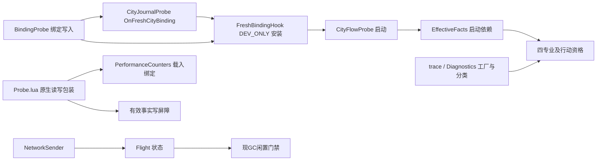

# P3：生产职责、诊断依赖与真实缺失验证

Status: Stable — `v3.1-review` 调查候选；可审阅，不代表审计关闭、正式接受或实施授权。

Primary｜2026-11-04｜develop `954dc67aca007082a5a164becdbafbacbad1403a`；D0058 / A0183 / S0866。B399.426 仅为现有部署记录，本轮未验运行包。

本轮仅修订候选／参考文档并作只读证据及文档完整性检查；不改冻结报告、生产、测试、工具、正式规范或状态，不运行生产测试／探针，不提交／推送，不启动游戏或部署。文内 LOCAL / NATIVE 均为未来验证要求，除明确标为“既有记录”外没有新 PASS。

## 1. 判定原则与当前实际链

文件名/DEV注释/trace开关不能定义职责。必须分别清点启动、事实/写屏障、业务入口、持久提交、transport/ACK、返回、退出/旧载体cleanup、GC安全控制、观测格式化。正常生产职责先有明确生产owner和完整调用，再退原模块；可选观察者应缺文件/缺global也不改变业务与错误可见性。**本轮只清点，未提取或删除。**

这些是当前硬依赖/调用，不宣称每次正常现代新城仍走旧Flow写路径；现代Store在CityFlow173/177抑制旧写入，但Start安装和EffectiveFacts依赖仍在。[Mod/Gameplay.lua:862](../../../../../../../Mod/Gameplay.lua#L862)–876、[Mod/FreshBindingHook.lua:4](../../../../../../../Mod/FreshBindingHook.lua#L4)–8、[Mod/CityJournalProbe.lua:85](../../../../../../../Mod/CityJournalProbe.lua#L85)、[Mod/Probe.lua:553](../../../../../../../Mod/Probe.lua#L553)–569。

## 2. 必要生产职责全链清单（Q1–8不替代本表）

| P3 | 当前入口／责任与证据 | 拟提取／保留owner；退出证据 |
|---|---|---|
| P3-01 | Gameplay9 include Probe；Probe553–556强绑Count/Observe/HasBuilding；567–569是所有建/拆/Property写入口 | 生产kernel持必要原生API与写屏障，计数为optional tap；缺Counters文件仍startup/read/write可达 |
| P3-02 | Probe558–565 BeginWrite/EndWrite在原生pcall前后，apply-and-throw也要失效；EffectiveFacts302安装服务 | O1生产facts/write owner；不能把注释Probe“清理”成直接native call；throw/重入/两消费者共享差分 |
| P3-03 | BindingProbe读取/创建city token和Game ledger，并触发OnFreshCityBinding；Gameplay862 | Store身份/绑定生产owner接历史引用及新城admission；旧property名字不是自动可删；同版本load/重复新城证明 |
| P3-04 | CityJournalProbe85 hook+57持久write；FreshBindingHook5–8 DEV_ONLY及Binding/Journal硬前提 | Store或现有fresh-admission生产owner接链，不再DEV_ONLY安装生产路径；modern/历史实际分支逐一对照，非单纯换名 |
| P3-05 | CityFlowProbe60安装FreshHook、数据读取/资格；Gameplay874–876是EffectiveFacts前置 | 统一facts+Store完成正负/初始化/绑定职责；移除强制诊断启动边不影响现代生产或合法同版本恢复 |
| P3-06 | GovernorProbe.sql→Probe GovernorGate→EffectiveFacts117–121；DistrictPrecision/CurrentSpecializationFacts为实际D基础输入 | 生产资格/共享facts保留必要SQL/读取；不按Probe名删；ACTIVE统一且无专业cache |
| P3-07 | UnitSiteProbe为只读位置描述，Gameplay908–910却阻UnitTargets；UnitActionSitePolicy由该Start所在入口include | UnitSiteFacts/UnitActionSitePolicy生产include独立；移除UnitSiteProbe只少描述，不让UnitTargets因缺observer SKIPPED |
| P3-08 / Q3 | ConstructionProbe7–26 ReadSnapshot读当前队列/成本/进度；CrewProjects303/334用它 | 生产施工目标采样owner接收同一可靠snapshot；DEV Prepare/Apply与手动AddProgress不混生产；保唯一Crew proof独立 |
| P3-09 / Q3 | CrewPrecision22–46装饰UnitActions.Run，预读/后读/记录且返回三元组 | observer可移除，保持实际Run result/receipt/outcome、异常语义；生产不依赖Precision全局 |
| P3-10 / Q1 | CultureInspirationProbe retired仍被CultureInspiration Start依赖；正式exact撤旧载体职责 | Inspiration或LegacyCleanup生产owner持withdraw/IDs；positive已停不等于全文件无责任 |
| P3-11 / Q4 | CultureMeaningProbe.lua未启不代表同名SQL可删；CultureMeaning9生产目录/92ID及cleanup | Meaning生产写者/定义保留；Bindings34死消费者与unused import按实际引用退出；不压缩重编码本批Carrier |
| P3-12 / Q7 | Dialogue retired positive，但paired样本、ACK、generation、ready与退出仍有caller；DialogueRefresh26 | Dialogue生产facts/transport owner接，区别collector可删；不丢恢复或让UI仅READY假成功 |
| P3-13 / Q8 | HalfYieldProbe retired、GreatWorkProbe初始化/精确清理、LegacyCleanup/Tombstones引用 | production retirement/真实GW owner保cleanup；再删probe Startup，不因无新positive就遗留旧载体 |
| P3-14 | PurchaseProbe27–34 load遍历所有玩家撤B053测试效果 | exact cleanup迁生产retirement owner，合并必要清单再去自动全扫；没迁前不是可选日志 |
| P3-15 | UI/BoostRefresh11等待NetworkBoost.ready且GreatWorkProbe.ready，每turn重置3次并挂SystemUpdateUI | 迁实际BOOST_INIT/legacycleanup readiness握手后撤无用reader/重试；3/turn仍可永续，不可称总体有界 |
| P3-16 | Gameplay24初始化SPC_Performance，Sender Flight无enabled检查；GC213–214读其inflight | 生产Network transport in-flight状态独立于计数器；GC读正式状态，禁用日志不丢安全gate |
| P3-17 | PerformanceCounters128起AutoGC启动+heap负值latch+busy/UI/route gates+唯一fullcollect | **现GC政策与hook/安全控制保持**，提取仅改owner；采样/格式化/计数/collector才可选；不新策略/定时器 |
| P3-18 | trace工厂与Error/Failure参与Start或错误处理；详下表 | 生产错误分类独立，optional工厂include+New+Record均保护；不开trace也有准确业务error，不noop掩盖错误 |
| P3-19 / Q2 | TimedProjectReaders/Display/Selection正式技术链；TimedTurnProbe replacement/旧ProjectTurnRead | 保真实timer/queue/reply/UI来源，迁实际caller后撤replace/文件；只影响观察的行才删 |
| P3-20 / Q5 | Expedition旧实验Gate与现SpyGate/Train/Read、native transport和持久任务职责不同 | 按真实call提取必要生产，不能借P3做新Expedition功能修复；已搁置边境native异常保持单独 |
| P3-21 / Q6 | CityIdentityMapping/Experiment、继承isolation、必要schema与清理 | 旧实验 inactive与实际caller分别核；保原身份/收据/合法deferred，不新玩法 |
| P3-22 | Probe/SourceYieldProbe/YieldCarrierProbe和P0手动命令入口（Gameplay9–14及request分派） | 只实验的命令随文件退役同步撤导出/UI引用，必需facts helper先迁；禁止留悬空按钮或missing include |
| P3-23 | NetworkRecovery*未被Gameplay/Bridge/消费者接线，仅入包；Store Stamp和s9g1–4/selection alarm | O3取消接线义务，O7退出真实unused adapter/Stamp/测试必要性；不做跨版本decoder保留任务 |
| P3-24 | Probe名SQL与modinfo：Governor、DistrictPrecision、OverflowSinkTest、HalfYield、GreatWork、Purchase、YieldCarrier、BoostIntegerTest等；SPC_B059_Dialogue在498/499重复组件ID | SQL逐ID生产/实验/cleanup引用审查后再决定；重复组件风险单独校正验证。无本轮删ID授权、无“SQL都保即可忽略包职责” |
| P3-25 | LegacyCleanup Start前强制RegisterExit；RuntimeRetirement和各业务exit/return | 受控注册表区分mandatory production cleanup与optional observers；Start失败保fail-closed，职责移交成功后才能移除gate |

源码主定位：[Mod/Gameplay.lua:930](../../../../../../../Mod/Gameplay.lua#L930)–1039、[Mod/ConstructionProbe.lua:7](../../../../../../../Mod/ConstructionProbe.lua#L7)、[Mod/CrewPrecision.lua:22](../../../../../../../Mod/CrewPrecision.lua#L22)、[Mod/PurchaseProbe.lua:27](../../../../../../../Mod/PurchaseProbe.lua#L27)、[Mod/UI/BoostRefresh.lua:3](../../../../../../../Mod/UI/BoostRefresh.lua#L3)、[Mod/LegacyCleanupCatalog.lua:1](../../../../../../../Mod/LegacyCleanupCatalog.lua#L1)、[Mod/SpecializationP0.modinfo:498](../../../../../../../Mod/SpecializationP0.modinfo#L498)。

## 2a. 其余自动Start／实验入口没有被遗漏

此表补足实际composition/dispatcher中的其它诊断，不把“没有生产前置声明”误说成无运行成本，也不把会写Property的实验称只读。以下职责在O7同一退役清单核销，不新建平行系统。

| 当前入口（Mod/） | 当前实际内容／后继处置 |
|---|---|
| TradeRouteProbe Start（Gameplay827；TradeRouteProbe123–146） | init及本地turn边界直接refresh/读取routes；事件仅标pending。不是可靠Bridge证明的替代；在当前call/显示链核查后撤自动观测扫描及UI引用，保真正Bridge/BackgroundRoutes采集 |
| CompletionProbe（Gameplay829）、CitySequenceProbe（835） | 原生完成/城市次序观测、实验Begin/Read与环形证据；未成为当前composition的生产前置。退出其listener/dispatcher，不丢Store正式first-completion证据 |
| CompletionRecordProbe（864；文件55–79） | 非modern托管范围可写SPC_DEV_COMPLETION_B014，依赖Binding；BlocksLegacy过滤现代Store城市。不是纯日志；正常现代事实接班前逐实际read引用，历史实验Property不当真first回填 |
| EligibilityProbe / QualificationProbe（868/870） | 测试玩家/roster/权限采样与诊断Gate；当前没有为production IsTestPlayer提供声明依赖。保真实trait资格helper，撤其观察/展示/实验调用，不把实验权限Gate升级正式权威 |
| StorageProbe（831）、EnvelopeProbe（872） | 手动STORAGE_WRITE/ENVELOPE_NEXT会写Game实验Property，load还有读取；只实验操作和相应UI一并退出，不抹Store真历史 |
| SourceYieldProbe / YieldCarrierProbe（Gameplay12/14/719–725） | 前者读城市产出、后者手动plotflag实验与Describe；YieldCarrier exact退出标志已由LegacyCleanupCatalog5/9持有。先保生产cleanup，再去未用include和命令；不能把plotflags连真yield载体批删 |
| TimedProductionProbe / OverflowStorageProbe / ProjectTurnObservation（1004/1006/1008） | request驱动实验采样/进度观测/溢出事务；production TimedProjectReaders/Display独立核对。移除实验dispatcher/observer时保正式计时、queue、overflow处理调用及收据，不因词形相近删错 |
| NetworkIsolation（1012） | 实验Stop/隔离控制会改变transport执行；先核各production guard的inactive语义和shutdown责任再去控制入口，不把active隔离状态当普通READY |
| MemoryObservation / Readiness / CarrierHealthTrace / EventTiming / CultureDiagnostics | GC生产职责单列P3-16/17；其余日志/采样默认/上限/收录协议与生产错误独立。collector退出仅少证据，不让业务变更 |

上述“尚无生产前置”仅当前源码直接声明/调用范围，不是授权直接删文件。退出时仍检查actualinclude、导出方法、UI请求、SQL/exactcleanup和测试引用；每行的生产职责接班证明计入O7，不能将未核清对象塞到“其它都可选”。

## 3. trace与错误分类的实际调用面

本轮按`Diagnostics.New/Failure/Error`调用定域枚举，不能只审几个示例就声称所有可删除。以下同组列出调用位置；“有and保护”仅防global不存在，仍未必防include或New抛错。

| 入口类别 | 当前调用点（Mod/） | 必要处理 |
|---|---|---|
| Start直接New | Commerce21及448；CapitalInvestment13；DevelopmentInvestment12；EngineeringStudyProjects13；CrewProjects14；IndustryHistory9；NetworkBridge43；IndustryWonderEffects11；UI/CityPotential14 | optional include/构造/记录全路径隔离；trace absent不使owner Start失败 |
| 全局and New但构造可throw | ExpeditionTraining18、IndustrySupport14、Restructuring10、Standardization30、StandardizationEffects17、UI/ExpeditionTrainingUI9 | 不能仅测flag=false；New throw也要只损观测 |
| pcall构造/懒构造及报告 | CultureNetwork46、ExpeditionSpyGate48、NetworkBridge41；ExpeditionSpyRead500、RestructuringUI70、UI/ExpeditionSpyActivity546、Gameplay289 | 区分pcall求值前global索引、懒初始化、返回nil后的调用；不能假定缺global等于New失败 |
| 专业错误分类 | CapitalInvestment15–18的CapitalInvestmentDiagnostics.Error；CultureNetwork368/393与NetworkBridge716/774/782的ExpeditionTrainingDiagnostics.Failure；Gameplay295 | 生产Failure/Error结构移生产helper，日志仅消费；缺observer时仍发布业务错误 |
| 已有隔离范式 | Gameplay1–8 cultureObserve；DialogueProjects78、Lv2GPP83、TimedProjectReaders36、UI/TimedProjectSelectionClient129 | 保持可拆除；诊断build函数内Error不承担生产判断，和上一行区别 |
| 纯观察／控制入口 | CarrierHealthTrace5、EventTimingDiagnostics34、ReadinessSummary5；PlaytestBoundaryDiagnostics、DiagnosticLog及UI生产/请求入口按include和callbacks追踪 | 退出前撤自动listener/collector引用，观测关时不多采原生；不增加新probe |
| Sender观测差异 | NetworkSender81：global存在且ENABLED=false直接返回，global缺失反而执行82–85的原生观察 | 目标enabled/disabled/missing都只影响记录，不让missing多出读开销；Flight不能随之删除 |

## 4. GC/Flight必须保持的精确不变量

Count在enabled=false时无输出，Flight27–30**仍更新**；删除SPC_Performance使GC213门禁缺席，不能视为无害缺诊断。原NETWORK_INFLIGHT的一次同回合接续、ROUTES_PENDING不同策略、负heap unsafe latch不复信、不变GC hook/阈值/唯一fullcollect控制，均按现行代码分别差分。移去外部global后必须有真实生产控制面接班，不能用test stub先造同名对象遮缺陷。

## 5. 真缺失夹具的最小设计（尚未实现/运行）

现 [DevelopmentTests/refactor_harness.py:48](../../../../../../../DevelopmentTests/refactor_harness.py#L48)–66直接从磁盘加载，无modinfo虚拟文件集合/absent集；旧fixture常注入诊断工厂、SPC_Performance和即成共享服务，只能证明其注入世界，不能证明实际缺文件可启动。

拟在既有harness扩展受审VFS：从实际modinfo读取可入包文件；支持exact absent文件集+globals集；缺include分别模拟抛错与无global静默返回（真实引擎行为仍UNVERIFIED）。独立跑真实Gameplay composition→Store/facts→四专业、实际UI上下文启动/ExposedMembers；native Doubles只给引擎接口，不stub掉生产wrapper/Flight/错误/ACK。生产源码限定Lua5.1受限环境。

三组相同合法same-build保存/初始facts：观察开、观察关、观察文件＋global真缺。比较：启动/FAILED及mandatory gates、ACTIVE/历史字节/receipts、原生建拆Property和严格Money/Unit次数、ACK恢复/typed UI/真实error、Flight与GC所有门禁；只允许日志/观测读取减少，不得允许事务差异。不在live重复扣款/创建求对照。测试代码/工具/SQL删除本轮均不写。

## 2026-11-04 targeted-review residuals (A10/A17–A19/A23–A26)

These supplement the existing P3/Q rows, not a second migration schedule; only integrated §4 orders slices. No code or absence harness was executed.

| Existing row / owner | Confirmed residual and required gate |
|---|---|
| P3-16 /19, UI+Gameplay Flight | NetworkSender8/19/29/35/71/78 invokes Flight through ExposedMembers.SPC_Performance, created by Gameplay24. This is a cross-context transport-control dependency, not merely a Gameplay diagnostic counter. Preserve production in-flight semantics before optional counters/global removal; absent harness must not pre-inject this object. |
| P3-19 / Q2, O5a/O6 | TimedTurnProbe2 includes HD_ActionPanel and is an unconditional ActionPanel replacement. Move it off the no-HD loading path before adapted smoke; normal CityPanel/project readers and native end-turn UI must survive. CrewProjectOrder33–44 GetDataHelper hook exists only in HD; O5 owns base/environment assembly and its one fixed no-HD load smoke; O6 owns actual callback/behavior/interaction integration and can reuse that evidence (Owner N3). |
| P3-24, O3/O7 | **StandardizationDiscount.sql2–8 is live:** SPC_B054_Targets feeds StandardizationEffects.sql3–6 then EngineeringStudy.sql10–13; old StandardizationDiscount.lua also uses the same target IDs for withdrawal. Do not retire the SQL merely because positive Lua is retired. DevelopmentInvestment.sql3–7 HD JOIN must be separate from unconditional15–20 project/access definitions before no-HD load. |
| P3-03/04 and P3-18 | Store2061 invokes BindingProbe for fresh admission; four UI DiagnosticLog sites are unguarded and23 UI includes import Probe-bound counters. Transfer the actual owned duties and size the real absence harness; a few stubbed modules do not prove all production contexts can load. |
| P3-25, PU08/O5b | Mandatory exits must exist despite failed/skipped ordinary Start. RuntimeComposition12–16 can skip before module code; Store1268–1280/1334–35 sees only registered entries. Installed old effects plus failed/skipped Start are required local cases, not a hypothetical repair state machine. |
| P3-25, PU08/O4, ExpeditionTraining | ExpeditionTraining299–304 exit ignores run123–129's ok/result and busy return; its wrapper can return normally after swallowed errors. Require an explicit confirmed result/known absence before exit completion. Unknown does not pass; no new training gameplay or replay. |
| Q/legacy list, O1/O7 | Exact-owned ID/presence/withdrawal lists must be available without HD catalogs; confirmed-absent no-op must be reachable. Validate per-module no-HD Start/D/exit consequences from the existing cross-profession matrix. No whole-family “current profession” filter. |

Diagnostics-on/off/absent arms include throw and silent-nil include results in real UI and Gameplay compositions, both before and after necessary production duties move. Flight/GC/error/ACK/cleanup are not stubbed away. Preserve present GC strategy and no speculative native recovery.
