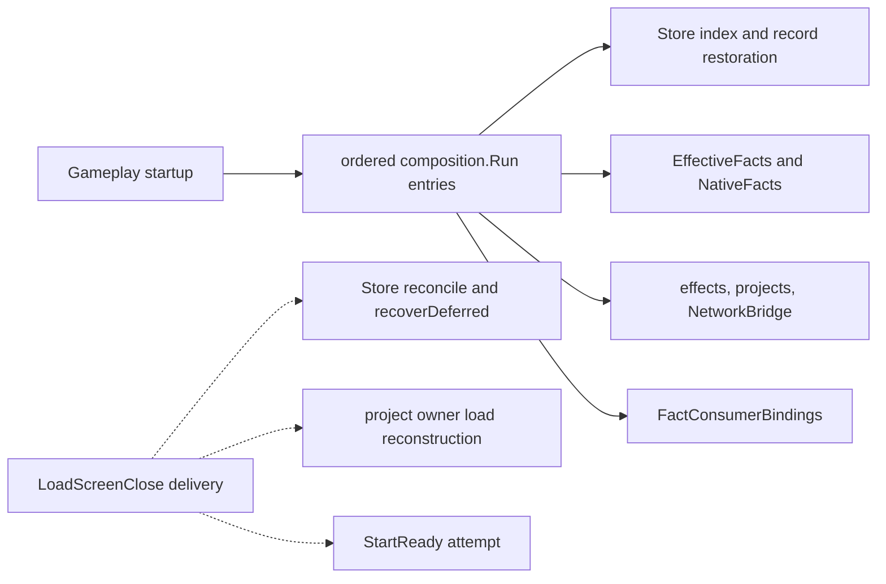
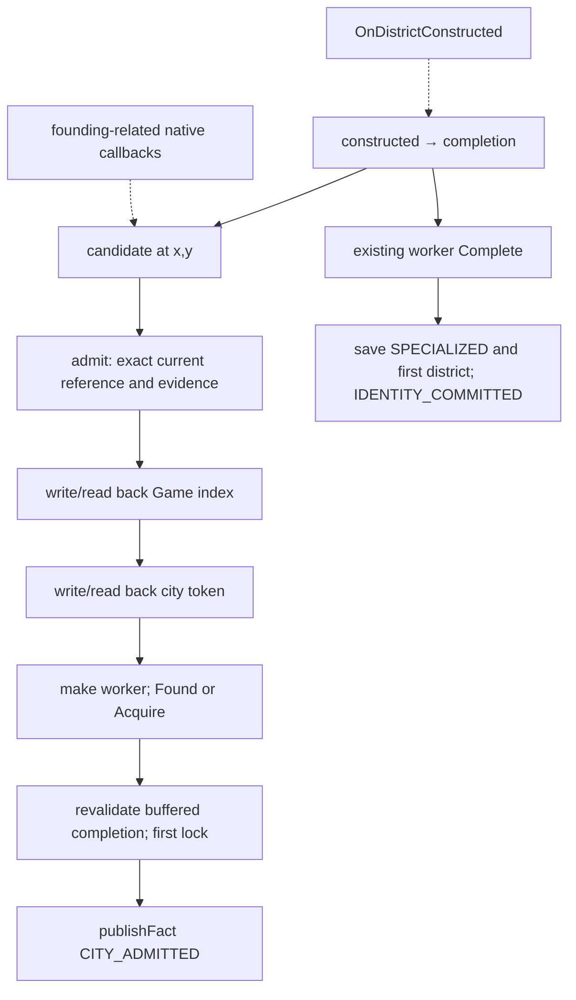
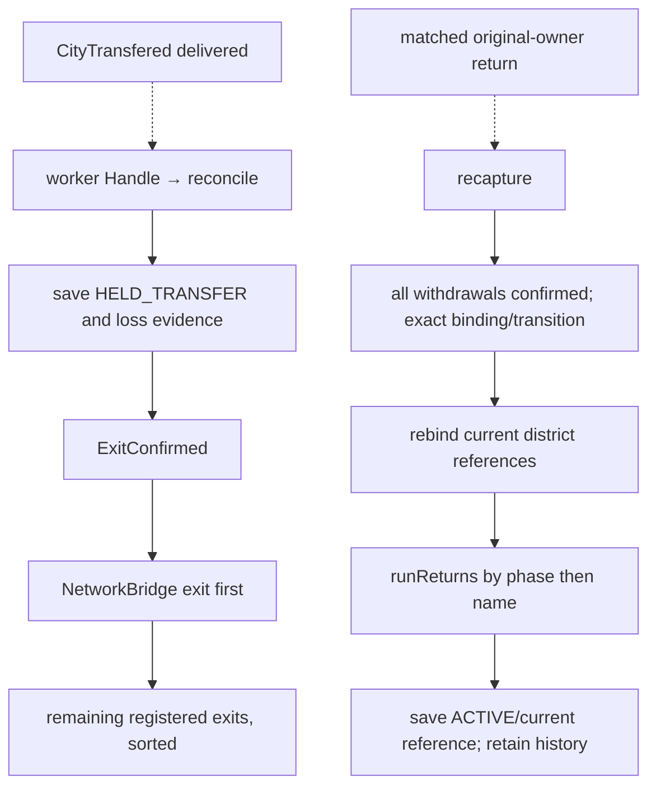
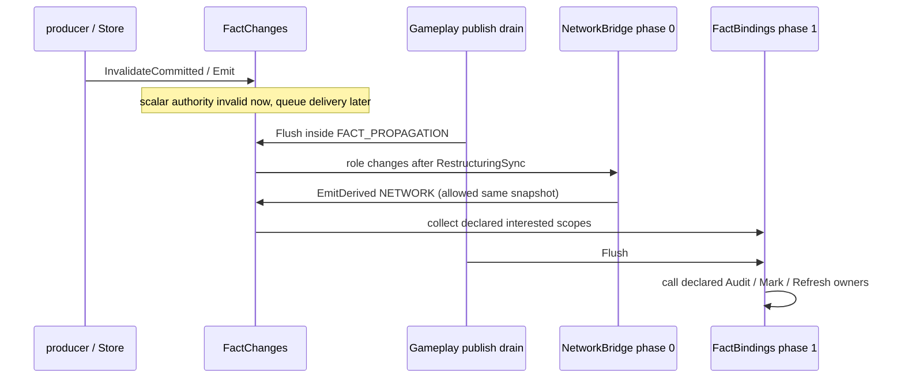
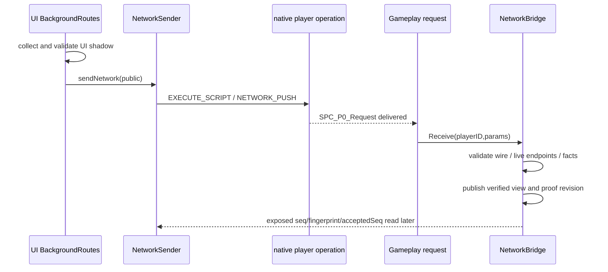

# Actual event chains

Investigation / Non-authoritative / No design decision implied
Status: Stable
Owner: delegated event-chain investigation; writes paused for Primary review.
Basis: develop `19d4669d11df945afcda9d73329dfb984fe8c694`, B393.420, D0058 / A0183 / S0850. Source inspected read-only; no runtime experiment.

## Evidence and diagram contract

All findings below are **STATIC_CONFIRMED** source behavior, conditional on each listener/provider being present and startup succeeding. Solid arrows mean calls or writes visible within the stated Lua path; dashed arrows mean native delivery, context transport, or a later callback. They do not assert native event order, successful native effects, multiplayer delivery, or frame/turn frequency. The diagrams supplement this Markdown; neither this report nor Stable status approves architecture. Startup failures are contained by explicit composition entries and the startup epilogue itself says `USER_GAME_TEST_REQUIRED` ([Gameplay composition](../../../../../Mod/Gameplay.lua#L813), [completion](../../../../../Mod/Gameplay.lua#L1016)).

## E01 — Startup and cold reconstruction

`Gameplay.lua` creates `ExposedMembers.SPC_P0`, constructs `SPCRuntimeComposition.New(shared)`, and runs named entries in source order. Store precedes EffectiveFacts/NativeFacts, effects, NetworkBridge, project owners and the final FactConsumerBindings registration. Declared composition dependencies are startup prerequisites, not proof of readiness ([initialization](../../../../../Mod/Gameplay.lua#L10), [Store/facts](../../../../../Mod/Gameplay.lua#L824), [projects/bindings](../../../../../Mod/Gameplay.lua#L960)).

Store restores its index and records through `loadIndex(v)` and `make(token)`, rather than inferring historical specialization from current districts. New-game initialization explicitly rejects an existing-city save with no supported initialization; the legacy import path is separate ([loadIndex](../../../../../Mod/CityProgressionStore.lua#L1624), [initializeNew](../../../../../Mod/CityProgressionStore.lua#L1661), [modern restore branch](../../../../../Mod/CityProgressionStore.lua#L1651)). On load, `Handle('LoadScreenClose')` reconciles and attempts deferred lifecycle recovery; the manager forwards the event to registered workers ([Handle](../../../../../Mod/CityProgressionStore.lua#L1438), [listen](../../../../../Mod/CityProgressionStore.lua#L2200)).

`SPCRuntimeWork.StartReady(P,shared,name,start)` attempts on load/publish/activation and latches success, subject to `HistoryStartStatus`; this is startup recovery, not a recurring successful full initialization. `CityFlowProbe` retains legacy resume code, but returns from its load traversal when `UsesNewAuthority` is true ([StartReady](../../../../../Mod/RuntimeWork.lua#L493), [legacy exclusion](../../../../../Mod/CityFlowProbe.lua#L175)).

## E02 — Founding, fresh registration, first completion

Native `GameEvents.CityBuilt`, `Events.CityAddedToMap`, `Events.CityInitialized`, and `Events.UnitActivate(owner,unitID,x,y,reason)` feed `candidate`/`spatial`/`founded`. `admit(q)` requires same-turn matching live reference, initialization plus FOUND_CITY evidence for founding, listener availability, no preexisting history and an unused registration slot. Candidate completion rows are buffered, capped at eight, revalidated and replayed in delivered order; only the first may lock specialization ([candidate](../../../../../Mod/CityProgressionStore.lua#L1943), [admit](../../../../../Mod/CityProgressionStore.lua#L1987), [buffer/replay](../../../../../Mod/CityProgressionStore.lua#L2066), [listeners](../../../../../Mod/CityProgressionStore.lua#L2143)).

`constructed(pid,index,x,y)` resolves `CityManager.GetDistrictAt`; it never treats the district type argument as cityID. `d.Complete(pid,c,e)` locks only an ACTIVE, non-invalidated UNASSIGNED record outside LEGACY_CLAIM, sets base Potential 1 and first-district history, saves, then publishes identity facts. Missing city evidence holds eligible records rather than choosing a later completion ([constructed](../../../../../Mod/CityProgressionStore.lua#L2102), [Complete](../../../../../Mod/CityProgressionStore.lua#L827)). No generic native callback ordering is asserted by this diagram.

## E03 — First acquisition, owner loss, conquest and recapture

These are distinct paths. A previously unregistered AI major/city-state acquisition requires the **observed** `CityConquered < CityAddedToMap < CityInitialized < CityTransfered` sequence, then snapshots this city's completed professional district families into LEGACY_CLAIM or FIRST_COMPLETION. The inequality is an implementation acceptance gate, not an engine guarantee ([acquisition gate and snapshot](../../../../../Mod/CityProgressionStore.lua#L2000), [conquest and transfer listeners](../../../../../Mod/CityProgressionStore.lua#L2146)).

For an existing registered record, `Handle` routes by exact location/reference; `reconcile(newOwner,newID,oldOwner,returnGuarded)` confirms live foreign ownership against CityTransfered, saves `HELD_TRANSFER`, clears/cancels unfinished timers and policies, terminates Capital/Development, transitions Commerce, and captures deferred lifecycle evidence. Historical records remain retained ([Handle routing](../../../../../Mod/CityProgressionStore.lua#L1438), [loss commit](../../../../../Mod/CityProgressionStore.lua#L1399)).

`ExitConfirmed` rechecks generation/live target around each callback, gives each registered exit at most three attempts in that generation, and records failure/partial status. `recapture` requires original owner, matching loss target, completed exits and no pending investment; it searches the returning owner's districts to rebind references, never creates a new historical completion. `runReturns` is ordered by the fixed phase table then name **before** save makes facts available ([exit](../../../../../Mod/CityProgressionStore.lua#L1251), [return phases](../../../../../Mod/CityProgressionStore.lua#L30), [recapture](../../../../../Mod/CityProgressionStore.lua#L1311)). Network exit prunes the old owner's snapshot; return only requests current route proof ([Network lifecycle](../../../../../Mod/NetworkBridge.lua#L939)).

## E04 — District/building, worker, governor and qualification changes

District/building causes go to `DistrictCompleteness.MarkDirty(pid,cid,cause,transfer)`, which dirties matching cached/in-flight facts and emits D. Known-city Events district hooks retain city scope; `GameEvents.OnDistrictConstructed` marks owner scope; building native coordinates are resolved before narrowing, and internal carriers are excluded where the owner explicitly identifies them. Unknown mapping retains broader scope ([MarkDirty](../../../../../Mod/DistrictCompleteness.lua#L143), [hooks](../../../../../Mod/DistrictCompleteness.lua#L247)). Reading D captures current city districts, complete/pillaged state and building locations; it is not permanent completion history ([capture](../../../../../Mod/DistrictCompleteness.lua#L85)).

`NativeFacts.Workers(scope,cause)` invalidates committed authority and emits WORKERS; `CityWorkerChanged` uses TargetHook, `CityFocusChanged` knows owner only. GovernorAssigned/Established/Changed/Promoted emit ACTIVE. `TargetHook` explicitly distinguishes Events from GameEvents and widens GovernorAssigned to owner scope; there is no event-name-based cross-namespace inference ([NativeFacts](../../../../../Mod/NativeFacts.lua#L8), [TargetHook signatures](../../../../../Mod/RuntimeWork.lua#L431)).

Potential/ACTIVE are recomputed by `EffectiveFacts.capture(pid,city)`: checked base plus unique committed investment receipts, total cap 4; ACTIVE is zero for NONE, otherwise Potential subject to `P.GovernorGate`, with `UNKNOWN_GOVERNOR` when readiness is unconfirmed. This reader does not promote a governor dirty cause into a fact value ([capture](../../../../../Mod/EffectiveFacts.lua#L78)). Investment requests publish only a committed receipt as targeted Potential/ACTIVE; fallback request dirtiness is owner-scoped ACTIVE/D/WORKERS ([request observer](../../../../../Mod/Gameplay.lua#L25), [action call](../../../../../Mod/Gameplay.lua#L593)).

## E05 — Deferred fact propagation and effect consumers

Store `publishFact` invalidates authority before queueing detached fact evidence. Identity commits use IDENTITY/POTENTIAL/ACTIVE; named history commits use HISTORY plus topic. `FactChanges.Emit` merges same owner/city/reference rows, bounded at 2,048 keys; it changes scalar generations synchronously, not native fact values ([Store publisher](../../../../../Mod/CityProgressionStore.lua#L16), [Emit](../../../../../Mod/FactChanges.lua#L116)).

`Flush` snapshots queued rows, uses phases 0 then 1 and stable consumer registration order, isolates callback errors, and defers ordinary reentrant causes to another snapshot. Only NETWORK emitted by NetworkBridge during its phase-0 callback can join that snapshot for phase 1. Gameplay drains only after composition sealing and calls FactBindings.Flush after FactChanges.Flush ([flush/derived exception](../../../../../Mod/FactChanges.lua#L164), [drain](../../../../../Mod/Gameplay.lua#L824)). This ordering is local synchronous code; ordering among separate native publish listeners remains unproven.

Declared binding targets include ResearchSupport/Lv2Housing/Lv2GPP, legacy Lv3/Lv4 owners, Research Infrastructure/Cross/Apply/Chair, Culture Aesthetic/Meaning/Inspiration, topic-filtered Tradition/Dialogue/Insights, StandardizationEffects/CultureNetwork, Commerce, Capital and Development. Network samples at most once per owner per fact flush; bindings merge owner/city work and handle source-dependent requests. Lv3Support and Lv3Effects take retirement/retry paths under the current composition options, and Lv4Percent.Audit is an empty compatibility function; a declared edge is not evidence of an active benefit ([Lv3Support](../../../../../Mod/Lv3Support.lua#L96), [Lv3Effects branch](../../../../../Mod/Lv3Effects.lua#L75), [Lv4Percent](../../../../../Mod/Lv4Percent.lua#L23)). Each owner retains eligibility and effect semantics ([declarations](../../../../../Mod/FactConsumerBindings.lua#L12), [scope merge/invoke](../../../../../Mod/FactConsumerBindings.lua#L52)).

## E06 — Claim project

`CLAIM_BEGIN/SYNC` request routing calls the project owner. `Request(pid,p)` checks current project and records a timer; turn deactivation records END, later activation handles DUE/MISSED using the saved boundary. DUE saves CALLING **before** `q:FinishProgress()`. `Events.CityProjectCompleted` may reenter: `completed(pid,id,index)` revalidates candidate district, calls `store.ClaimComplete`, forgets the timer and only marks dirty; flush is deferred. Load reconstructs access/timers and settles a saved due boundary without beginning a new timer ([request routing](../../../../../Mod/Gameplay.lua#L112), [Request](../../../../../Mod/ClaimProjects.lua#L91), [completion/turn/load](../../../../../Mod/ClaimProjects.lua#L131), [Store ClaimComplete](../../../../../Mod/CityProgressionStore.lua#L872)).

## E07 — Dialogue and Engineering timed projects

Both owners register their production/completion/turn hooks in the `Events` namespace and use private rounds, dirty sets, settling/armed guards, qualification reads, and a durable pending record. `Events.PlayerTurnDeactivated` records the end boundary; `Events.PlayerTurnActivated` advances only tracked runnable rounds, checks current queue and eligibility, saves CALLING, arms the same round in memory, then calls FinishProgress. Missing full-turn evidence cancels; uncertain facts block/hold ([Dialogue advance](../../../../../Mod/DialogueProjects.lua#L181), [Engineering advance](../../../../../Mod/EngineeringStudyProjects.lua#L142)).

Dialogue samples fresh GreatWork era facts once at completion and checks state again before commit; no pending round means no reward, failed boundary is HELD and never resampled later. Engineering additionally requires known national credit, `ended`, exact next turn and unused knowledge capacity. Successful Store writes publish DIALOGUE or ENGINEERING history; the corresponding effects update through E05 ([Dialogue completion](../../../../../Mod/DialogueProjects.lua#L150), [Engineering completion](../../../../../Mod/EngineeringStudyProjects.lua#L121), [Store history publishing](../../../../../Mod/CityProgressionStore.lua#L451), [Engineering topic](../../../../../Mod/CityProgressionStore.lua#L517)).

Qualification/production events wake access checks; governor handlers include immediate qualification-only audits of existing rounds plus owner city access marking. Load rehydrates access and attempts advance, but an old CALLING round lacks the current in-memory arm and cannot justify replay ([Dialogue hooks](../../../../../Mod/DialogueProjects.lua#L254), [Engineering hooks](../../../../../Mod/EngineeringStudyProjects.lua#L200)).

## E08 — Crew project completion and use

`Events.CityProjectCompleted → completion(pid,id,index)` validates an admitted order and native completed counter, rejects duplicates/gaps, counts bound live Crew units, persists order and player receipt as CALLING, then invokes `UnitManager.InitUnit`. Returned unit identity/type/source and property binding must read back before receipt becomes BOUND and the order is removed. An ambiguous grant remains held; it does not replay native creation ([Crew completion](../../../../../Mod/CrewProjects.lua#L265)). Production/city/unit/governor/wonder callbacks mark private dirty scopes and publish flush reconciles markers/access; Store exit removes owned markers, return marks the city ([Crew hooks/lifecycle](../../../../../Mod/CrewProjects.lua#L366)). `Consume(pid,u,c,plan)` is the separate Crew-use transaction called through action/precision ownership, not project completion itself ([Consume](../../../../../Mod/CrewProjects.lua#L311), [composition wrapping](../../../../../Mod/Gameplay.lua#L905)).

## E09 — UI, Gameplay and route bridge

UI `BackgroundRoutes.collect(pid)` enumerates local city outgoing routes and checks count/content identity before publishing `COMPLETE_UI_SHADOW`. Dirty/retry flush calls NetworkSender; sender allows one in-flight request and sends bounded scalar `UI.RequestPlayerOperation(... EXECUTE_SCRIPT, {OnStart='SPC_P0_Request',Action='NETWORK_PUSH',...})`. That is a context boundary, not an ordinary synchronous call into the Gameplay request handler ([collect](../../../../../Mod/UI/BackgroundRoutes.lua#L44), [flush](../../../../../Mod/UI/BackgroundRoutes.lua#L176), [sender](../../../../../Mod/NetworkSender.lua#L9)).

Gameplay Receive validates epoch/sequence/turn/signal/wire and live references; refreshing reentry is queued and drained by FlushPending. `NetworkInput.Capture` enumerates the owner's current city set and reuses facts only with matching reference, scalar generation, Store authority and governor witness; unknown facts retain provenance rather than becoming a fabricated zero. Verified/current accessors are explicit consumer gates ([routing](../../../../../Mod/Gameplay.lua#L653), [Receive/FlushPending](../../../../../Mod/NetworkBridge.lua#L430), [Capture](../../../../../Mod/NetworkInput.lua#L22), [current views](../../../../../Mod/NetworkBridge.lua#L561)). Native route/lifecycle signals increment RouteSignalRevision; evidence checks, turn rebuild and StartReady are separate entry paths ([signals/rebuild](../../../../../Mod/NetworkBridge.lua#L877)).

General player views follow the same request boundary: presentation reads EffectiveFacts and Store summary, then publishes through typed PlayerActionReplies; legacy exposed view remains a separate diagnostic mirror ([presentation request](../../../../../Mod/Gameplay.lua#L233), [unit reply routing](../../../../../Mod/Gameplay.lua#L575)). UI LuaEvents transport presentation within UI, not canonical Store history ([CityPotential publishing](../../../../../Mod/UI/CityPotential.lua#L28)).

## E10 — Turn boundaries, invalidation and recovery closure

No single master turn dispatcher was found in these traced owners. Native activation separately reaches Store `traditionTick` (registered workers only: TickTradition/TickCommerce and bounded local held-exit retry), timed projects E06/E07, effect audits/marks E05, Network refresh E09 and banner projections. Registration source order is visible, but engine delivery/reentry across those listeners and UI contexts is not established by this report ([Store turn](../../../../../Mod/CityProgressionStore.lua#L1825), [effect examples](../../../../../Mod/ResearchSupport.lua#L48), [banners](../../../../../Mod/LevelBannerState.lua#L40)).

Durable deferred lifecycle recovery is distinct from ephemeral busy queues. `recoverDeferred(cause)` runs on restore/load/CityInitialized, validates exact parent/current reference, plans each isolated subrecord independently through StoreLifecycleRecovery, commits a candidate with exact recovery capability and publishes successful history topics. Failed entries remain protected with errors; it does not manufacture missing history. `StoreDeferredLifecycle` stores bounded per-owner episode evidence, while RuntimeWork.NewAudit and FactChanges hold session-only scopes ([recovery](../../../../../Mod/CityProgressionStore.lua#L1061), [triggers](../../../../../Mod/CityProgressionStore.lua#L1167), [episode model](../../../../../Mod/StoreDeferredLifecycle.lua#L94), [busy scope queue](../../../../../Mod/RuntimeWork.lua#L55)).

## Read / Write / Listen and limits

Read: canonical Mod Lua at the stated baseline and routing guidance. Write: this new report only. Listen: static registration evidence only; no live listener, probe, game, test or configuration change was performed. E01–E10 cover the requested main lifecycle/fact/project/network paths; expedition task internals and every diagnostic observer are outside this report's exhaustive claim. The companion [Scan inventory](Scan_Inventory.md) classifies scans, including recovery and targeted fallbacks.

Final bounded review: E01–E10 and S01–S33 remain unchanged as identifiers; current retirement/no-op targets and namespace distinctions were rechecked against the same source baseline. No additional implementation or runtime conclusions were added.

Unknowns requiring existing or future user-game evidence: optional event availability; actual native callback ordering and reentry for a particular scenario; native save serialization/cold UI-Gameplay convergence; actual effect/yield application; timing/frequency/performance. The source safeguards are not proof of those outcomes.

## Read Ledger and handoff

Stage A: root/project/Investigation guidance, project/topic navigation, Workflow R9/language/checkpoint rules, Authority versions and Status CURRENT. Stage B: Gameplay includes/composition → Store registration/lifecycle → EffectiveFacts/NativeFacts/DistrictCompleteness → FactChanges/FactConsumerBindings → project owners/Crew → NetworkBridge/NetworkInput/NetworkSender/BackgroundRoutes; RuntimeWork helpers and named consumer callsites. This task explicitly authorized bounded static Mod inventory. No external mods, HD, archives, game files or runtime probes were read/run.

User decision: none made here; resolve architecture questions through Primary's comparison report. User testing: none performed or scheduled. Primary next: review the two delegated Stable reports and their evidence/links; publication does not accept findings or authorize implementation. Stop point: writes paused for review.
