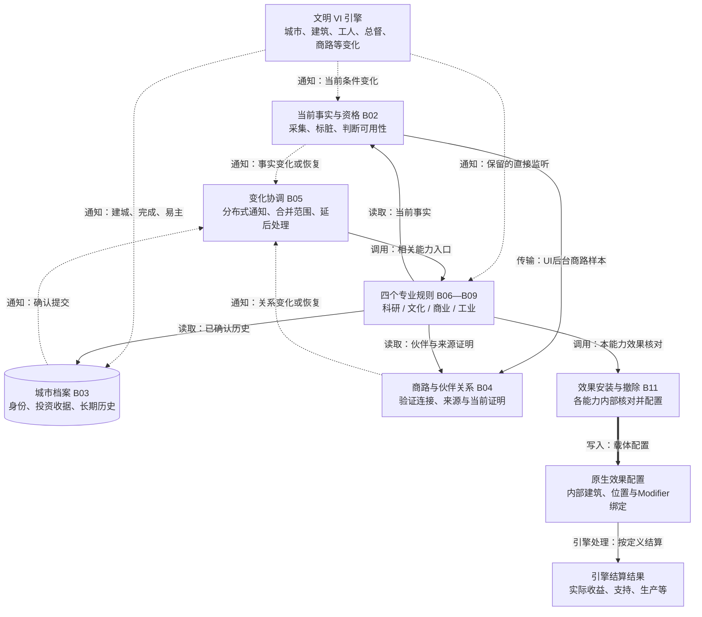
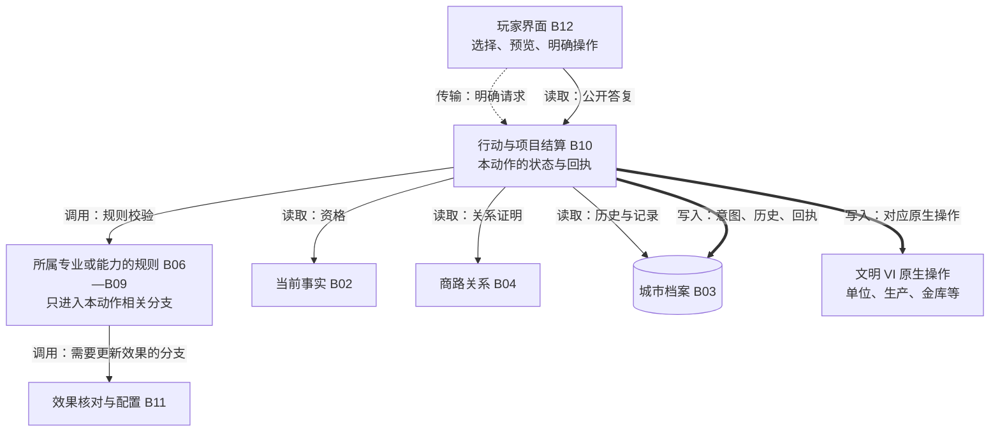
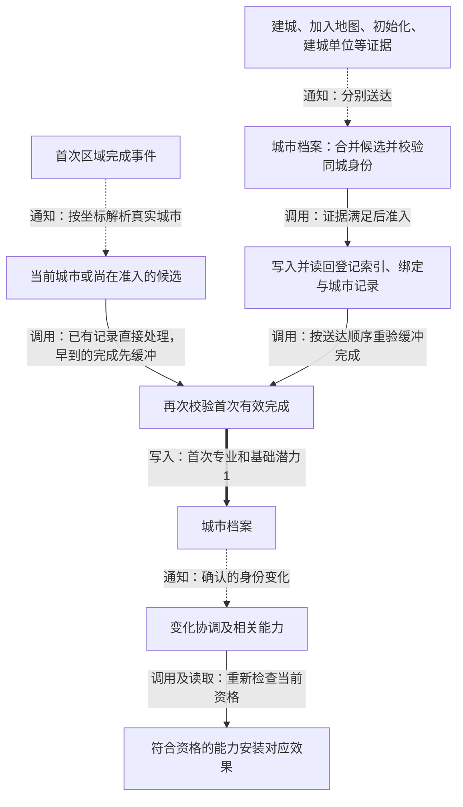
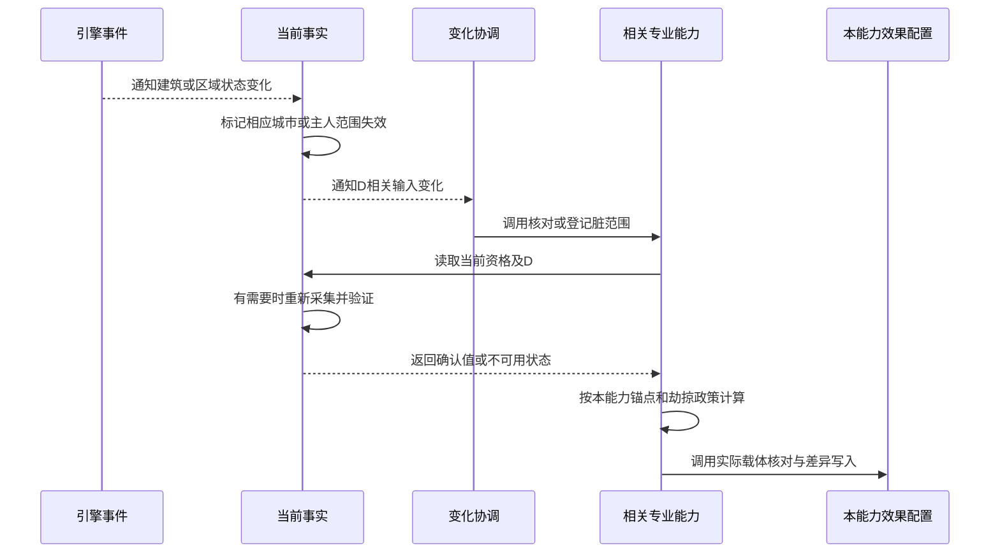
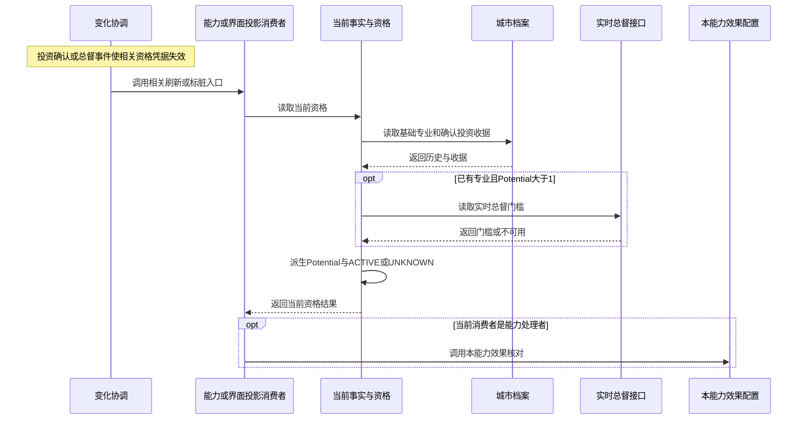
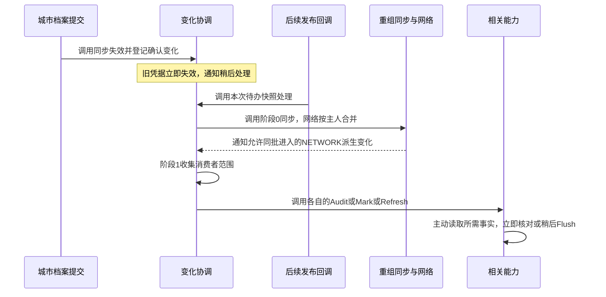
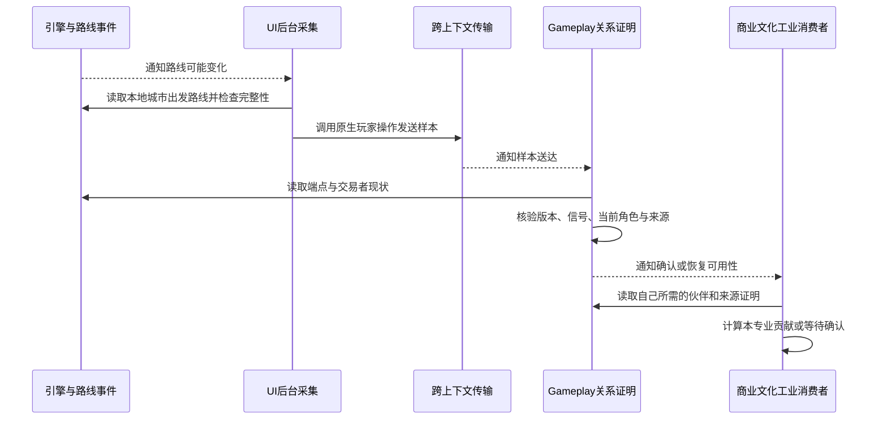
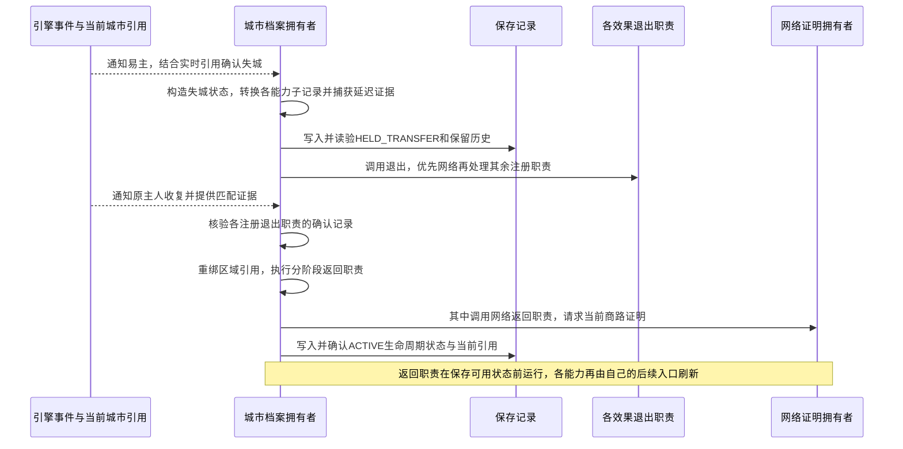
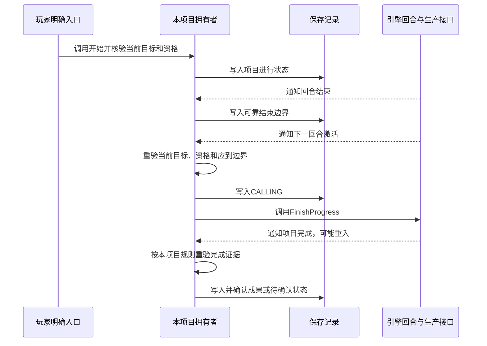
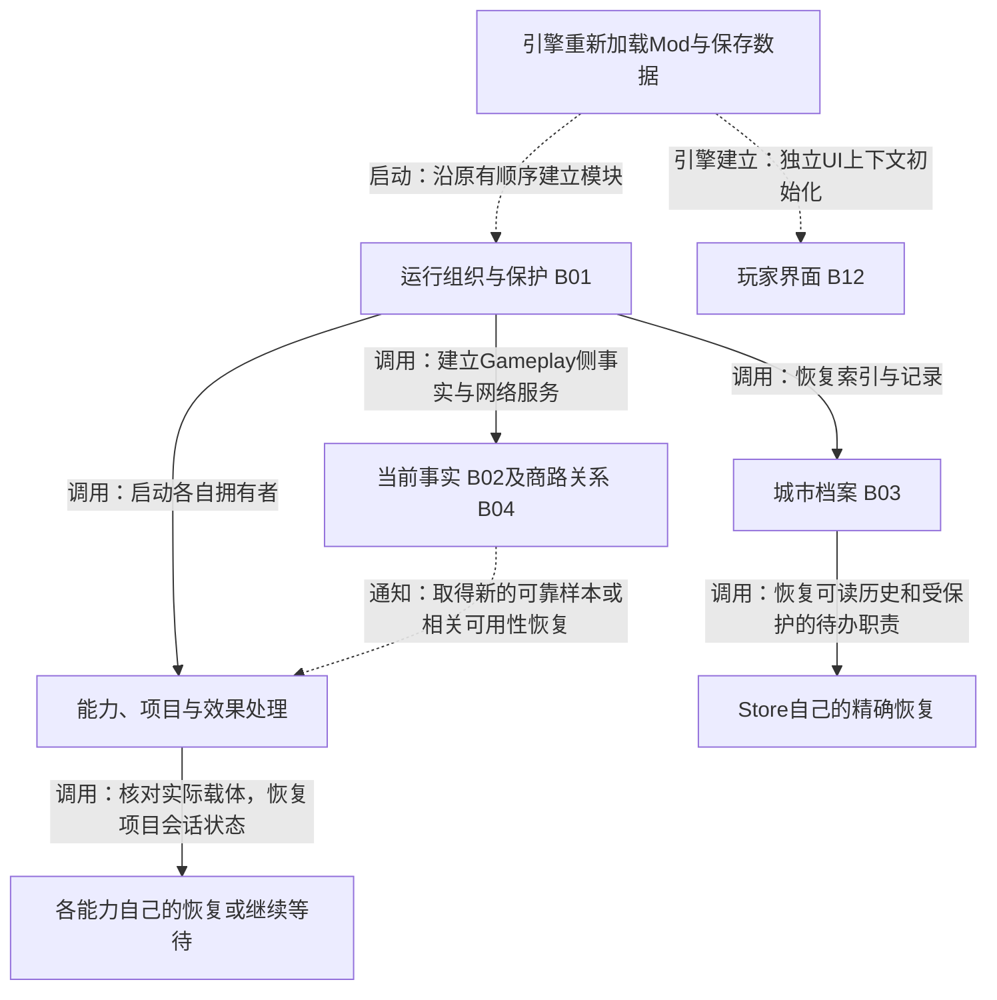

# 逻辑架构总览 / Logical Architecture Overview

As-Is 阅读视图 · Investigation / Non-authoritative · Status: Stable

本页只解释系统当前怎样工作。源码基线沿用上一轮调查的 `19d4669`（B393.420）；本轮开始时 HEAD 为 `b7153a2`，两者的 Mod 源码一致。依据是已有调查及必要的定点核对，不是重新设计。中文表达按用户本轮要求；正式 Architecture 中已批准的 Markdown 仍是最终架构权威。

## 1. 先顺着主线看整个系统

**游戏里发生变化，通常先使某些旧读数或凭据失效；随后相关能力重新读取自己需要的事实，决定是否保留、改变或撤下效果。** 另外，一些能力仍直接响应原生事件，玩家明确操作也有独立入口。

图中的 B 编号只是本页的阅读编号，与旧报告的文件分组不同。四专业分别在第2节说明，下一图展开玩家操作分支。**“变化协调”和“效果安装”是分布在多处代码中的职责，不是当前存在的两个中央服务。** 例如巨作事实有自己的消费者通知；专业也有本地脏集合、直接事件回调及回合处理。

箭头必须按标签阅读：

| 标签 | 箭头方向与含义 | 不代表什么 |
|---|---|---|
| 通知（虚线） | 发生方→接收方，说明发生变化或需要检查；可能延后处理 | 不等于携带了完整的新事实，也不等于效果已更新 |
| 调用（实线） | 发起方→执行方，请对方执行一个步骤；逻辑步骤可能在同一Lua模块内部 | 不等于原生引擎保证的全局事件顺序 |
| 读取（实线） | 读取方→数据拥有者，取回数据或不可用状态；图中省略返回箭头 | 数据拥有者没有因此自动推送或提交新历史 |
| 写入（粗线） | 执行方→被修改的档案、单位、金额或效果配置 | 调用返回之前和之后可能有不同的确认、失败保护 |
| 传输 | 从一个引擎上下文送到另一个，接收时须重新核验 | 不视为普通同步函数调用；收到回执也不等于业务成功 |
| 返回／引擎处理 | 分别表示读取的返回值，或配置由原生引擎解释结算 | 不是新一次主动读取，也不是Lua直接写入最终收益 |

当前事实来自实时引擎读数与已确认历史。能力主动读取时，事实提供方可能重新采集，也可能在有效范围内复用确认值。图中“事实→通知”不表示每次读取都会通知，更不表示所有原生变化都已经有可靠通知。

### 玩家操作如何进入，四个专业如何展开

第二图展开的是**明确动作分支**，不是四专业唯一入口。被动能力沿第一图更新；具体动作只进入所属专业，不依次经过四个专业。规则、行动、效果步骤可能由同一个能力拥有者实现，图没有要求它们拆成独立服务。普通界面读取也可读取现有公开视图，或经 Gameplay 只读请求获取答复，不会因此进入动作结算。不同动作的先写意图、原生调用、读回与确认顺序并不相同，具体见第3节。

启动组织与保护 B01 在建立这些模块时生效；读档、失城和退出恢复分散在 B02—B12 各自职责中，见流程八。

## 2. 按职责理解逻辑模块

这些职责是阅读系统的一种划分，不是建议的新代码边界。一个职责可分布于多个Lua文件，一个文件也可同时承担专业规则、行动结算和效果处理。这里不要求职责互相排斥，更不暗示它们已有统一接口。

### B01　运行组织与保护（Runtime Composition and Protection）

- **模块名称**：运行组织与保护。
- **职责**：按现有顺序组织启动，检查依赖、隔离失败、保护回调及部分写入边界；不决定专业公式，也不保证自动撤销已经发生的游戏操作。
- **输入**：游戏加载脚本、启动依赖、回调执行结果及受保护写入调用。
- **处理**：依次启动，记录成功、失败或依赖跳过；失败时清理已声明的导出与监听；在受保护的真实写入前后使读取窗口失效。
- **输出**：启动状态、有效模块引用、受保护的调用边界、诊断信息；不是一份“全部业务已就绪”的证明。
- **下游**：所有实际启动的模块使用这些引用和保护；界面／诊断可解释未就绪原因。
- **实现映射**：主要为 RuntimeComposition、Gameplay启动区、SafeCallbacks、Probe的写入包装及EffectiveFacts读取屏障。详见映射表。

### B02　当前事实与资格（Current Facts and Eligibility）

- **模块名称**：当前事实与资格。
- **职责**：回答“这座城市现在是什么专业、能激活到几级、有哪些完整区域／普通建筑／工人／合格巨作，以及后台原生样本是否可用”；不替专业决定如何计算全部收益，不拥有永久成就历史。
- **输入**：当前引擎对象、城市档案；建筑／区域／工人／总督等变化，后台UI样本，以及能力发起的读取。
- **处理**：验证身份和读数，派生Potential与ACTIVE；计算区域深度、解释馆藏；标记旧读数失效，在受限读取阶段复用事实。不同事实仍由各自提供者维护，部分采集运行于UI上下文。
- **输出**：确认值、范围和版本，或UNKNOWN／暂不可用状态；另有事实变化通知。事件本身不是确认值。
- **下游**：四专业、行动校验、商路来源判断和界面主动取值；变化协调接收相关通知。各能力仍保留自己的锚点、劫掠和资格规则。
- **实现映射**：EffectiveFacts、CurrentSpecializationFacts、DistrictCompleteness、OrdinaryBuildingCatalog、NativeFacts、GreatWorkFacts及相应UI事实采集路径（含BackgroundRoutes中的原生读取步骤；关系验证另归B04）。

### B03　城市档案与长期历史（City Identity and Durable History）

- **模块名称**：城市档案与长期历史。
- **职责**：确认记录属于哪座城市，保存专业、投资收据和城市所属的能力历史，协调其易主生命周期；不把当前收益快照当成永久记录，也不接管引擎金库。
- **输入**：建城与首次完成的组合证据、原生城市引用、明确操作的已校验提交、既有保存记录、确认的易主／夺回。
- **处理**：校验绑定和记录，比较提交前旧值，保存并读回；按各能力既有政策处理失城／回归。不能安全读取的能力保留原字节和必要的延后恢复证据。
- **输出**：城市档案、确认提交结果、变化通知、退出／返回职责，以及仍待确认的故障状态。这里只统一城市历史写入口；工程队玩家级回执、单位属性等仍有各自拥有者。
- **下游**：事实解释读取基础与投资；各能力读取自己的历史并经受控接口提交；通知分发更新消费者，退出职责撤下当前效果。
- **实现映射**：CityProgressionStore、CityIdentityRead、StoreSubrecords、StoreDeferredLifecycle、StoreLifecycleRecovery及被委托的能力模型。

### B04　商路与伙伴关系（Trade Network and Source Evidence）

- **模块名称**：商路与伙伴关系。
- **职责**：回答“当前有哪些可靠连接、哪些城市是相关来源、这些来源的角色是否确认”；不决定商业／文化／工业各自收益公式。
- **输入**：后台UI当前路线样本，路线信号、城市身份／资格变化，当前端点与交易者对象，消费者的证明请求。
- **处理**：跨上下文核验版本、回合、序列、端点和来源；构建关系视图，区分确认、保留、未知；负面事实可触发退出，重新确认有自己的恢复入口。
- **输出**：拓扑、来源关系与provenance、当前可用性／证明状态，以及相关变化通知。传输ACK、旧贡献和“可签新合同”是不同判断。
- **下游**：商业化、资本／发展投资、文化网络和标准化主动查询所需关系；相关能力收到通知后重算或标脏。
- **实现映射**：BackgroundRoutes、NetworkSender、NetworkBridge、NetworkInput；持久来源恢复适配器已有代码，但商业／文化正常消费者尚未完整接入。

### B05　变化通知与工作协调（Change Propagation and Scoped Work）

- **模块名称**：变化通知与工作协调。
- **职责**：记住哪些输入变了、哪些消费者需要处理，并限定工作范围；不存储全部事实，不是全系统总调度器。
- **输入**：已确认的城市档案提交、原生事实失效、网络／馆藏变化，以及各能力自己的脏标记。
- **处理**：立即作废相关旧凭据，合并范围，在后续发布点分发；某些消费者只被Mark，另由自己的Flush执行。事实提供者、本地能力队列与直接原生监听仍并存。
- **输出**：通知、待处理范围和Audit／Mark／Refresh调用。这里的“已通知”不代表“已成功应用”。
- **下游**：专业能力、训练／项目访问和界面投影分别按自己的入口处理；失败与重入按相应拥有者的规则保留或等待新的可靠原因。
- **实现映射**：FactChanges、FactConsumerBindings、RuntimeWork、Gameplay发布回调，以及GreatWorkFacts和各能力的独立通知／dirty／flush路径。

### B06　科研能力处理（Research Rules）

- **模块名称**：科研能力处理。
- **职责**：解释科研资格及校园、建筑、工人、跨区输入与学术历史，决定对应支持、加成和当前效果；不拥有引擎事实，也不自行生成缺失历史。
- **输入**：当前专业／ACTIVE、区域与工人事实、相关UI采集样本、Store学术传统；事实通知、加载及实际回合等已接入入口。
- **处理**：按各能力独立公式和锚点检查计算；核对当前资格、已保存年龄与采样可用性；必要时标脏、撤除或等待恢复。
- **输出**：科研能力自己的候选计划、实际效果配置／记录和说明；可靠年龄的提交由城市档案拥有者执行。
- **下游**：效果落地配置对应原生载体；界面读取结果；与历史相关的确认变化通知后续消费者。
- **实现映射**：ResearchSupport、ResearchInfrastructure、ResearchCross、ResearchApply、ResearchChair、ResearchTradition及ResearchTraditionEffects等。

### B07　文化能力处理（Culture Rules）

- **模块名称**：文化能力处理。
- **职责**：解释巨作、建筑、时代、对话、见闻与文化关系，决定已接入文化能力的当前效果；不把现存巨作或考察单位反推为永久任务成功。
- **输入**：当前资格、区域／馆藏事实、Store对话／见闻、文化网络来源，以及项目／远征的实际事件和操作。
- **处理**：各能力分别解释自己的输入；对话结算、考察训练／派遣／任务和文化网络投影是不同过程。输入未确认时按各自保护处理。
- **输出**：文化效果计划／配置、对话或见闻的受控提交、单位／任务状态和可展示结果。并非所有文化相关代码都已接入或完成实机验收。
- **下游**：城市档案保存城市历史，行动模块执行对话／考察流程，效果模块落地；界面展示当前结果和门槛。
- **实现映射**：CultureAesthetic、CultureMeaning、CultureInspiration、CultureInsightsTourism、CultureNetwork、DialogueProjects／Effects、ExpeditionTraining／SpyGate等。

### B08　商业能力处理（Commerce Rules）

- **模块名称**：商业能力处理。
- **职责**：解释商业化领域、来源收益、信誉和两类投资的条件及合同政策；不以保存余额或UI报价取代引擎金库。
- **输入**：Store商业选择／信誉／合同、当前专家与来源产出、商路证明、原生金额和明确报价／确认请求。
- **处理**：商业化计算来源与领域贡献；资本投资核验并推进自己的合同；发展投资核验目标及建筑报价，维护自己的生产效果与退出。三者不是一套通用投资流程。
- **输出**：商业化配置与视图、合同状态／实际金额回执、发展投资效果及原因。网络未确认可能使新签约停在待确认，不可据此认为当前ACTIVE必定不可读。
- **下游**：城市档案保存相关记录；动作结算与金库交互；效果配置维护金币／生产等载体；界面读取可签约状态和结果。
- **实现映射**：Commerce、CommerceCalculation／Model、CapitalInvestment及其Model、DevelopmentInvestment及其Targets／Model等。

### B09　工业能力处理（Industry Rules）

- **模块名称**：工业能力处理。
- **职责**：解释工业支持、模板知识、工程学习与奇观履历，决定当前可用效果与施工队条件；不把接收的模板自动记成自己的学习历史。
- **输入**：当前资格、已保存模板／工程知识、城市和文明奇观历史、当前网络来源、生产／项目／单位事件。
- **处理**：分别核对模板可用性与实际拥有、标准化计划、工程研习和奇观生产条件；施工队准入、完成发放和使用另有各自凭据。
- **输出**：模板／工程历史的受控提交、标准化和奇观效果计划、项目／训练访问及施工队动作结果。
- **下游**：城市档案保存城市知识；效果模块维护当前加成；行动模块结算研习／施工队；界面解释可用性。
- **实现映射**：IndustrySupport、IndustryHistory、Standardization、StandardizationEffects、EngineeringStudyProjects、IndustryWonderEffects、CrewProjects等。

### B10　玩家行动与项目结算（Actions and Stateful Processes）

- **模块名称**：玩家行动与项目结算。
- **职责**：执行明确动作和有期过程，保护消耗、付款、完成及单位发放不被重复执行；不统一不同专业的资格、奖励或取消规则。
- **输入**：玩家请求、当前资格和目标、已保存的项目／合同／订单、相关完成和回合边界事件。
- **处理**：按动作自己的步骤校验、记录意图、调用原生操作、读回并确认；项目保存计时边界，含糊的CALLING／HELD等待可归属的新证据。没有统一交易执行器，也不是所有动作都经过同一套状态机。
- **输出**：成功回执、进行中／停止／待确认状态、原生单位／生产／金额变化、与该动作有关的历史提交和通知。
- **下游**：专业拥有者处理自己的历史与效果；城市档案接受受控提交；界面展示结果。原生完成可能在调用尚未返回时重入，保护不能省略。
- **实现映射**：InvestmentAction、ClaimProjects、DialogueProjects、EngineeringStudyProjects、CrewProjects、UnitActions、Restructuring，以及两类投资和远征各自的行动路径。

### B11　效果安装与撤除（Effect Application and Withdrawal）

- **模块名称**：效果安装与撤除。
- **职责**：把能力的当前决定变成原生效果配置，并确认本能力拥有的配置是否正确；不接管收益公式或永久历史。
- **输入**：能力已经核验的期望配置、实际内部建筑／位置／劫掠状态，以及退出或恢复要求。
- **处理**：读取实际载体，比较并精确创建／移除；写入后检查，按能力规则保留旧值或退出。旧模块可能仍负责精确撤销，不能因正向收益退役就删除。
- **输出**：已观察到的实际配置、局部成功／失败信息、可展示的应用结果；原生Modifier最终怎样结算数值仍是引擎行为。
- **下游**：引擎应用SQL定义的效果；界面可读取能力发布的结果。原生载体存在不等于永久成就存在。
- **实现映射**：各能力的reconcile／apply／exit、CarrierSet、Probe写入包装，以及Data中的内部建筑和Modifier定义；并非所有能力都使用相同载体工具。

### B12　玩家解释与操作界面（Presentation and Player Interaction）

- **模块名称**：玩家解释与操作界面。
- **职责**：展示专业、机构、门槛、预览与结果，维护选择并发送明确操作；不拥有专业历史或资金回执。后台事实采集虽在UI上下文运行，逻辑上归B02／B04，不等于必须打开面板。
- **输入**：当前选中城市／单位、公开视图、请求答复、版本和刷新原因、玩家点击。
- **处理**：核验选中对象及答复是否仍匹配，显示或隐藏行、更新说明；需要操作时发送带凭据的请求。当前部分说明仍用候选算式，尚未完全由已应用结果驱动。
- **输出**：玩家看见的内容、界面本地选择和请求；不是新的资格或历史事实。
- **下游**：明确请求进入Gameplay对应处理路径；用户依据说明作判断。界面看见的ACTIVE、网络凭据和实际收益可能不是同一时刻确认的结果。
- **实现映射**：CityPotential、Institutions／InstitutionOverview、LevelBannerState及城市横幅扩展、CommerceUI／CapitalInvestmentUI／DevelopmentInvestmentUI、项目／单位／远征UI等。

## 3. 顺着主要事件理解处理流程

下图是**各条已接入路径的局部处理顺序**，不是引擎保证所有回调都按此全局排序。虚线标注的后续通知、原生完成或跨上下文到达，需要实际引擎递送。普通变化不一定每次都写永久档案。

### 流程一：建城、首次区域完成、确立专业

不是单个建城事件一来就登记，也不是读档时看现存区域猜过去的专业。早到的完成可能等待登记；缺少身份／完成证据会保持保护状态。之后能力读取档案和当前资格，再决定支持、访问标记或其他效果。依据：[原事件链E02](Event_Chains.md#e02--founding-fresh-registration-first-completion)。

### 流程二：建筑完成、区域变化、掠夺与修复

区域完成还可能进入档案的首次专业／历史处理；同一个原生事件因此有多条入口，不是这里一条线覆盖所有订阅者。内部载体建筑在一些输入通知路径中会被排除，避免把自己的写入当普通建筑变化。无法可靠定位城市时，工作范围可能扩大到主人；下一回合的首次按需读取也可能复核D。**失效不等于已重新采集，按城市筛选重算也不等于前面没有枚举。** 依据：[E04](Event_Chains.md#e04--districtbuilding-worker-governor-and-qualification-changes)、[扫描S07等](Scan_Inventory.md#shared-scope-and-queue-mechanics)。

### 流程三：投资、总督变化与专业激活

图把实际读取过程展开；计算在当前事实解释层完成，消费者不因此获得新的等级写权限。界面投影消费者只更新自己的呈现数据，不因此写入专业效果。Potential来自基础进度与确认投资，ACTIVE再受当前总督门槛限制。事件只说明可能变化，不直接证明新等级。界面横幅、机构和收益模块有各自刷新入口；读到相同等级不能证明它们的实际效果都已同步。取得未知门槛时不会把它伪装成确认成功。依据：[E04／E05](Event_Chains.md#e04--districtbuilding-worker-governor-and-qualification-changes)、[F03](Shared_State.md#event--fact--consumer-matrix)。

### 流程四：一项确认提交怎样通知下游

这里只有代码明确的局部顺序：阶段0中的自身重组同步在网络刷新之前，然后才处理阶段1消费者。网络有一个特定的同批派生通知例外；普通重入原因留到之后的快照。**这不是全游戏唯一刷新顺序**：直接原生订阅、能力自己的回合和脏集合仍存在，可能重复触及相关输入。失败通知也不等于所有消费者已成功。依据：[E05](Event_Chains.md#e05--deferred-fact-propagation-and-effect-consumers)、[F05](Shared_State.md#event--fact--consumer-matrix)。

### 流程五：商路变化到专业效果，及为何合同可能仍不可签

这里既有“路线是否可靠”，也有“来源城市的事实是否可靠”。拓扑待确认时可能保留已应用效果；拓扑确认后也可能混用可靠新事实和仍有效的旧贡献。**保留旧效果，不意味着可以用旧证明签新合同。** 原生路线／城市事件也会直接触发Gameplay证据检查，不必先经过UI新包。界面传输成功和ACK只证明相应步骤，不保证后来信号仍匹配。源码仍有主人城市枚举、端点重验及有限失败恢复；后台回调被调用不等于每帧全量扫路线。依据：[E09](Event_Chains.md#e09--ui-gameplay-and-route-bridge)、[S27—S29](Scan_Inventory.md#projects-ui-routes-and-request-only-scans)。

### 流程六：城市易主、效果退出和原主人收复

本图针对已有档案的原主人失城与收复；首次接收符合条件的未登记AI大国／城邦城市另走准入，有已完成专业区域时建立认领候选，否则等待首次合格完成，见原E03。这里的ACTIVE是城市记录的生命周期状态，不是专业等级数字；原始状态名保留以免混淆。收复不重新造一遍过去完成历史。档案读不到某项能力时，已接入的延迟生命周期证据可保护原字节，并在可靠条件恢复后执行原来的转换。退出有确认与有限重试，返回职责在保存可用状态前有自己的顺序；图不把先前历史、当前资格和原生载体混成一个状态。原生收复事件能否按保护条件送齐仍待对应实机场景证明。先后顺序另定点核对了[失城转换与保存](../../../../../Mod/CityProgressionStore.lua#L1413)、[保存返回状态前的职责](../../../../../Mod/CityProgressionStore.lua#L1383)和[网络返回请求](../../../../../Mod/NetworkBridge.lua#L954)。依据：[E03](Event_Chains.md#e03--first-acquisition-owner-loss-conquest-and-recapture)、[E10](Event_Chains.md#e10--turn-boundaries-invalidation-and-recovery-closure)。

### 流程七：整回合项目、单位与金额怎样避免重复结算

这张图只概括已接入的整回合项目共同形状，不是通用动作状态机。认领、时代对话和工程研习保持不同资格、额度和结算规则：对话完成边界读取新的馆藏时代事实，工程另验全国知识额度。读到UNKNOWN不能直接当作取消或完成；不可判定的原生调用结果不能重新执行来碰运气。

工程队项目发放另有链路：完成通知→订单和可归属完成证据→先记CALLING→创建原生单位→验证返回单位及来源绑定→记BOUND。其单位使用又是独立消耗过程。资本／发展投资分别验证合同条件，按各自意图与实际金库读回确认收据；不能套用上面的生产计时图。新请求、已受理、原生调用返回和最终确认成功分别是不同阶段。依据：[E06—E08](Event_Chains.md#e06--claim-project)、[商业边界](As_Is.md#4-representative-end-to-end-paths)。

### 流程八：读档后谁恢复什么

这些分支不是一个总恢复器依次执行的步骤，UI与Gameplay上下文由引擎分别建立；图只列职责。Store不从当前建筑反推缺失历史；网络需要重新取得当前证明；项目不能把旧CALLING直接重放；界面会话与请求凭据重新建立。商业／文化的持久来源归因虽然有适配器，当前生产消费者尚未完整接入，因此不能说读档后已经能完整恢复每个来源贡献。恢复还可能由现有的加载、就绪和相关城市初始化边界触发，并非只靠一次LoadScreenClose。依据：[E01](Event_Chains.md#e01--startup-and-cold-reconstruction)、[F09／F10](Shared_State.md#event--fact--consumer-matrix)。

## 4. 把逻辑职责对应回实际实现

本表用于需要验证时再进入代码。B编号不会替代原调查的M分组，也不建议按B编号重新拆文件。只列主要映射，完整文件清点仍见[Module Index](Module_Index.md)。

| 逻辑职责 | 主要实现与可核查入口 | 为什么不是一对一 |
|---|---|---|
| B01 运行组织与保护 | [Gameplay启动](../../../../../Mod/Gameplay.lua#L824)、[RuntimeComposition](../../../../../Mod/RuntimeComposition.lua#L7)、[写入屏障](../../../../../Mod/Probe.lua#L558) | 启动和运行中的写入保护不是同一个时间点 |
| B02 当前事实与资格 | [EffectiveFacts.capture](../../../../../Mod/EffectiveFacts.lua#L78)、[D读取](../../../../../Mod/DistrictCompleteness.lua#L182)、[原生脏通知](../../../../../Mod/NativeFacts.lua#L8)、[馆藏接收](../../../../../Mod/GreatWorkFacts.lua#L132) | 分别拥有资格、区域深度、馆藏及可用性，不是一个全局事实缓存 |
| B03 城市档案 | [Store写入](../../../../../Mod/CityProgressionStore.lua#L1563)、[准入](../../../../../Mod/CityProgressionStore.lua#L1987)、[生命周期恢复](../../../../../Mod/CityProgressionStore.lua#L1061) | 业务模型定义各能力历史语义，Store承担城市记录提交保护 |
| B04 商路与伙伴 | [UI采集](../../../../../Mod/UI/BackgroundRoutes.lua#L44)、[传输](../../../../../Mod/NetworkSender.lua#L9)、[Bridge接收](../../../../../Mod/NetworkBridge.lua#L430)、[角色事实](../../../../../Mod/NetworkInput.lua#L22) | UI采集与Gameplay证明属于不同上下文；关系不等于专业收益 |
| B05 变化协调 | [FactChanges](../../../../../Mod/FactChanges.lua#L116)、[Bindings](../../../../../Mod/FactConsumerBindings.lua#L11)、[发布入口](../../../../../Mod/Gameplay.lua#L824)、[馆藏局部通知](../../../../../Mod/GreatWorkFacts.lua#L198) | 共享分发、本地队列和直接监听并存 |
| B06 科研 | [Chair核对](../../../../../Mod/ResearchChair.lua#L34)、[Apply](../../../../../Mod/ResearchApply.lua#L81)、[Tradition效果](../../../../../Mod/ResearchTraditionEffects.lua#L183) | 各能力资格、取样、公式与写入各自拥有 |
| B07 文化 | [文化网络](../../../../../Mod/CultureNetwork.lua#L286)、[对话完成](../../../../../Mod/DialogueProjects.lua#L150)、[见闻效果](../../../../../Mod/CultureInsightsTourism.lua#L113) | 同时涉及馆藏、城市历史、跨城投影、项目与单位 |
| B08 商业 | [商业化核对](../../../../../Mod/Commerce.lua#L301)、[资本投资](../../../../../Mod/CapitalInvestment.lua#L416)、[发展投资](../../../../../Mod/DevelopmentInvestment.lua#L381) | 领域、金库合同与目标建筑报价不能合成同一来源或资格 |
| B09 工业 | [标准化效果](../../../../../Mod/StandardizationEffects.lua#L247)、[工程完成](../../../../../Mod/EngineeringStudyProjects.lua#L121)、[奇观效果](../../../../../Mod/IndustryWonderEffects.lua#L83) | 学会知识、接收知识、拥有模板、实际效果分别处理 |
| B10 行动与结算 | [请求路由](../../../../../Mod/Gameplay.lua#L36)、[认领](../../../../../Mod/ClaimProjects.lua#L91)、[工程队完成](../../../../../Mod/CrewProjects.lua#L265)、[商业化请求](../../../../../Mod/Commerce.lua#L401) | 不同拥有者处理生产、金库、单位和永久提交，未形成通用交易执行器 |
| B11 效果落地 | [CarrierSet](../../../../../Mod/CarrierSet.lua#L33)、[Chair落地](../../../../../Mod/ResearchChair.lua#L67)、[文化自行核对](../../../../../Mod/CultureNetwork.lua#L230)、[标准化旧效果退出](../../../../../Mod/StandardizationEffects.lua#L100) | 共享工具只覆盖部分机制，许多安装／退出仍在专业内部 |
| B12 玩家界面 | [答复消费](../../../../../Mod/UI/CityPotential.lua#L90)、[横幅投影](../../../../../Mod/LevelBannerState.lua#L22)、[机构说明](../../../../../Mod/InstitutionPresentation.lua#L64) | 公开视图、只读请求、原生选中状态和候选说明有不同更新时间 |

## 5. 看图时值得继续审查的关系

| 关系 | 当前能确认什么 | 仍不能据此确认什么 |
|---|---|---|
| 原生事件、档案提交与能力刷新 | 同一变化可能走直接监听和共享通知等多条入口 | 不能只数订阅就断言实际重复扫描次数；也不能画成已全局去重 |
| 当前事实与缓存 | D有自己的受限缓存，资格／锚点／工人有同步读取阶段复用 | 不能把所有读数当同一份“当前城市状态”；写入、身份变化及不可用会打断复用 |
| 跨城关系与交易条件 | 有可靠拓扑不代表每个来源事实都已确认，保留贡献不能作新交易完整凭据 | 不能因横幅ACTIVE正常，就断言投资应当立即可签 |
| 有限定域与实际枚举 | 有些消费者只重算受影响城市，但前面仍枚举主人城市；回合核对与首次清理也不同 | 不能从“事件驱动”推导不存在回合工作或集合扫描 |
| 永久历史与当前效果 | 失城可保留历史，同时撤除当前载体；返回按可靠身份和当前条件重建 | 不能用已有载体、单位或现存建筑补造过去成果 |
| 专业规则、行动和效果步骤 | 三类逻辑常在同一个能力拥有者中协作；共享模型也被Store调用 | 不能把图上的职责框误读成已彻底解耦的服务或应当照图拆文件 |
| 退役与兼容清理 | 旧正向writer关闭后，精确退出／读入／回执等职责可能仍被使用 | 不能仅按文件名或Start为空判断可删除；NetworkBoost等也不能再当现行正向收益层 |
| 候选解释、已应用结果与界面 | 当前部分机构说明仍由年龄、ACTIVE或知识数推算 | 不代表所有说明都已由实际应用结果驱动；有差异应沿读数、资格、安装和展示分别追踪 |
| 读档与通知恢复 | 有多个按职责分布的恢复入口，部分网络来源恢复仍未集成 | 不能声称一次加载通知就会保证全系统收敛，也不能凭静态注册断言原生必然送达 |

现有[差异和问题表](Comparison_and_Questions.md)继续保存详细证据；本页不重开修复排期。若图与已批准的Architecture Markdown出现规则冲突，以正式文字为准、记录差异并由项目负责人裁定，不由Codex择优解释。

## 附：阅读和验证边界

- 本页是对既有调查的中文、功能职责重表达；不重新生成文件清单或完整技术审计。引用旧报告不改变其冻结证据。
- 原生事件顺序、实际调用频率、跨上下文收敛和数值效果均不能由本页的静态箭头证明。UNKNOWN、延迟和未接入路径保留。
- 仅新增本页，不改代码、配置、原有调查、正式架构、权威入口或部署包；不新增探针或运行游戏。
- Read Ledger：本轮读取当前路由和旧调查，确认源码与旧基线相同；沿具体不确定步骤定点核对。没有外部Mod／HD／历史档案扫描。主要证据仍由原Event Chains、Shared State及Scan Inventory承担。
- 验证记录：两名只读复核者检查职责与实际流程，修正了总督读取条件、失城保存顺序、返回职责、UI启动来源和读取方向。12项职责均包含指定7字段，8条主要流程包含10张Mermaid图；全部通过Mermaid10.9.3与隔离的现有无界面Chrome渲染／SVG解析，前两图另经图像检查。HTML换行导出问题改用SVG文本标签处理；没有安装项目依赖或修改浏览器／游戏配置。所有文件链接、行号和章节锚点经检查。
- 范围核对：仅新增本页；原有八份调查、源代码及正式规范没有改动。图可渲染不代表原生执行顺序或实际收益验收。
- User decision：审阅本页的职责和连接表达，无新增架构决定。User testing：无新增要求。Primary next：交付这份阅读视图，停在表达整理边界；后续修复或设计另按授权范围推进。
