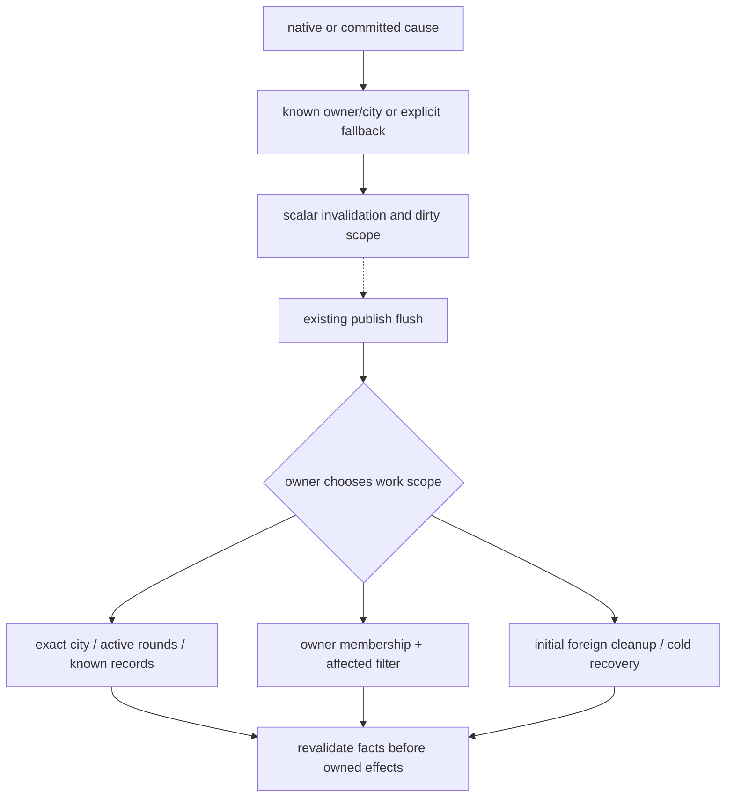

# Scan and deferred-work inventory

Investigation / Non-authoritative / No design decision implied
Status: Stable
Owner: delegated event/scan investigation; writes paused for Primary review.
Basis: develop `19d4669d11df945afcda9d73329dfb984fe8c694`, B393.420; D0058 / A0183 / S0850. **STATIC_CONFIRMED** only.

## Interpretation and coverage

A scan means collection traversal, including in-memory record/dependency traversal; it does not always mean native enumeration. “Periodic” below means a registered turn-boundary path exists, never a measured execution rate. Scope caps are assertions/protocol limits visible at the cited site, not expected game sizes. A callback count, loop count or source line count cannot establish runtime cost. “Potential overlap” identifies two paths that can touch related inputs; it is not a redundant-write or performance finding.

This inventory follows the production owners reached from [Gameplay composition](../../../../../Mod/Gameplay.lua#L813), then their actual helper calls. It covers shared traversal machinery, registration/recovery, the four professions, projects/Crew and route UI/Gameplay transport. The separate Module_Index inventories packaged files; this report does **not** claim every loop in every diagnostic/UI/SQL file was semantically audited. Diagnostic, retired and legacy paths are called out when needed to avoid mistaking them for current hot paths. Event IDs refer to [Event_Chains](Event_Chains.md).

## Shared scope and queue mechanics

| ID / module | Exact callsite and trigger | Actual traversal / scope and caps | Consumer and classification |
|---|---|---|---|
| S01 / M03 | `SPCRuntimeWork.Cities(collection,scope)` [L40](../../../../../Mod/RuntimeWork.lua#L40), called by audit owners | Known city uses FindID; only if unavailable does it enumerate until match. Missing city scope returns Members. | Shared scope adapter; targeted or owner-wide fallback. A city-aware caller is not automatically a full-city scan. |
| S02 / M03 | `SPCRuntimeWork.New(P,shared).Districts(pid,c)` [L15](../../../../../Mod/RuntimeWork.lua#L15) | One owner district enumeration on first use in this batch object, grouped by city; subsequent batch lookups reuse it. No loop cap at this site. | Effect readers; batch index, neither persisted nor shared across arbitrary batches. |
| S03 / M03 | `SPCRuntimeWork.NewAudit(...).audit/mark/flush` [L55](../../../../../Mod/RuntimeWork.lua#L55) | Busy reentry stores scalar owner/city/transfer scopes, total cap 2,048; global/owner dominates city scopes. Publish callback drains a detached snapshot; load clears pending scopes. | Deferred **scope**, not fact/result cache. No timer or automatic UNKNOWN-retry claim. |
| S04 / M03/M05 | `NewTargets(...).Run(scope)` [L312](../../../../../Mod/RuntimeWork.lua#L312), with `Retry` [L265](../../../../../Mod/RuntimeWork.lua#L265) | Retries known pending/exits, then enumerates Players; known city selects lookup, otherwise participant city collections. Transfer considers new/old owners; load permits cleanup outside participants. Target maps cap 2,048 [L222](../../../../../Mod/RuntimeWork.lua#L222). | Lifecycle-safe current-target/exit recovery; owner/unknown scope fallback is intentional. |
| S05 / M03 | `FactChanges.Emit/Flush` [L116](../../../../../Mod/FactChanges.lua#L116), publish drain [Gameplay L824](../../../../../Mod/Gameplay.lua#L824) | Detached owner/city/reference keys, ≤2,048 queue keys; ≤128 registered consumers, ≤32 merged cause/topic names. Flush phase 0/1 callbacks, no native read in this registry. | E05; synchronous generation invalidation, deferred notification. Never count as world scan. |
| S06 / M03 | `FactConsumerBindings.collect/invoke/Flush` [L52](../../../../../Mod/FactConsumerBindings.lua#L52) | Per-consumer owner/city merging, ≤2,048 city IDs per owner row; NetworkBridge sampled once per owner per fact flush [L15](../../../../../Mod/FactConsumerBindings.lua#L15). | E05; dispatch into Audit/Mark/Refresh. Some methods intentionally broaden owner-level source pools. |
| S07 / M03 | `DistrictCompleteness.capture(pid,c)` [L85](../../../../../Mod/DistrictCompleteness.lua#L85), called by read [L182](../../../../../Mod/DistrictCompleteness.lua#L182) | Indexed **selected-city** districts plus cached static building definition list, HasBuilding/location/pillage checks. No fixed n cap at capture; raw/detail LRU eight is separate from business facts [L245](../../../../../Mod/DistrictCompleteness.lua#L245). | D consumers; demand capture after invalidation, not an all-city event scan. Native events mark scopes [L265](../../../../../Mod/DistrictCompleteness.lua#L265). |
| S08 / M03/M06/M09 | `SPCSampleLifecycle.Live(P,pid,industry)` [L17](../../../../../Mod/SampleLifecycle.lua#L17), `Receive` [L35](../../../../../Mod/SampleLifecycle.lua#L35) | Owner districts; validates completeness/identity, retains eligible rows (cap 512). Receive validates all current live rows against the sample and ≤60,000-byte payload/512 declared rows. | ResearchCross/IndustrySupport transport; complete logical sample proof, not arbitrary per-city narrowed transport. |

## Identity, history and load/recovery

| ID / module | Exact callsite and trigger | Actual traversal / scope and caps | Consumer and classification |
|---|---|---|---|
| S09 / M02 | Store `loadIndex(v)` [L1624](../../../../../Mod/CityProgressionStore.lua#L1624), modern startup [L1651](../../../../../Mod/CityProgressionStore.lua#L1651) | Saved index entries and record properties; capacity derives from map width × height [L1654](../../../../../Mod/CityProgressionStore.lua#L1654). `initializeNew` checks participant city collections to reject unsupported existing-city initialization [L1661](../../../../../Mod/CityProgressionStore.lua#L1661). | E01. Startup/history reconstruction, not periodic world search or historical backfill. |
| S10 / M02 | Store `admit(q)` acquisition [L2000](../../../../../Mod/CityProgressionStore.lua#L2000); completion buffering [L2112](../../../../../Mod/CityProgressionStore.lua#L2112) | Current acquired city's indexed districts; pending candidates bounded by map capacity, ≤8 buffered completion rows [L1923](../../../../../Mod/CityProgressionStore.lua#L1923). District family replacement walk ≤32 [L1963](../../../../../Mod/CityProgressionStore.lua#L1963). | E02/E03. Event-triggered fresh admission; scan creates acquisition candidate set, not guessed completion chronology. |
| S11 / M02 | Worker `Handle(name,...)` routed by manager `listen` [L2200](../../../../../Mod/CityProgressionStore.lua#L2200) | Each registered worker receives selected lifecycle callbacks, rejects irrelevant references internally [L1438](../../../../../Mod/CityProgressionStore.lua#L1438). | E03/E10. In-memory registered-record traversal. Event forwarding count does not imply native city scan. |
| S12 / M02 | `recapture(c,current,newOwner,newID,oldOwner)` [L1311](../../../../../Mod/CityProgressionStore.lua#L1311) | Returning owner's districts, filtered to exact city/type. Further district passes are conditional on restructuring DISCARDED or SETTLED. No numeric district cap at these sites. | E03. Rare lifecycle rebinding; possible repeated district traversals within one return; no timing/cost conclusion. |
| S13 / M02 | `ExitConfirmed` [L1251](../../../../../Mod/CityProgressionStore.lua#L1251), `recoverDeferred(cause)` [L1061](../../../../../Mod/CityProgressionStore.lua#L1061) | Registered exit names sorted with NetworkBridge first; ≤3 attempts/name/generation. Recovery visits fixed isolation keys and exact witnesses; load/restore/CityInitialized triggers [L1438](../../../../../Mod/CityProgressionStore.lua#L1438). | E03/E10. Cleanup and durable partial-history recovery; no global periodic repair timer. |
| S14 / M02/M06/M08 | `traditionTick(pid,allowExitRetry)` [L1825](../../../../../Mod/CityProgressionStore.lua#L1825) on activation and load | Registered workers only: TickTradition, TickCommerce, selected held-exit retry. Once-per-call local-owner check before retry. | Recurring turn settlement and load recovery; **no city/district/building enumeration at this dispatcher**. Subrecord rules retain their own boundary guards. |
| S15 / M02 legacy | `CityFlowProbe.resume(pid,city)` [L137](../../../../../Mod/CityFlowProbe.lua#L137), load [L175](../../../../../Mod/CityFlowProbe.lua#L175) | Legacy city traversal and a ≤512 owner-district check for NONE. Load additionally calls Read for cities. **UsesNewAuthority returns before these scans**. | Legacy compatibility/diagnostic scope; do not report as normal modern-store load work. |

## Production effect consumers

The generic adapters in S01–S04 materially affect these rows: a targeted fact wake can use one city, while a native player turn or owner-wide unknown legitimately expands scope. The declarations below describe existing call paths, not an approved consolidation plan.

| ID / module | Exact callsites / triggers | Scope and consumer closure | Classification / overlap boundary |
|---|---|---|---|
| S16 / M05 | ResearchSupport NewTargets [L29](../../../../../Mod/ResearchSupport.lua#L29), NewAudit [L36](../../../../../Mod/ResearchSupport.lua#L36), hooks [L48](../../../../../Mod/ResearchSupport.lua#L48); Lv2Housing [L48](../../../../../Mod/Lv2Housing.lua#L48)/[L90](../../../../../Mod/Lv2Housing.lua#L90); Lv2GPP [L59](../../../../../Mod/Lv2GPP.lua#L59)/[L109](../../../../../Mod/Lv2GPP.lua#L109) | StartReady load cleanup/current participants; activation owner audit; transfer/remove targets; E05 role/D/WORKERS changes per declared consumer. Each owns its carrier/fact eligibility. | Initial/recovery + periodic owner + targeted. Shared facts do not establish a single shared effect writer. |
| S17 / M05 retired | Lv3Support current Start/Audit [L96](../../../../../Mod/Lv3Support.lua#L96); Lv3Effects current options branch [L75](../../../../../Mod/Lv3Effects.lua#L75); Lv4Percent `Audit()` [L23](../../../../../Mod/Lv4Percent.lua#L23); composition options [Gameplay L889](../../../../../Mod/Gameplay.lua#L889) | Lv3Support runs NewTargets only on load and otherwise retries exact pending retirement/exit candidates. Lv3Effects with current `retireCommerce=true` likewise Run(load)/Retry; its broader benefit branch is bypassed. Lv4Percent Audit is a no-op; WithdrawCulture removes exact retired IDs when called by the current Culture owner. | Retirement/recovery only under current composition. Binding declarations and historical branches must not be counted as current periodic benefit scans. |
| S18 / M06 | ResearchInfrastructure NewTargets [L100](../../../../../Mod/ResearchInfrastructure.lua#L100), startup/hooks [L144](../../../../../Mod/ResearchInfrastructure.lua#L144); ResearchCross audit [L102](../../../../../Mod/ResearchCross.lua#L102)/hooks [L151](../../../../../Mod/ResearchCross.lua#L151); ResearchApply audit [L81](../../../../../Mod/ResearchApply.lua#L81)/hooks [L127](../../../../../Mod/ResearchApply.lua#L127); ResearchChair audit [L76](../../../../../Mod/ResearchChair.lua#L76)/hooks [L111](../../../../../Mod/ResearchChair.lua#L111) | Infrastructure uses target machinery; Cross/Apply/Chair enumerate eligible owners then scoped city collections via RuntimeWork.Cities. Cross additionally validates transported samples (S08). | Load + activation + E05 dirty causes; selected-city adaptation does not remove declared owner-wide sampling. |
| S19 / M06 | ResearchTraditionEffects `Flush/healthRun` [L183](../../../../../Mod/ResearchTraditionEffects.lua#L183), ready/turn/publish [L209](../../../../../Mod/ResearchTraditionEffects.lua#L209) | Pending owner flush calls Store.VisitTradition, which visits registered workers [Store L1819](../../../../../Mod/CityProgressionStore.lua#L1819); health can select FindID or visit stored tradition records. | History/role wake + turn mark; record-based ability update, no new world/district scan in this dispatcher. |
| S20 / M07 | CultureAesthetic audit [L145](../../../../../Mod/CultureAesthetic.lua#L145); CultureMeaning ready cleanup [L66](../../../../../Mod/CultureMeaning.lua#L66)/audit [L134](../../../../../Mod/CultureMeaning.lua#L134); CultureInspiration cleanup [L80](../../../../../Mod/CultureInspiration.lua#L80)/audit [L125](../../../../../Mod/CultureInspiration.lua#L125); InsightsTourism cleanup [L101](../../../../../Mod/CultureInsightsTourism.lua#L101)/audit [L113](../../../../../Mod/CultureInsightsTourism.lua#L113) | Meaning one-time initialization scans world city collections (cap 2,048) for legacy-owned cleanup; Inspiration/Insights also distinguish initial cleanup from participant audits. Their ordinary audits respect owner/city scope; GreatWork facts and D are downstream inputs. | Initial cleanup is not evidence of all-world cleanup every turn. Each audit's native building reads/eligibility remain separately owned. |
| S21 / M07/M09 | CultureNetwork Audit initial collection and candidate selection [L294](../../../../../Mod/CultureNetwork.lua#L294); StandardizationEffects Audit [L255](../../../../../Mod/StandardizationEffects.lua#L255) | CultureNetwork initial world traversal clears foreign exact-owned effects and restores participant installed records; changed sources use reverse dependencies/new topology/self, with cold/unavailable-index owner fallback. StandardizationEffects initial world cleanup is separate; normal owner city enumeration still occurs at L281 even when only affected cities reconcile. | Initial/recovery + source-targeted work + turn owner marks. A filtered reconciliation is **not** equivalent to avoiding owner-city enumeration. |
| S22 / M08 | Commerce initialization [L111](../../../../../Mod/Commerce.lua#L111), Audit [L302](../../../../../Mod/Commerce.lua#L302), turn hooks [L496](../../../../../Mod/Commerce.lua#L496); Capital Reconcile hooks [L416](../../../../../Mod/CapitalInvestment.lua#L416); Development initialize [L184](../../../../../Mod/DevelopmentInvestment.lua#L184)/turn [L381](../../../../../Mod/DevelopmentInvestment.lua#L381) | Commerce collects current/known/dependent targets and builds per-audit fact/depth/yield/identity plans before writes. Development initially reads supported owner indexes/cities; later exact pending-city recovery is distinct. Capital/Development reconcile Store records via their own contract machinery. | Initial/recovery + activation + E05 scopes. Shared route/commerce inputs may wake multiple consumers; financial intent/receipt work cannot be inferred redundant from scan overlap. |
| S23 / M09 | Standardization load initialize [L155](../../../../../Mod/Standardization.lua#L155), BuildingAdded recheck [L303](../../../../../Mod/Standardization.lua#L303); IndustryWonderEffects Flush [L83](../../../../../Mod/IndustryWonderEffects.lua#L83)/hooks [L118](../../../../../Mod/IndustryWonderEffects.lua#L118) | Standardization can queue all owner cities when a building-add event does not yield narrower owned evidence; Wonder effects mark owners then enumerate their cities or process known IDs. | Load/event/periodic fallback, not proof every building notification invokes every downstream effect. |

## Projects, UI routes and request-only scans

| ID / module | Exact callsites / triggers | Actual traversal / caps / consumers | Classification |
|---|---|---|---|
| S24 / M10 | Claim load [L175](../../../../../Mod/ClaimProjects.lua#L175), turn [L144](../../../../../Mod/ClaimProjects.lua#L144), `district(c,kind)` [L111](../../../../../Mod/ClaimProjects.lua#L111) | Load marks supported cities; turn iterates rounds.Active rather than all cities. Completion locates candidate district in this city's indexed districts, cap 1,024. | E06. Full initial access reconstruction + active-round boundary work + targeted completion. |
| S25 / M07/M09/M10 | Dialogue `markPlayer` [L26](../../../../../Mod/DialogueProjects.lua#L26), `advance` [L181](../../../../../Mod/DialogueProjects.lua#L181), hooks [L254](../../../../../Mod/DialogueProjects.lua#L254); Engineering [L24](../../../../../Mod/EngineeringStudyProjects.lua#L24)/[L142](../../../../../Mod/EngineeringStudyProjects.lua#L142)/[L200](../../../../../Mod/EngineeringStudyProjects.lua#L200) | Load/access reconstruction enumerates owner cities; ordinary turn advances active rounds. Governor changes inspect tracked rounds plus mark owner access; publish drains dirty sets. | E07. Qualification-only checks and full completion sampling are different operations. Potential overlap in immediate round audit and deferred access audit, not established duplicate reward/effect. |
| S26 / M10 | Crew Inventory [L73](../../../../../Mod/CrewProjects.lua#L73), initialize/Flush [L195](../../../../../Mod/CrewProjects.lua#L195), completion [L265](../../../../../Mod/CrewProjects.lua#L265), hooks [L369](../../../../../Mod/CrewProjects.lua#L369) | Inventory enumerates owner units and validates bound source; Flush batches dirty city audits, completion additionally reads inventory to enforce live cap 2. Governor/bound-unit changes can mark owner cities. | E08. Startup/reconciliation + event-targeted grants; no recurring scan frequency inferred. |
| S27 / M04/M12 | BackgroundRoutes `collect(pid)` [L44](../../../../../Mod/UI/BackgroundRoutes.lua#L44), dirty/flush [L123](../../../../../Mod/UI/BackgroundRoutes.lua#L123), hooks [L203](../../../../../Mod/UI/BackgroundRoutes.lua#L203) | Local participant city outgoing routes, ≤512 cities/4,096 raw rows; before/after outgoing-count consistency. Dirty/retry gates drive scan. Existing publish/playback/SystemUpdateUI callbacks invoke flush, which returns early when clean; retries ≤3 per dirty episode. | E09. Event/turn initial/recovery scan; SystemUpdateUI registration is **not** a full route scan every frame. |
| S28 / M04 | NetworkInput `Capture` [L22](../../../../../Mod/NetworkInput.lua#L22), NetworkBridge `refresh` [L304](../../../../../Mod/NetworkBridge.lua#L304), receive/FlushPending [L430](../../../../../Mod/NetworkBridge.lua#L430) | Owner city membership ≤512 plus all route endpoints; known unchanged fact rows can reuse strict authority/generation/governor witnesses. Sender route limit 128 and payload 16,384 bytes [L35](../../../../../Mod/NetworkSender.lua#L35). | E09/E05. Owner membership traversal remains even during incremental fact reuse; route validation and role capture are different evidence layers. |
| S29 / M04 | NetworkBridge `Verified` [L264](../../../../../Mod/NetworkBridge.lua#L264), `CheckEvidence/Rebuild` [L892](../../../../../Mod/NetworkBridge.lua#L892) | Accepted routes/live endpoints/traders/war; loops bridge player buckets, not every world city. Native route/lifecycle callbacks, current owner activation and capital/city-membership causes reach different checks. | Negative evidence pruning + current proof reconstruction. Possible overlap with UI resampling; no proof either layer is dispensable. |
| S30 / M12 | LevelBannerState `mark/all/Flush` [L8](../../../../../Mod/LevelBannerState.lua#L8), hooks [L40](../../../../../Mod/LevelBannerState.lua#L40) | Owner-wide mark enumerates cities and old views; Flush uses dirty ID FindID + EffectiveFacts, increments revision only on changed signature. Transfer marks all supported owners; load/governor/activation/fact changes mark scopes. | Disposable UI projection; related fact reads overlap effects but have a separate consumer contract. |
| S31 / M10 | UnitTargets request path [Gameplay L612](../../../../../Mod/Gameplay.lua#L612), target enumeration [UnitTargets L24](../../../../../Mod/UnitTargets.lua#L24) | Explicit UNIT_TARGETS_READ request scans districts and supplies city enumeration when target policy needs it. | User/request-only work. Do not classify as periodic automatic world search. |
| S32 / M07 | GreatWorkFacts scope validation [L158](../../../../../Mod/GreatWorkFacts.lua#L158) | Supported owner city membership ≤512 proves sample completeness; candidate coverage is required. | Complete-scope sample validation, distinct from selected-city GreatWork read. |
| S33 / M11 | ExpeditionSpyGate unit collection [L113](../../../../../Mod/ExpeditionSpyGate.lua#L113), city-coordinate fallback [L166](../../../../../Mod/ExpeditionSpyGate.lua#L166), related-unit collection [L394](../../../../../Mod/ExpeditionSpyGate.lua#L394), turn hook [L985](../../../../../Mod/ExpeditionSpyGate.lua#L985) | Bound task endpoints/unit are primary. Pending travel can add owner-unit collection; city search is fallback when narrower resolution is unavailable. | Bounded-task recovery/qualification; source does not support treating every activation as a full task-world scan. Expedition mission internals are not exhaustively audited here. |

## Small scan-routing diagram

The scope branch is decided by the cited owner; the shared diagram does not grant every caller a city-targeted path. Evidence examples are RuntimeWork.Cities (S01), StandardizationEffects' remaining membership enumeration (S21), and BackgroundRoutes' clean-flush early return (S27).

## Potential overlap and unanswered questions

1. **Repeated input paths exist statically.** Native district causes can reach D, Store completion and NetworkBridge; committed identity later reaches Network again. FactBindings limits its own phase-0 sample to once per owner per fact flush, but that does not deduplicate all native refresh entry paths. Whether a given scenario materially repeats native reads needs observation; no deletion/refactor is authorized ([Store constructed](../../../../../Mod/CityProgressionStore.lua#L2102), [D hooks](../../../../../Mod/DistrictCompleteness.lua#L283), [Network native refresh](../../../../../Mod/NetworkBridge.lua#L896), [binding guard](../../../../../Mod/FactConsumerBindings.lua#L15)).
2. **Turn fallbacks remain broad in several owners.** They are actual owner-level audit/mark paths, while some inner operations use changed-source indices or registered-record sets. The report does not assume caches erase all enumeration or that broader fallbacks are bugs (S14, S16–S23, S28).
3. **A future performance claim needs evidence beyond static counts.** This report supplies candidate callsites and scopes only; it ran no timing, profiler, probes, tests or game. Optional native event availability, actual coalescing/reentry, save/load convergence and native effects remain unverified in this task.

## Read Ledger and handoff

Stage A: routing guidance, Workflow role/language/checkpoint clauses, Authority/Status current boundary and topic README. Stage B: Gameplay composition and actual includes/calls → shared RuntimeWork/FactChanges/Bindings → Store/D/native facts → four-profession owners → project rounds/Crew → UI route collection/sender/bridge/capture; bounded Mod-only symbol inventory to locate member traversals and hook registrations. Excluded external mods/HD, game configuration, logs/saves, archives, all probes/tests and all runtime execution.

User decision: none made. User testing: none performed or scheduled. Primary next: review this Stable checkpoint with Event_Chains; carry unresolved overlap questions into comparison work without promoting them to performance findings. Writes are paused for review.
