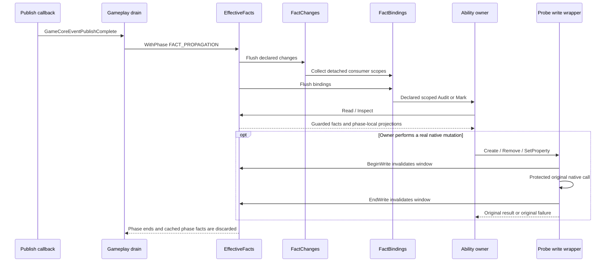

# Shared facts, ownership and lifecycle

Investigation / Non-authoritative / No design decision implied

Status: Stable
Maintainer: Primary. Baseline: develop 19d4669, B393.420; D0058 / A0183. STATIC_CONFIRMED means inspected code, not engine delivery or native acceptance. These diagrams have no independent Architecture authority. Approved Markdown prevails; discrepancies belong in [Comparison and questions](Comparison_and_Questions.md).

## Read this map

A shared table is not necessarily a shared source of truth. This implementation has five different roles: native engine facts, permanent Store records, disposable confirmed projections, invalidation/version metadata, and physical effect configuration. The engine retains native balances/buildings/queues; Store owns Mod history; effect owners interpret facts and own their exact carriers. A UI snapshot, queue acknowledgement or retained effect is not a new-transaction credential.

Module groups M01–M14 are defined in [As-Is](As_Is.md). Event IDs are defined in [Event chains](Event_Chains.md). All source links resolve against this investigation's fixed repository commit; subsequent source changes require rechecking their line numbers.

## Event → fact → consumer matrix

| Fact ID | Origin / update cause | Fact or version owner | Main readers / consumers | Persistence and scope | Invalidation / recovery evidence |
|---|---|---|---|---|---|
| F01 | Native city, district, building, governor, worker, treasury, queue and unit changes | Civilization VI engine; Probe wraps selected reads/mutations, not the native truth | Store admission, qualification, fact owners, transactions and UI collectors | Native save and engine context; getters can fail or reenter | Native signatures and availability must be checked at actual use. [Probe.GovernorGate](../../../../../Mod/Probe.lua#L340), [NetworkInput.Reference](../../../../../Mod/NetworkInput.lua#L7), [NativeFacts.New](../../../../../Mod/NativeFacts.lua#L3) |
| F02 | New-game admission / first qualifying completion / approved action / confirmed loss-return | CityProgressionStore: compact Game index plus per-token Game records; identity binding remains a distinct native check | EffectiveFacts, profession controllers, lifecycle delegates | Permanent: index SPC_PROGRESSION_INDEX_V3; record SPC_PROGRESSION_CITY_V3_<token>. In-memory workers/positions are disposable routing | Exact old value, full validation, current reference, write/readback. Existing-city edits write their record; index changes on admission. [keys](../../../../../Mod/CityProgressionStore.lua#L15), [storage.Write](../../../../../Mod/CityProgressionStore.lua#L1563), [initializeNew](../../../../../Mod/CityProgressionStore.lua#L1661) |
| F03 | Store-validated base + confirmed investment receipts + live governor gate | EffectiveFacts capture; CurrentSpecializationFacts is a facade, not another ledger | Support/effect owners; network role input; training and institution presentation | Derived Potential/ACTIVE; only synchronous WithPhase reuse, no saved ACTIVE | Store FactStamp, owner/id/position/turn, read generation, governor witness; UNKNOWN and pending investment do not become confirmed cached hits. [capture](../../../../../Mod/EffectiveFacts.lua#L78), [phasedRead](../../../../../Mod/EffectiveFacts.lua#L202), [facade](../../../../../Mod/CurrentSpecializationFacts.lua#L3) |
| F04 | Building/district/pillage/transfer events mark dirty; explicit demand reads | DistrictCompleteness + OrdinaryBuildingCatalog: ordinary-building classification and D | Research Apply/Infrastructure/Chair/Cross, common effects, Culture, Commerce; bindings declare actual subscriptions | Session compact per-city cache cap2048; raw/detail LRU8; simultaneous captures cap8. No Property writes | Dirty scope, turn boundary on next demand, reference/token/load epoch and write-generation checks. Failed capture retains value with unavailable status; does not certify it fresh. [cache limits](../../../../../Mod/DistrictCompleteness.lua#L68), [ReadFacts/Read](../../../../../Mod/DistrictCompleteness.lua#L182), [hooks](../../../../../Mod/DistrictCompleteness.lua#L250) |
| F05 | Committed Store changes, D changes, native governor/worker changes and network publications | FactChanges: declared kinds, bounded detached queue, NETWORK/COMMERCE generations | FactConsumerBindings; direct declared consumers such as LevelBanners | Gameplay-session metadata, not fact values; max2048 queued keys,128 consumers | InvalidateCommitted is synchronous; deferred Flush uses stable phases. Subsequent/reentrant causes remain queued except the declared phase0 Bridge-derived NETWORK edge. [generations](../../../../../Mod/FactChanges.lua#L56), [Emit](../../../../../Mod/FactChanges.lua#L116), [Flush](../../../../../Mod/FactChanges.lua#L182) |
| F06 | Current UI route collection and related route/role signals | BackgroundRoutes session snapshot → NetworkSender transport → NetworkBridge validated topology + NetworkInput role facts | CultureNetwork, StandardizationEffects, Commerce; transaction readers demand separate proof. NetworkBoost retains retired cleanup/compatibility only | UI and Gameplay epochs/sequence/revisions; player-scoped session route/input/derived state | Current turn/signal/reference and proof generation; ACK alone is not VERIFIED. Source provenance CONFIRMED/RETAINED/UNKNOWN remains explicit. [sender](../../../../../Mod/NetworkSender.lua#L9), [capture](../../../../../Mod/NetworkInput.lua#L22), [TransactionCurrent](../../../../../Mod/NetworkBridge.lua#L20) |
| F07 | UI great-work sample, catalog interpretation, changed city input / load epoch | GreatWorkFacts maintains per-city current confirmed collection and domestic era index | CultureAesthetic/Meaning/Inspiration and Dialogue project-related readers; legacy interpretation is independently gated | Session epoch/ACK/revision; no permanent achievements are inferred from it | Validate full current scope and references; retain old same-reference data as unavailable when necessary; changed inputs schedule declared consumers. [Collector](../../../../../Mod/GreatWorkFacts.lua#L31), [receive](../../../../../Mod/GreatWorkFacts.lua#L132), [notify](../../../../../Mod/GreatWorkFacts.lua#L198), [Read/Domestic](../../../../../Mod/GreatWorkFacts.lua#L282) |
| F08 | Ability-specific transactions, full-turn completion, reliable age boundary, confirmed historical event | Profession models define meaning; Store is the permanent writer | ResearchTraditionEffects, DialogueEffects, Engineering/Standardization, Commerce/Capital/Development and Culture insights projections | Per-city subrecords, known flags, receipts and history; profession-specific lifecycle | Fixed validators and explicit known-metadata repairs; CHECK_FAILED is not proof of permanent corruption. [owner definitions](../../../../../Mod/StoreSubrecords.lua#L7), [CheckOne](../../../../../Mod/StoreSubrecords.lua#L113), [KnownCandidate](../../../../../Mod/StoreSubrecords.lua#L143) |
| F09 | Confirmed loss/return while an ability's payload cannot safely be transformed | Store-owned deferredLifecycle; pure StoreDeferredLifecycle / StoreLifecycleRecovery delegates | Exact affected ability recovery; postcommit HISTORY consumers | Saved bounded optional witness, nine fixed ability keys; preserves opaque payload | Parent/token/owner/episode witness, original business transition, one confirmed save plus evidence clear. Restore/load/related CityInitialized trigger recovery; no payment replay. [keys](../../../../../Mod/StoreDeferredLifecycle.lua#L6), [Plan](../../../../../Mod/StoreLifecycleRecovery.lua#L7), [recoverDeferred](../../../../../Mod/CityProgressionStore.lua#L1061) |
| F10 | Approved durable source-attribution responsibility; production integration incomplete | NetworkRecoveryModel/Cell/Store adapter exists; actual Commerce/Culture production adoption remains open | Explicit callers only; no automatic consumer wired by the adapter itself | Explicit derived Game Property adapter outside permanent history; no automatic consumer use yet; not route authority or quote proof | Family/reference/lifecycle validation, invalidation/ticket/CAS/readback mechanics. Do not infer active cold recovery from packaged code. [Open](../../../../../Mod/NetworkRecoveryStore.lua#L15), [To-Be](To_Be.md) |
| F11 | Confirmed eligible facts interpreted by each ability | Effect owner owns the desired plan, exact physical carriers and exit registration; CarrierSet supplies mechanics | Native SQL modifiers; UI may read owner-published applied values | Engine building/plot configuration plus disposable per-owner views; not permanent history | Fresh physical preflight/readback, exact removal, policy-specific pillage/qualification. [CarrierSet.Observe/Apply](../../../../../Mod/CarrierSet.lua#L33), [ApplyLocated](../../../../../Mod/CarrierSet.lua#L84), [Commerce apply](../../../../../Mod/Commerce.lua#L79) |
| F12 | UI selection, explicit panel request, runtime UI revision and derived owner publication | Gameplay publishes presentation/replies; UI owns selection, token, pending request and visual state | Institutions, city banners and investment/project panels | Session only; selected-city identity plus reply channel/backend/epoch/token | Reject stale backend/channel/identity; raw accepted request is not committed business result. [request ingress](../../../../../Mod/Gameplay.lua#L36), [CityPotential consume](../../../../../Mod/UI/CityPotential.lua#L90), [banner projection](../../../../../Mod/LevelBannerState.lua#L22) |
| F13 | Observational counters, readiness, memory/trace callbacks | PerformanceCounters / ReadinessSummary / trace modules own diagnostics only | User and offline collector, bounded reports | Session diagnostic buffers/counters; archived logs are evidence, not saved authority | Passive failures must not replace original authority results. Startup composition complete is distinct from module/business readiness. [protected read observation](../../../../../Mod/EffectiveFacts.lua#L247), [composition completion](../../../../../Mod/Gameplay.lua#L1018) |

## Declared changes and actual consumers

This table reads the actual declaration list; it is not a proposed universal bus. Provider-specific RegisterConsumer calls still feed FactChanges. Direct native callbacks in ability owners remain and are catalogued separately in [Scan inventory](Scan_Inventory.md).

| Kind / topic | Primary producer | Representative binding targets | Scope and ordering |
|---|---|---|---|
| IDENTITY / POTENTIAL / ACTIVE | Store publishFact; NativeFacts governor marks | RestructuringSync, NetworkBridge; support/GPP/common levels; Research/Culture effects; Dialogue access; Capital | Phase0 own-state sync before one Bridge refresh per owner/flush, then phase1 consumer collection |
| D | DistrictCompleteness.MarkDirty | Common effects, Research owners, Aesthetic/Meaning/Inspiration, CultureNetwork; IndustrySupport only admitted city/owner causes | Per-city when known; owner/global fallback when native signature cannot prove city |
| WORKERS | NativeFacts native/UI worker causes | Lv2GPP, Lv3Effects, Lv4Percent, ResearchInfrastructure/Apply/Chair, Commerce | Detached dirty notification; facts sampled only by actual consumers |
| NETWORK | NetworkBridge publication / derived notification | Lv3Effects, StandardizationEffects, CultureNetwork, Commerce, Capital, Development | Reliable topology and source provenance are distinct; new irreversible actions retain proof gates |
| HISTORY:TRADITION / DIALOGUE / INSIGHTS | Confirmed Store-owned subrecord changes | Tradition Mark / DialogueEffects / CultureInsightsTourism and CultureNetwork | Topics limit unrelated HISTORIES; these are not persisted event streams |
| HISTORY:TEMPLATES / ENGINEERING / WONDER_CREDIT | Confirmed history commits / Industry history | StandardizationEffects / EngineeringStudy.CreditChanged | Own policy and current eligibility remain independent of the shared transport |

A declaration does not prove an active benefit writer: current Lv3Support/Lv3Effects options select retirement/retry paths, and Lv4Percent.Audit is a compatibility no-op. See S17 and E05 for the actual branches.

Source: [FactConsumerBindings declarations](../../../../../Mod/FactConsumerBindings.lua#L11) and [collection/invocation](../../../../../Mod/FactConsumerBindings.lua#L57); [NativeFacts hooks](../../../../../Mod/NativeFacts.lua#L34); [Store publication](../../../../../Mod/CityProgressionStore.lua#L16). This is a representative consumer matrix, not every direct callback in the package.

## One safe read phase and a real write

The exact local ordering is [Gameplay drain](../../../../../Mod/Gameplay.lua#L824); write fences are [Probe.factWrite](../../../../../Mod/Probe.lua#L558) and [EffectiveFacts.BeginWrite/EndWrite](../../../../../Mod/EffectiveFacts.lua#L21). This diagram shows synchronous calls in one handler, not an engine-wide ordering guarantee. A write may apply then throw; the wrapper invalidates on both boundaries before rethrowing. It increments the public UI revision only after the protected call returns successfully. Other mutation types and module-private native calls are not automatically covered merely because this wrapper exists.

## Reuse, retention and remaining duplication

- EffectiveFacts shares base and raw anchor/worker samples only within a declared synchronous phase, with current Store and generation witnesses. CurrentSpecializationFacts adapts those results; it does not add another persistent cache. [WithPhase](../../../../../Mod/EffectiveFacts.lua#L30), [workers/anchor](../../../../../Mod/EffectiveFacts.lua#L142).
- DistrictCompleteness owns a longer-lived compact D cache, separate from eight retained diagnostic reports. Its first demand in a new game turn can recapture even without a delivered dirty event. That is demand-time reconciliation, not proof of a timer-driven scan. [read condition](../../../../../Mod/DistrictCompleteness.lua#L204).
- Great-work collection builds both new raw slot rows and legacy interpretation input from one native slot walk. Those interpretations and consumers remain distinct; shared input does not mean shared gameplay policy. [Collector](../../../../../Mod/GreatWorkFacts.lua#L30).
- NetworkInput samples the supported owner's city membership and role facts. Epoch/Store-witness reuse may avoid some role recaptures, but does not erase the enumeration. Consumers also need their own D, workers and native source yields. [Capture](../../../../../Mod/NetworkInput.lua#L22), [Commerce.prepare/sourceYield](../../../../../Mod/Commerce.lua#L136).
- LevelBannerState has its own governor/player-turn dirty hooks as well as declared role consumers. This is a concrete overlapping update surface, not proof of redundant execution or a bug: its dirty set and signature suppress some work. [hooks](../../../../../Mod/LevelBannerState.lua#L40).
- Scalar version names are not interchangeable: Store revision, EffectiveFacts generation, FactChanges domain generation, network input/proof revision, GreatWork epoch/ACK, UI revision and contract quote revision have different validity windows. No universal version currently proves all inputs current.

## Recovery and ownership boundaries

The Store's permanent record and valid ability history can survive loss, while current eligibility and native carriers withdraw through registered owner-specific exits. A new native city reference is not obtained by copying an old identifier. Deferred recovery preserves unresolved ability bytes and applies only the original transition when its witness and dependencies recover. No fact cache or successful UI report grants native receipt replay.

Network cold-load source recovery is the clearest unfinished separation: approved A0183 allows derived attribution evidence, and adapter mechanics exist, but normal Commerce/Culture writers do not yet automatically use them. By contrast, deferred lifecycle evidence is already included by Store and recoverDeferred is invoked at restore/load/related initialization. These two approved extensions must not be described as equally integrated. [Store includes](../../../../../Mod/CityProgressionStore.lua#L11), [recovery entry](../../../../../Mod/CityProgressionStore.lua#L1061), [adapter](../../../../../Mod/NetworkRecoveryStore.lua#L1).

## Evidence and coverage

Read Ledger: Stage A authority/current status and user scope; Stage B Store keys/write/recovery sections, full FactChanges/Bindings/NativeFacts and EffectiveFacts read/projection sections, D cache/capture/hooks, GreatWork collection/publication, NetworkInput role sampling, sender/Bridge transaction fence, CarrierSet and current banner/presentation paths. No external engine/mod source or live game was inspected; native event delivery/frequency, numerical effect correctness and every ability-specific mutation remain outside this static proof. No tests were executed and no new instrumentation was added.

User decision: no new architecture rule proposed. User testing: existing test table remains user-owned; this report adds no immediate test request. Primary next: reconcile the matrix with the module/event/target reports; retain native ambiguities in the question list.
