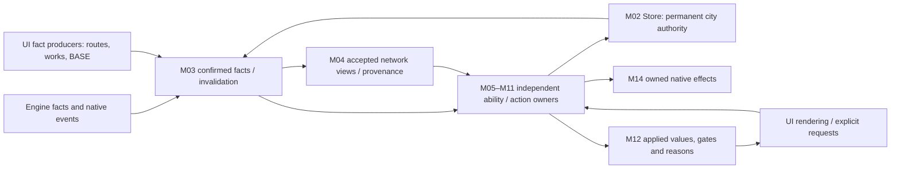
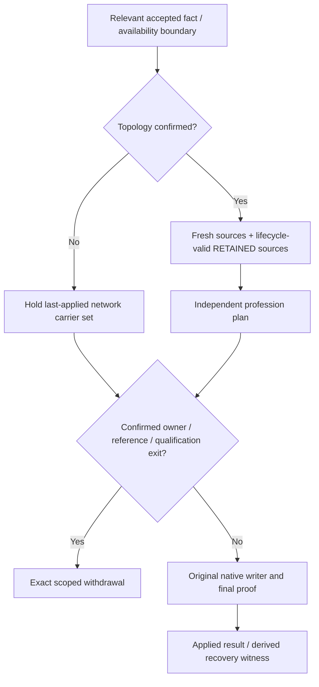

# To-Be: architecture after the accepted refactor

Investigation / Non-authoritative / No design decision implied
Status: Stable
Maintainer: delegated Architecture Reconstruction investigator; this file only
Basis: develop `19d4669d11df945afcda9d73329dfb984fe8c694`; B393.420 / D0058 / A0183 / S0850. Tracked working tree was clean when inspected.
Evidence: STATIC_CONFIRMED document/source reconstruction. No tests, probes, game execution, deployment or native acceptance performed.

## Reading contract and approval provenance

This document reconstructs the expected result of **already accepted** architecture/refactor decisions, including requirements whose implementation remains incomplete. It does not wait for code to exist before describing an approved responsibility. It also does not turn a historical plan, Advisor recommendation or a convenient implementation pattern into an approved target. **Approved Architecture Markdown remains the final architecture authority.** Every diagram and table here is investigation evidence only; if it conflicts with approved Markdown, retain the conflict for user review rather than choosing a resolution.

Paths and line numbers below refer to the fixed baseline. `A` means [Architecture A0183](../../../../Architecture/Specialization_v0.1_Architecture.md); `U` means [accepted U1](../../../Proposals/Refactor_Program_U1.md); `R` means [approved recovery-evidence scope](../../../Proposals/Refactor_Recovery_Persistence_Proposal.md); `I` means the [existing intake](../../../Proposals/Audit_Followup_Priorities.md); `S` means [Status S0850](../../../../Status/Specialization_P0_Status.md). The T01–T24 IDs are local navigation labels, **not** the Workflow T01–T08 validation gates, a new authority registry, or a new schedule. M01–M14 are the shared investigation groups, not proposed new runtime modules.

| Accepted provenance | Exact anchor / lines | What may be reconstructed | What it does not prove |
|---|---|---|---|
| U1 explicitly accepted, 2026-10-24 | U §Accepted U1, lines 8–26; §Execution, 28–34 | D-1…D-15, authorized S2–S10 dependency sequence and engineering checkpoints | Acceptance of every Advisor input; runtime/native completion |
| Formal architecture integration contract | A §Runtime integration contract — P01–P10, lines 160–177; §U1 refactor fault and mechanism boundaries, 634–646 | Owners, scoped causality, invalidation, recovery, read/write consistency, retirement and proof | Blanket compliance of current code or an unrelated platform rewrite |
| Both minimal saved-evidence extensions approved, 2026-10-25 | A §Recovery evidence persistence, lines 16–22; R lines 3–5, 29–38, 48–56, 82–84 | Derived Commerce/Culture attribution and deferred opaque-ability lifecycle witnesses | New gameplay, arbitrary migration, replay or generic exactly-once semantics |
| Existing current profession contracts | A lines 27–51 and their linked scoped Architecture pages | Four-profession responsibilities and their independent lifecycle/transaction boundaries | Inclusion of future professions or elimination of deferred technical limits |
| Presentation principle USER_CONFIRMED | [Presentation model](../../../../Architecture/v2/Presentation_Institution_Carrier_Model.md) §1, lines 18–32; A lines 156–158 | Presentation-only institutions and separated ability/carrier state | Authority of its old D0025 ability mapping or its old NOT_STARTED header |
| Current implementation/evidence boundary | S §CURRENT, lines 11–19; S0846, lines 36–38 | Remaining S9/S10/U5, scoped base recovery and unresolved commercial facts | Full ability/visual/native acceptance |

[Authority](../../../../Workflow/Authority.json) routes to D0058/A0183/S0850; it identifies versions and scope rather than approving new semantics. No Advisor originals were ingested for this reconstruction. Current Design reading pages are derivative navigators; Spec/Content acceptance is governed by [Design README](../../../../Design/README.md), lines 68–72. No Design JSON was needed to infer additional architecture.

## Expected system and ownership

The accepted result retains Gameplay, UI and native SQL effects, with existing named owners and explicit public projections. It does not require a new universal state engine, transaction framework, event bus, city-key migration or one file per service. Proposed historical service names describe responsibilities only: [D0032 adaptation](../../../../Architecture/v2/D0032_Adaptation.md) §Canonical state model, lines 23–38, read with A lines 27–41 and current Store contracts. The arrows below express responsibility/data flow, not startup ordering or an exhaustive caller graph.

Diagram evidence: T01–T08 and T15–T23 below. `Owners → Store` denotes guarded commits through Store, not direct arbitrary persistence; native Treasury/unit/project operations retain their own owners and irreversible receipts.

| ID / groups | Approved target requirement | Evidence anchor and lines |
|---|---|---|
| T01 · M01 | Preserve existing startup order. Model FAILED and SKIPPED_DEPENDENCY honestly; dependent failures never become readiness success. Isolate post-commit observer failure from committed transactions. Readiness is initialization evidence, not effect PASS. | U D-3, line 16; A §U1 boundaries, line 636; §B267 boundary, 55–59 |
| T02 · M02 | Store is the only permanent city-history commit authority. Preserve strict envelope, identity/reference, exact old-value comparison, write lock, setter/readback and isolated returned copies. Unknown/old history is not reconstructed from current buildings, UI, units or carriers. | A §Facts/save, lines 82–90; §Store writes, 116–124; §Recovery evidence, 18–22 |
| T03 · M02/M03 | Separate current Identity, permanent Potential/history, derived ACTIVE and current native facts. REALLOCATING is an explicit transaction state; optimistic in-flight candidates must not escape as confirmed facts. Profession histories and contracts retain independent policies. | A lines 84–90, 51; [Commerce](../../../../Architecture/v2/Commerce_Preparation.md) §B247 implementation, lines 289–299 |
| T04 · M03 | One owner per fact: DistrictCompleteness owns D; ordinary catalog and domain normalization are reused without ontology unification. Normal consumers use compact confirmed facts; details are on demand and copied separately. Shared anchor/worker/BASE sampling retains each ability's eligibility/pillage policy. | A §Shared D, lines 108–114; P01/P07, 166/172; U D-8/D-9, line 21; [Adaptation](../../../../Architecture/v2/D0032_Adaptation.md) §Shared facts, lines 60–73, subject to current scoped overrides |
| T05 · M03/M04 | Preserve cause, owner, exact city/reference and fact domain through producers and consumers. Ignore proved irrelevant work before deep reads. Coalesce redundant recomputation without losing same-turn changes, ordered transitions, foreign former-holder exits or conservative UNKNOWN fallback. | A P02/P03, lines 167–168; §Public update, 183–189 |
| T06 · M03/M05 | Default sharing is one synchronous Audit with independent return copies and no retained native objects. Wider reuse needs reference/epoch, value and availability versions, explicit invalidation and post-write freshness. A carrier write or relevant same-turn mutation crosses the read barrier; partial/UNKNOWN reads cannot become cached successes. | A P07, line 172; §Public update, 185–187; U D-15, line 26 |
| T07 · M04 | Reuse the accepted background UI route source and verified Gameplay bridge; no new pure-Gameplay complete-route prerequisite. Keep topology separate from professional payloads and from permanent progress/transaction credentials. | A §Network/cross-context, lines 130–136; [Commerce](../../../../Architecture/v2/Commerce_Preparation.md) §O, lines 65–75 |
| T08 · M03/M04/M05 | Every pending/cache/session has an owner, reference/generation, size/work/attempt bounds, meaningful wake causes and load/exit disposal. Publish may drain eligible pending work; it cannot produce endless retries. Availability recovery must notify even when the logical value/version is unchanged. | A P05/P06, lines 170–171; §Public update, 187; §Network waiting, 146–148 |

## Network continuity and recovery

Diagram evidence: A §Network pending hold, lines 138–148 and §Recovery evidence, 18–22; T09–T12. This is not the native write algorithm. Capital/Development transactions do not enter through the carrier-hold branch.

| ID / groups | Approved target requirement | Evidence anchor and lines |
|---|---|---|
| T09 · M04/M05/M07–M09 | D-1: pending topology preserves each active writer's last-applied set without create/remove/reconfigure. Standardization's physically inseparable local/network set holds together. Confirmed eligibility/owner/reference exits take priority; no carrying effects into a new owner/reference. | U D-1, line 14; A §Network waiting, lines 140–144 |
| T10 · M04/M07/M08 | D-2: after topology confirmation, update reliable siblings and retain only valid prior attributable source contributions. Never-known sources contribute nothing; retained/UNKNOWN are not globally fresh transaction proof. Confirmed identifiable exits remove their contribution. Standardization cold exception A alone may temporarily retain a lost-source contribution in its reviewed inseparable aggregate under an eligible same receiver. | U D-2, line 15; A lines 145–147; A §Recovery evidence, 18 |
| T11 · M04 | Commerce/Culture cold recovery uses bounded detached attribution bound to source/receiver lifecycle and confirmed applied-carrier provenance, outside permanent achievement authority. Version/shape/size/reference validation and both metadata/carrier failure directions must be proved. Pending candidates, aggregate inversion and UNKNOWN cannot manufacture APPLIED evidence. | A lines 18–22; R §Recommended extension, lines 29–38; §Implementation intake, 91–107 |
| T12 · M02 | Deferred lifecycle witnesses preserve exact opaque ability bytes and only the necessary fixed per-ability confirmed episode. On reliable load/related availability, execute the original ability-specific transform once, with parent/CAS/readback protection and evidence clear in the same confirmed commit. This never proves a payment or native completion. | A lines 19–22; R §Second extension, lines 48–56 |
| T13 · M02/M06–M11 | D-7: protect base authority, isolate only the affected ability, try deterministic reliable reconstruction first. A lawful initial baseline requires supported identity/schema plus proved permanent irrecoverability and absence of other recovery evidence. One exception, unknown getter, elapsed time or retry count is insufficient. Uncertain native/money receipts cannot be erased. Permanent HELD/player repair is not the normal finished recovery outcome. | U D-7, line 20; A line 640; R §Per-ability intake, lines 58–74 |
| T14 · M06/M08 | D-6: no age/benefit credit for unprovable intervals; resume from reliable boundaries. Unknown Reputation contributes no bonus while preserving otherwise valid Commercialization. Persistent normal-play UNKNOWN_INTERVAL requires root-cause investigation rather than becoming accepted ordinary behavior. | U D-6, line 19; A line 639 |

The approved target fixes recovery purpose, ownership, bounded validated provenance and write/readback/failure protections (A lines 18–22). R lines 91–107 record subsequent implementation intake: line 93 explicitly leaves the exact native adapter/key to a later implementation step; line 95 records the tombstone/single-use-ticket/CAS mechanism. The current key is concrete implementation evidence in [NetworkRecoveryStore](../../../../../Mod/NetworkRecoveryStore.lua) `Key`, lines 9–13, and the codec/bounds are implementation evidence in [NetworkRecoveryModel](../../../../../Mod/NetworkRecoveryModel.lua) lines 1–29. These exact names, wire choices and mechanisms are not promoted here into immutable user-approved target mandates. They neither enlarge permanent Store authority nor bypass existing setter barriers. Commerce per-domain mixed provenance and Culture whole-source civilization sets remain distinct (R lines 103–107); the approved recovery responsibility stands even where complete consumer integration is absent.

## Expected event-chain counterparts

This table pairs the actual [E01–E10 atlas](Event_Chains.md) with already approved expected responsibilities. It is nonauthoritative investigation evidence, not a proposed dispatcher, event API or new ordering guarantee. Each row follows trigger → reliable facts/state → effect/action → recovery. Exact current callbacks belong to the actual atlas; an approved responsibility does not approve every present callback or fix an unspecified future implementation.

| Actual atlas chain | Approved expected chain | Target / approved source | Detail not fixed or not proved here |
|---|---|---|---|
| [E01 — Startup and cold reconstruction](Event_Chains.md#e01--startup-and-cold-reconstruction) | Startup keeps existing composition order and honest failure/dependency states → restore validated Store history → derive reliable current facts → surviving owners reconcile their effects. Reliable existing load/related availability boundaries may discharge deferred lifecycle duties; cold network attribution must satisfy its own applied/lifecycle proof. | T01–T03, T08, T11–T13; A §U1 boundaries, line 636; §Recovery evidence, 18–22; §Facts/save, 82–90 | No new startup framework or universal load callback order. Actual Commerce/Culture cold composition remains incomplete. |
| [E02 — Founding, fresh registration, first completion](Event_Chains.md#e02--founding-fresh-registration-first-completion) | Supported founding/first-completion evidence → exact city identity/admission checks → Store alone commits permanent Identity/Potential/history → publish confirmed facts → qualified owners derive effects. Uncertain identity/save outcomes preserve protection rather than infer history from current districts. | T02–T03, T05–T06; A §Facts/save, 82–90; §Store writes, 116–124; P02/P03/P07, 167–172 | No new founding hook or engine-wide callback order selected. Historical generic cityKey/migration is not mandated by this row. |
| [E03 — First acquisition, owner loss, conquest and recapture](Event_Chains.md#e03--first-acquisition-owner-loss-conquest-and-recapture) | Confirmed exact-reference ownership transition → preserve permanent history and apply each existing ability/contract lifecycle policy → withdraw owned temporary effects at confirmed exits → same-city return derives current qualification/network anew. Opaque affected abilities preserve bytes plus bounded deferred witness; reliable recovery commits the original transform and witness clear together. | T02–T03, T09–T14, T17–T20; A §Facts/save, 90; §Recovery evidence, 19–22; §Network waiting, 143–147; Commerce §B247, 293–297 | No generalized conquest/Legacy policy, missing historical episode or new unit-owner-extinction rule. Any normative ownership conflict remains user-owned. |
| [E04 — District/building, worker, governor and qualification changes](Event_Chains.md#e04--districtbuilding-worker-governor-and-qualification-changes) | Relevant native/current-fact change → invalidate the exact owner/city/domain → reuse shared compact D/anchor/worker/BASE facts under valid read barriers → independent owners recompute or withdraw only their affected configuration. Same-turn changes and availability recovery remain observable. | T04–T06, T08, T15–T18; A §Shared D, 108–114; P01–P03/P07, 166–172; §Public update, 183–189 | Sampling reuse does not choose one pillage/qualification policy. No new event signature, global debounce or cross-mutation cached success is approved here. |
| [E05 — Deferred fact propagation and effect consumers](Event_Chains.md#e05--deferred-fact-propagation-and-effect-consumers) | Declared committed change → invalidate before affected delivery → coalesce redundant dependent work while preserving ordered transactions → owner performs fresh guarded planning/native application → publish applied result. Real writes invalidate read reuse; failed/UNKNOWN siblings retain their own meaningful recovery causes. | T05–T06, T08, T21, T24; A P02/P03/P06/P07/P10, 167–175; §Public update, 185–187 | No master event bus or claim that all current callers are fenced. Concrete FactChanges phases/adapter ranks are implementation facts unless separately fixed by a scoped contract. |
| [E06 — Claim project](Event_Chains.md#e06--claim-project) | Existing explicit Claim entry and its reliable related queue/qualification evidence → independent Claim policy/timer state → only proved eligible completion commits the Claim result → publish confirmed Identity/current facts. Known other project, known empty and UNKNOWN remain distinct; blocked work wakes only on verified related facts/availability or necessary initialization. | T02–T03, T19; U D-4, line 17; A §U1 boundaries, line 637; §Facts/save, 84–90 | No new completion API, polling fallback, refund or cancellation rule. A missing reliable recovery trigger is a scoped gap, not permission to sweep cities each turn. |
| [E07 — Dialogue and Engineering timed projects](Event_Chains.md#e07--dialogue-and-engineering-timed-projects) | Existing explicit project entry → separately validate each profession's current qualification, full-turn/queue evidence and original quota/credit → its own guarded completion and Store history commit → its own cumulative/current effect owner. UNKNOWN or ambiguous CALLING never authorizes completion replay; related proven facts alone recover pending work. | T12–T13, T16, T18–T19; A §Dialogue, 102–106; §U1 boundaries, 637/640; Industry §B235, 127–130 | Shared technical timing does not merge reward, sample, cancellation or quota policy. No missing completion receipt is synthesized; older completion-status prose discrepancy remains flagged below. |
| [E08 — Crew project completion and use](Event_Chains.md#e08--crew-project-completion-and-use) | Admitted project plus uniquely attributable completion/unit/source proof → bind immutable source and locked capacity once → actual legal Wonder target is revalidated → original native one-use consumption/progress path → exact receipt/slot release once. New attributable proof, rather than counter/time alone, resolves HELD/CALLING. | T20; U D-5, line 18; A §Crew, 98–100; §U1 boundaries, 638; Industry §J2, 282–290 | No inferred grant from counter/appearance, guessed source, blind consume replay or new target class. Native delivery and multi-city attribution remain separately unproved here. |
| [E09 — UI, Gameplay and route bridge](Event_Chains.md#e09--ui-gameplay-and-route-bridge) | Existing UI route/current-fact producer or explicit user request → Gameplay validates scope/reference/epoch and independent transaction proof → accepted bridge publishes topology/provenance → professional owners apply independent payloads → UI renders owner-published applied values/gates/reasons. Pending topology holds last-applied carriers; fresh/retained sources remain distinct after topology confirmation. | T07–T11, T17, T21–T22; A §Network, 130–148; §U1 boundaries, 642; U D-10/D-11, line 22 | No new route collector, universal reply framework or automatic transaction authorization from an ACK/UI view. Exact applied DTO/request-channel integration remains partially open. |
| [E10 — Turn boundaries, invalidation and recovery closure](Event_Chains.md#e10--turn-boundaries-invalidation-and-recovery-closure) | Existing necessary turn/related availability boundary → reliable age/maturity/current-fact reconciliation under each owner's policy → skip unprovable intervals, resume from reliable facts → apply only eligible pending work and dispose successful/invalidated/expired session state. Confirmed exits remain prior to carrier continuity; uncertain irreversible outcomes never replay. | T08–T14, T19, T24; A P05/P06, 170–171; §Public update, 185–189; §U1 boundaries, 637–640; U D-6, line 19 | No generic per-turn world sweep, time-only project recovery, retry budget as corruption proof, or universal timer rule. Engine ordering and full U5 convergence remain separate evidence questions. |

Here “Commerce §…” and “Industry §…” refer to the current scoped [Commerce preparation](../../../../Architecture/v2/Commerce_Preparation.md) and [Industry preparation](../../../../Architecture/v2/Industry_Preparation.md) contracts cited in T17–T20. These counterparts preserve approved responsibility boundaries; they do not select new module boundaries or resolve discrepancies between approved Markdown sources.

## Four-profession responsibilities and irreversible boundaries

Baseline support/housing/GPP and exact carrier exits remain independently owned M05 responsibilities; common infrastructure does not unify payload formulas. A §Runtime entries, lines 73–80; §Network, 134–136; P01, 166. The following requirements describe expected ownership after refactor, retaining accepted gameplay and existing deferred limits.

| ID / groups | Profession target / distinct responsibilities | Irreversible or authority boundary | Approved Architecture evidence |
|---|---|---|---|
| T15 · M06 | Research shares confirmed D/catalog/BASE facts, while Cross, Apply, Chair, Infrastructure and Tradition retain separate plans/writers. Cross floors once after six-yield/nine-domain aggregate; Apply floors each specialist coefficient after same-yield aggregation; Chair projects per eligible ordinary Campus building. Shared sampling cannot merge those formulas. | Tradition age is Store-owned; effects are derived from reliable age plus current qualification. Lost intervals gain no credit. Existing user-approved precision exceptions remain scoped; no general floor rule. New Research network remains outside v0.1, and retired output must not revive. | [Cross](../../../../Architecture/v2/P0_D1_Research_Cross_Cutover.md) §Rule/modules, lines 8–24; [Apply](../../../../Architecture/v2/P0_D2_Research_Apply.md) §§Calculation/writer, 8–27; [Chair](../../../../Architecture/v2/P0_D3_Research_Chair.md) §§Result/authority, 10–27; A lines 43, 136; D-6/D-8/D-9 |
| T16 · M07/M11 | Culture separates Great Work facts/catalog, Aesthetic, Meaning, Inspiration, Dialogue and Expedition/Insight history/network projection. Current-era facts, cumulative successful Dialogue history and observed-civilization sets are distinct. One source's three-category completion forms its own civilization set before network union. | Dialogue full-turn attempt/quota/history is Store-owned; CALLING and ambiguous completion never replay or resample after load. Mission history is not inferred from carrier totals or current unit presence. HOLD features and accepted Tourism-only Dialogue fallback remain explicit rather than silently added to this refactor. | A §Dialogue, lines 102–106; lines 45–49; [Culture preparation](../../../../Architecture/v2/Culture_Preparation.md) §§Module table/shared inputs, lines 19–39; A lines 136, 637, 645 |
| T17 · M08 | Commerce separates Store-owned domain selection/activation order and Reputation from current Commercialization effects, Capital contracts, Development contracts and restructuring. Direct either-direction matching-Identity partners, direct-outgoing Development signing and center-based Capital S remain three distinct route relations. | Treasury owns balances. Capital keeps private outcome/n; INTENT/CALLING precedes native money call, exact immediate evidence gates ACTIVE/SETTLED, unresolved calls never replay. Accepted <=0.01 Gold per call records actual receipts without compensation. Development explicit quotes/confirm revalidate prices and refs; signed terms follow their own lifecycle rather than new route prerequisites. | [Commerce preparation](../../../../Architecture/v2/Commerce_Preparation.md) §§O/P, lines 65–90; §B241, 211–217; §B245, 241–245; §B246, 247–255; A lines 34–38, 147 |
| T18 · M09/M10 | Industry separates Store-owned typed learned knowledge, city Wonder N, civilization completion E, Engineering L/receipts, current per-template MAX plan and current Wonder-production projection. Received templates are ephemeral usable knowledge, never re-exported as learned history. | Existing possession cannot invent completing-civilization E or unseen history. Engineering full-turn/native completion keeps its own receipt/no-replay policy. Target-specific District purchase remains explicitly deferred; broad all-District substitute is not approved. | A §§Industry history, lines 92–96; [Industry preparation](../../../../Architecture/v2/Industry_Preparation.md) §B233, 77–85; §B234, 100–108; §B235, 125–131 |
| T19 · M10 | Claim, Dialogue and Engineering Study share repeated technical timing/read mechanisms while keeping independent business policy. Distinguish CONFIRMED_OTHER, CONFIRMED_EMPTY and UNKNOWN. Only related verified facts/events/availability or necessary initialization may recover blocked work. | Unknown is neither cancellation nor completion. No polling, all-city turn sweep, irrelevant-event retry or elapsed-time-only recovery. Missing reliable native trigger remains a scoped architecture gap. | U D-4, line 17; A line 637 |
| T20 · M10 | Crew city admission, unique player completion proof, immutable completed-unit source/locked capacity and fresh native inventory remain separate. Support multi-city same-tier completions only with unique attributable request/unit/source/completion evidence per grant. | A completion counter only finds missing evidence. HELD/CALLING require new proof; no blind grant/consume replay. Current Wonder use consumes once and injects `min(locked capacity, remaining)` through the accepted native production path, with applicable multipliers and no overflow; source decline does not erase a completed unit. | U D-5, line 18; A lines 98–100, 638; [Industry preparation](../../../../Architecture/v2/Industry_Preparation.md) §B236, 149–155; §J2, 282–290 (D0053/B238 supersedes older fixed-output plans) |

## UI, startup and retirement result

| ID / groups | Approved target requirement | Evidence anchor and lines |
|---|---|---|
| T21 · M12/M05–M11 | Gameplay owns target/business rules; UI supplies allowed raw native facts and renders owner-published **applied** values, gates, reasons and provenance. Candidates/previews, retained effects and confirmed applied results must remain distinguishable. UI cannot recompute effect authority from Reputation age or template history alone. | U D-10/D-11, line 22; A line 642; I §S9, lines 488–496 |
| T22 · M12 | Institutions are presentation-only, cumulative from permanent Potential/history; ACTIVE controls abilities independently. Current unestablished rows are previews. Technical carriers remain hidden/excluded from ordinary infrastructure. Hover produces no request/write; bounded open/selection requests use current reference/version, with hidden outcome/n redacted. | [Presentation model](../../../../Architecture/v2/Presentation_Institution_Carrier_Model.md) PRES-001…007, lines 20–32; A lines 156–158; [Adaptation](../../../../Architecture/v2/D0032_Adaptation.md) §Presentation, 87–93, read with current B251 override |
| T23 · M01/M10–M14 | Retirement moves production readers/actions, exact cleanup, ACK/generation/pairing, timing, observation and recovery duties before code/package removal. Startup uses surviving owners in existing order; retired positive writers stay disabled. Preserve needed SQL/save IDs. Review exact deletion/rollback for both deployment paths before removals ship. | U D-12, line 23; A P08, 173; A line 643; I §S10, lines 498–512 |
| T24 · M01/M03/M13 | Bound both retention and executed work: scans, city visits, native reads, allocations, writes, dispatches and diagnostics. Normal reports use published results; deep inspection is separately bounded. Verify real producers plus representative real consumers, actual same-turn/UNKNOWN/recovery/exit combinations. Local work counts are not native memory attribution or final gameplay PASS. | A P04/P05/P09/P10, lines 169–175; §Regression boundary, 197–203; U D-13/D-15, 24/26 |

No concrete new file/module boundary is fixed by T21–T24: the accepted requirement is responsibility transfer with preserved contracts. Adapter registration/request-channel and applied-value publication implementation may reuse existing named owners. A new generic scheduler, automatic discovery bus, universal transaction engine or ontology unification is not implied (A lines 20, 181; U D-4/D-8/D-9).

## Implemented status is a separate question

These are scoped observations at the fixed baseline, not a complete code conformance audit or a new work queue. The authoritative stage/evidence route remains Status CURRENT. Targets above remain valid even when their row is partially implemented.

| Target / current observation | Scope and remaining gap | Evidence |
|---|---|---|
| T01 composition exists | `RuntimeComposition.New/Run/Complete` represents dependency skip/failure and rolls back failed exports/hooks; Gameplay retains explicit order and labels completion diagnostic. This supports a concrete implementation of startup containment, not readiness/effect/native success. | [RuntimeComposition](../../../../../Mod/RuntimeComposition.lua) lines 7–19, 65–81; [Gameplay](../../../../../Mod/Gameplay.lua) lines 813–829, 1016–1023 |
| T11 cold attribution integration incomplete | Pure model/cell and native Store adapter prerequisites exist through S9g4. Actual Commerce/Culture cold consumer/writer composition, negative-write ordering and aggregate work proof remain open. Current sources still create session `samples`/`sourceSamples`; Culture's loaded row starts with empty `contributions`. | S0843–S0846, lines 36–50; [Commerce](../../../../../Mod/Commerce.lua) `Start` line 16 and source sampling lines 240–278; [CultureNetwork](../../../../../Mod/CultureNetwork.lua) `Start` line 41 and loaded row line 309; [NetworkRecoveryStore](../../../../../Mod/NetworkRecoveryStore.lua) lines 7–42; R lines 91–107 |
| T12 partially delivered, T13 broader limits remain | S9f4 records actual deferred-lifecycle recovery and exact commit/clear, while broader D7 and unprovable origin/native outcomes remain open. This cannot become blanket corruption reset permission. | S0842, lines 52–54; R §Per-ability intake, 58–74 |
| T21 applied display incomplete | S9d1 publishes Tradition values but its UI DTO is not wired. Current institution display still derives Reputation percentage from `age/2` and Standardization from ACTIVE/L. Owner publication must supply actual result/gate/reason instead of treating those candidates as applied truth. | S0823, lines 128–130; [InstitutionPresentation](../../../../../Mod/InstitutionPresentation.lua) dynamic ability branch lines 64–99; I §S9 applied display, line 495 |
| T23 S10 remains open | Existing intake lists load-bearing Binding/Flow/Construction and Q1–Q8 duties, other quarantine references, dead ActionPanel replacement and both deployment deletion gates. Later slices may retire individual hot paths (e.g. S0830 Half scans), so the old table is not an exact current live-hook census. File-by-file duty transfer/removal review remains required. | I §S10, 498–512; S0830, lines 100–102; S CURRENT, 13–19 |
| T24 and final U5 remain incomplete | S0850 records 173 READY institution facts, 98 READY applied UI views and four-profession base recovery in the tested campaign; this is scoped evidence. Capital/Development remain held by pending Commerce/outgoing facts; nonzero Commerce income, money outcomes, cold load, complete visual/ability acceptance and final U5 are unverified. | S CURRENT, lines 13–19; S0850, 21–23 |

## Source qualifications, ambiguities and excluded conclusions

- **Old target text versus current accepted contracts:** D0032 adaptation explicitly marks Commerce/Industry and Culture semantics superseded (its lines 3–5). Its cityKey/service tables and phrases such as original-owner Culture ownership, unfrozen Reputation, Research legacy network or old Crew fixed-output handling are not copied as current targets. Current scoped A0183 references govern those subjects. Any remaining genuine contradiction must be reported rather than resolved by this investigation.
- **Potentially stale completion prose in Architecture:** A line 106 still describes the cumulative Dialogue writer as unimplemented, whereas its linked Culture preparation lines 13–15/27 record B177 cumulative Tourism implementation and scoped acceptance. A line 209 still lists new generic cityKey/restructuring/Commerce long contracts as things not inferred complete, while current B247/Capital/Development contracts document actual scoped implementations. This report preserves the distinction: generic historical schema is not inferred complete; the named later slices are acknowledged. It does not edit either source, declare either normative passage superseded, or silently promote the older target to current status. This is a completion-status discrepancy, not an investigation decision about conflicting gameplay. If it reflects a genuine normative conflict rather than older completion prose, retain both statements as unresolved and require the user's decision (`DESIGN_DECISION_REQUIRED`) before dependent implementation.
- **Stage tables are mixed-age navigation:** I §S9 contains early OPEN rows next to B355/B360 updates; Status records later slices through B393. Do not equate every old OPEN row to a freshly audited defect. The concrete current gaps above use direct code or later Status; remaining S9/S10 is explicitly current in S0850.
- **Deployment language is time-scoped:** U/A0182 forbid automatic deployment in their original scope; current Authority/S0850 records the later 2026-10-27 standing safe-develop authorization. This changes no target ownership rule and grants this Investigation no runtime write/deployment permission. No deployment architecture change is proposed.
- **No expanded gameplay:** eight-era Inspiration max24% / Dialogue max40 is the explicitly accepted D-14 delta (U line 25; A line 645), not a neutral refactor or approval for Culture HOLD/Expedition functional repair. Future professions, AI/MP, generalized ownership gameplay and unrelated feature/architecture migration remain excluded.

## Read / Write / Listen surface and Read Ledger

READ: routed root/project/Investigation guidance, topic README, current Authority/Status, Architecture current sections and directly linked relevant scoped contracts, accepted U1/intake/recovery scope, derivative Design navigation for authority qualification, and narrow implementation symbols listed above. LISTEN: no runtime listeners or external sources executed. WRITE: only this new report. No existing document, source, config, index/hash metadata, test, runtime or Git state was changed.

Stage A established the fixed revision/role and acceptance boundary. Stage B followed A0183 links to shared/profession/recovery/presentation contracts; direct code reads checked startup containment, session source retention and applied-display gaps. Narrow source expansion was needed to distinguish approved responsibilities from implemented status; it stopped at those named definitions/call sites. No Advisor originals, historical archives, external Mods/HD/game databases, broad disk scan or runtime experiments were loaded. No unknown outcome is presented as native proof.

## Stable handoff

Completed: approved target ownership, shared facts/write barriers, events/UNKNOWN/recovery, all four professions, irreversible guards, UI/startup/retirement and fixed-baseline implementation gaps, with source-qualified diagrams and approval provenance.

User decision: none requested by this reconstruction; genuine source contradictions or new tradeoffs remain for the user, not this report to resolve. User testing: no new task issued; current U5 and commercial blockers remain as Status records. Primary next: review citations/privacy/evidence boundaries and this Stable file; coordinate corrections before publication. **Writes to this file are paused for Primary review.**
