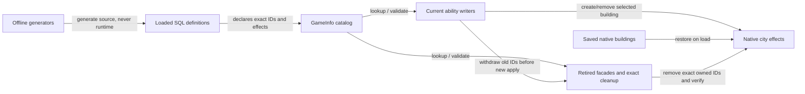

# Carrier / Modifier Footprint — Findings, Dependencies and Options

Investigation / Non-authoritative / No design decision implied

Status: Stable

Maintainer: Primary; independent read-only Carrier / Modifier audit

Baseline: develop `3d0ac4b4c2b1c3d71cb46beb7d1093d191ade795`, initially clean; 2026-11-02.

Scope: source definitions, manifest loading, actual consumers and compatibility, structural scaling. No implementation, gameplay test, probe, deployment, authority edit or v3 change.

## 1. What the 4,020 definitions actually represent

| Spotlight file | Unique Modifiers | Buildings | Current role |
|---|---:|---:|---|
| NetworkBoost.sql | 2,064 | 1,032 | B055 forward writer retired; exact legacy cleanup remains |
| GreatWorkAdjacency.sql | 1,092 | 156 | Old BASE writer retired; current Meaning invokes its withdrawal |
| CultureMeaningProbe.sql | 644 | 92 | 55 production final-value options / 385 Modifiers; 37 other exact cleanup/disabled options / 259 Modifiers |
| NetworkBoostInteger.sql | 180 | 90 | B058 replacement encoding, now also retired; cleanup remains |
| CopyYields.sql | 40 | 80 | 40 inert Science tombstones plus 40 Production carriers with attached native effects; retired writers, current consumers require cleanup |
| **Total** | **4,020** | **1,450** | Neither column counts actual installations |

The four fully retired forward-effect families contribute **3,376 / 4,020 = 83.98% of this selected subtotal**. This percentage is not a fraction of all loaded definitions, memory or execution time. The five SQL sources occupy **1,950,209 bytes**, uncompressed source text, not DDS/package size or resident memory.

The complete manifest-selected literal pool is larger (4,181). Other SQL generates definitions from catalogs; therefore neither 4,020 nor 4,181 is the complete effective-loaded total. See the [complete inventory](Definition_Inventory.md) and [reproduction method](Reproduction_Method.md).

## 2. Six scales, kept separate

| Scale | Finding | Evidence boundary |
|---|---|---|
| Source definitions | 4,181 literal unique Modifiers; 4,420 including catalog-independent generated families; exact parameterized total below | STATIC_CONFIRMED source analysis; successful catalog-dependent expansion assumed only in formulas |
| Effective loaded definitions | Manifest schedules 49 unique gameplay SQL files; actual execution success/final rows NOT_CONFIRMED | No current configured HD database; no game or load log experiment |
| Carrier catalog | Internal buildings dominate; direct citizen-yield/GPP/Housing effects do not require Modifiers rows; units/access markers are separate native entities | Template definitions, not active effects |
| Active runtime instances | UNMEASURED | No current city-by-city installed-building or modifier-instance census; no new probe |
| Compatibility/tombstones | Exact ID cleanup and startup validation are live dependencies, including positive legacy SQL | Static callers and catalogs; native save compatibility not retested |
| Optional diagnostics | Some manual/retired; some productionized; some trait-attached and condition-gated | Filename/comment alone never establishes isolation |

No current source declaration creates a Policy or UnitAbility catalog. Literal Unit declarations total nine unique IDs; they are not nine building-carrier instances. Two custom DynamicModifier types (Governor property and Wonder era production) are distinct from individual Modifier IDs. Buildings→Types must exist; individual Modifier IDs are not required to be Types entries.

## 3. Multiplication and encoding history

### B055 and B058

B055 expands `2 directions × 4 weights × 129 recipient counts × 2 channels = 2,064 Modifiers`, backed by 1,032 buildings. The channels are a native boost and an HD Property, not two interchangeable copies. Culture-direction BuildingModifiers are intentionally absent even though definitions remain. B058 represents the final integer range instead: `2 directions × 45 final values × 2 channels = 180`, backed by 90 buildings. Its 45 is `floor(4 * sqrt(129) + 0.5)`. Quantization occurs once after the complete floating calculation. Sources: [tools/generate_boost.py:7](../../../../../tools/generate_boost.py#L7), [tools/generate_boost_integer.py:4](../../../../../tools/generate_boost_integer.py#L4), [Mod/NetworkBoost.lua:7](../../../../../Mod/NetworkBoost.lua#L7).

The two generators emit SQL and Lua catalogs offline; the game does not execute Python. They were inspected, not run in write/check mode. Current GWA/Meaning SQL is expanded source; no corresponding generator was found in the current tools inventory. This is not a claim about historical generation.

### Great Work Adjacency

`6 yields × 2 signs × 13 bits = 156 carrier templates`, each with seven Great Work object-category attachments: **1,092 Modifiers**. Native stored amounts are signed half-units `2^bit / 2`; the model's integer BASE ranges ±8,191, representing ±4,095.5. See [Mod/GreatWorkAdjacencyModel.lua:4](../../../../../Mod/GreatWorkAdjacencyModel.lua#L4) and [Mod/Data/GreatWorkAdjacency.sql:1](../../../../../Mod/Data/GreatWorkAdjacency.sql#L1).

### Current Meaning

`24 bit candidates + 3 controls + 65 final-value options = 92 buildings`; seven object categories each give 644 Modifiers. Current production selects **55 non-Culture final values**: Science5 + Production10 + Gold30 + Food5 + Faith5 =55. At most one nonzero carrier per selected yield is used per city, at most five for this ability; those are source selection bounds, not an observed live count. The ten Culture finals remain disabled. See [Mod/CultureMeaningModel.lua:69](../../../../../Mod/CultureMeaningModel.lua#L69) and [Mod/CultureMeaningModel.lua:104](../../../../../Mod/CultureMeaningModel.lua#L104).

The 37 currently unselected options are **24 bits + 3 controls + 10 Culture finals**. Do not confuse them with historical B163's “old37,” which included Production final values that are still used today. The normal writer validates and removes all92 exact IDs; none of the37 is immediately deletable. [Mod/CultureMeaning.lua:17](../../../../../Mod/CultureMeaning.lua#L17).

### Other production encodings

| Family | Encoding and owner | Why a Modifier-only count misleads |
|---|---|---|
| ResearchSupport / ConstantSupport | 3 direct citizen-yield carriers; [Mod/ResearchSupport.lua:9](../../../../../Mod/ResearchSupport.lua#L9) | No Modifiers table rows |
| IndustrySupport | Food master +8 adjacency bits; [Mod/IndustrySupport.lua:17](../../../../../Mod/IndustrySupport.lua#L17) | Native specialist coefficients, not one definition per assigned worker |
| Lv2Housing / Lv2GPP | 9 unit-Housing /32 GP carriers; [Mod/Lv2Housing.lua:10](../../../../../Mod/Lv2Housing.lua#L10); [Mod/Lv2GPP.lua:17](../../../../../Mod/Lv2GPP.lua#L17) | Direct Building fields and Building_GreatPersonPoints; Culture associates three GP classes |
| ResearchApply / Infrastructure | 25 /4 citizen-coefficient bits; [Mod/ResearchApply.lua:4](../../../../../Mod/ResearchApply.lua#L4); [Mod/ResearchInfrastructure.lua:15](../../../../../Mod/ResearchInfrastructure.lua#L15) | No flat-city Modifier graph |
| ResearchCross / Chair | 32 signed district-Science bits /8 per matched target building; [Mod/ResearchCross.lua:4](../../../../../Mod/ResearchCross.lua#L4); [Mod/ResearchChair.lua:20](../../../../../Mod/ResearchChair.lua#L20) | Target-specific scope and arguments matter |
| Tradition / Inspiration | 5 Science percentage tiers /8 era-count tiers; [Mod/ResearchTraditionEffects.lua:8](../../../../../Mod/ResearchTraditionEffects.lua#L8); [Mod/CultureInspiration.lua:8](../../../../../Mod/CultureInspiration.lua#L8) | Final-tier choice, not all tiers active |
| Aesthetic | 1 master building →16 property-gated district Modifiers; [Mod/CultureAesthetic.lua:27](../../../../../Mod/CultureAesthetic.lua#L27) | One building can attach many native Modifiers |
| CultureNetwork | 4 recipient families ×8 citizen-yield bits; [Mod/CultureNetwork.lua:6](../../../../../Mod/CultureNetwork.lua#L6) | Worker multiplicity is native, not static per-worker expansion |
| Insights / Dialogue | 192 final tourism values /8E final values ×7 categories; [Mod/CultureInsightsTourism.lua:57](../../../../../Mod/CultureInsightsTourism.lua#L57); [Mod/DialogueEffects.lua:12](../../../../../Mod/DialogueEffects.lua#L12) | One chosen final value may attach seven category-specific Modifiers |
| Commercialization | 31 Gold bits; [Mod/Data/Commerce.sql:2](../../../../../Mod/Data/Commerce.sql#L2) | Gold carrier input already contains accepted per-domain Floor; must not alter rounding |
| Standardization / Study | Target × final level; construction plus building purchase; [Mod/StandardizationEffects.lua:38](../../../../../Mod/StandardizationEffects.lua#L38) | Broad shared target catalog; grows when eligible ordinary buildings grow |
| Development / Restructuring | One +50% district-target carrier per domain; one disruption building with multiple yield/growth Modifiers | Per-domain targets differ from target-building × level catalogs |
| Crew / Claim / Study / Expedition access | Native prerequisite markers and units | Effect-free access buildings can be load-bearing eligibility contracts |

## 4. Dependency and compatibility map

| Family | Real dependency / exit path | Removal assessment |
|---|---|---|
| B055 / B058 | [Mod/Gameplay.lua:944](../../../../../Mod/Gameplay.lua#L944) starts retired mode. [Mod/NetworkBoost.lua:20](../../../../../Mod/NetworkBoost.lua#L20) still asserts B055 building definitions during Clean. [Mod/LegacyCleanupCatalog.lua:18](../../../../../Mod/LegacyCleanupCatalog.lua#L18) requires 1,032 +90 catalog entries. [Mod/UI/BoostRefresh.lua:8](../../../../../Mod/UI/BoostRefresh.lua#L8) still sends BOOST_INIT; [Mod/Gameplay.lua:499](../../../../../Mod/Gameplay.lua#L499) cleans Boost and GreatWorkProbe. | Not dead SQL; move necessary exit/init duties before changing definitions or UI transport. |
| Copy | [Mod/CopyYields.lua:16](../../../../../Mod/CopyYields.lua#L16) exposes retired withdrawal; [Mod/StandardizationEffects.lua:100](../../../../../Mod/StandardizationEffects.lua#L100) calls it. [Mod/Tombstones.lua:14](../../../../../Mod/Tombstones.lua#L14) and [Mod/ResearchInfrastructure.lua:28](../../../../../Mod/ResearchInfrastructure.lua#L28) require40 Science tombstones. | Keep stable building IDs and validated cleanup; retaining IDs is separable from retaining positive effect graphs, but equivalence/save proof is missing. |
| GWA | [Mod/Gameplay.lua:954](../../../../../Mod/Gameplay.lua#L954) disables positive writer; [Mod/GreatWorkAdjacency.lua:49](../../../../../Mod/GreatWorkAdjacency.lua#L49) retains156-ID withdrawal; [Mod/CultureMeaning.lua:62](../../../../../Mod/CultureMeaning.lua#L62) invokes it. | Formal [Specialization/Architecture/v2/P0_L2_Meaning.md:18](../../../../../Specialization/Architecture/v2/P0_L2_Meaning.md#L18) explicitly retains definitions and exact withdrawal. Requires an approved contract change before retirement changes. |
| Meaning | Current writer starts at [Mod/Gameplay.lua:956](../../../../../Mod/Gameplay.lua#L956); asserts no experimental writer; validates92 IDs and writes55 final options. | Do not remove entire Probe SQL or merely rename/delete37 supposedly old options. |
| Inspiration probe | [Mod/CultureInspirationProbe.lua:12](../../../../../Mod/CultureInspirationProbe.lua#L12) validates four old definitions; production [Mod/CultureInspiration.lua:68](../../../../../Mod/CultureInspiration.lua#L68) withdraws them. | Retired manual writer still has a mandatory production exit dependency. |
| B054 old discounts | [Mod/Gameplay.lua:940](../../../../../Mod/Gameplay.lua#L940) retired; [Mod/StandardizationEffects.lua:100](../../../../../Mod/StandardizationEffects.lua#L100) requires exact withdrawal before current target projection. | `4B` old definitions coexist with current baseline/levels; not automatically discardable. |
| Legacy Dialogue | [Mod/DialogueEffects.lua:12](../../../../../Mod/DialogueEffects.lua#L12) disables old positive behavior. [Mod/Dialogue.lua:14](../../../../../Mod/Dialogue.lua#L14) and [Mod/LegacyCleanupCatalog.lua:43](../../../../../Mod/LegacyCleanupCatalog.lua#L43) retain old ownership/cleanup. | Four diagnostic controls and old projections load. Transport/ACK/collection duties must not disappear with old numerical writer. |
| Convergence48 | [Mod/Gameplay.lua:962](../../../../../Mod/Gameplay.lua#L962) retires it; [Mod/CommerceConvergence.lua:6](../../../../../Mod/CommerceConvergence.lua#L6) withdraws48 exact IDs. | Positive SQL remains attached; retired is not inert. |
| Inert III/IV/precision buildings | Lv3Support12, Lv3Effects19, Lv4Percent16, DistrictPrecision3; [Mod/Tombstones.lua:5](../../../../../Mod/Tombstones.lua#L5) | Already zero Modifiers; deleting these cannot yield the advertised Modifier reduction. |

B055/B058/Copy together contain2,284 Modifiers,1,202 buildings and1,162 BuildingModifiers links. Of those Modifiers,1,122 Culture-direction definitions have no BuildingModifiers in these files;1,162 retain legacy effect links. No native-save evidence proves it is safe to delete even the unlinked definitions. Positive legacy effects may exist in an old save before exact cleanup completes.

The Copy Production encoding includes16 positive +16 negative integer pieces and8 population half-unit pieces. Nonnegative desired yields can still need negative compensators (e.g. `3 ×0.5 −1 =0.5`). Removing negative/half pieces or directly substituting floats is not demonstrated equivalent. [Mod/CopyYields.lua:5](../../../../../Mod/CopyYields.lua#L5).

## 5. Probe isolation is a dependency question

| Loaded file | Definitions | Current path and exit boundary |
|---|---:|---|
| GovernorProbe | 6 Modifiers;6 Trait attachments | **Production ACTIVE facts**, not optional. [Mod/Probe.lua:325](../../../../../Mod/Probe.lua#L325) reads the six governor Properties; [Mod/EffectiveFacts.lua:117](../../../../../Mod/EffectiveFacts.lua#L117) consumes them; America shares the trait. |
| CultureMeaningProbe | 644 Modifiers | Production final carriers live here; experimental Lua is not started. Production/diagnostic split is an actual migration prerequisite. |
| YieldCarrierProbe | 6 Modifiers;6 Trait attachments | Already attached but Plot-Property-gated; manual STEP/OFF toggles. [Mod/YieldCarrierProbe.lua:17](../../../../../Mod/YieldCarrierProbe.lua#L17); central cleanup clears exact flags. Not “unattached by default.” |
| GreatWorkProbe | 8 Modifiers /2 buildings | Manual CITY/OBJECT test, mutually exclusive; [Mod/GreatWorkProbe.lua:13](../../../../../Mod/GreatWorkProbe.lua#L13); exact central cleanup. |
| HalfYieldProbe | 32 Modifiers /32 buildings | [Mod/Gameplay.lua:930](../../../../../Mod/Gameplay.lua#L930) starts retired early-return branch; central cleanup owns saved effects. |
| PurchaseProbe | 3 Modifiers /2 buildings | Manual BASE/ON/OFF; [Mod/PurchaseProbe.lua:19](../../../../../Mod/PurchaseProbe.lua#L19) still registers load cleanup even with centralExit. |
| CultureInspirationProbe | 4 /4 | Retired positive experiment, current production withdrawal dependency. |
| DistrictPrecisionProbe | 0 /3 | Inert SQL tombstones; Lua files remain packaged/importable, but no current startup/caller found. |
| BoostIntegerTest | 8 /4 | Explicit legacy controls and cleanup; Culture direction has no building links. |
| OverflowSinkTest | 0 /1 | Access/disabled production target definitions, not Modifier payload. |
| Legacy Dialogue controls | 56 if E≥2 /4 | Generated by cloning D2; retained exact old ownership. |

Loaded definitions can have database/loading/catalog costs even when not creating normal positive effects. That is a mechanism to measure, not proof of material runtime cost. A safe diagnostic exit must preserve the production facts, cleanup of saved instances, UI callers and missing-definition validation; deleting a named Probe file is not a safe boundary today.

## 6. What the engine evidence does and does not establish

The existing [Specialization/Status/Validation/Results/Specialization_B160_Production_Reconfiguration_Native.md:17](../../../../../Specialization/Status/Validation/Results/Specialization_B160_Production_Reconfiguration_Native.md#L17) documents active flat1 +flat2 instances producing1, not3, while a single flat3 gives3 in the tested Writing fixture. [Specialization/Status/Validation/Results/Specialization_B161_Production_Single_Value_Native.md:11](../../../../../Specialization/Status/Validation/Results/Specialization_B161_Production_Single_Value_Native.md#L11) records3→5 and W2 total10; it also records a then-unresolved cold-load withdrawal failure. [Specialization/Status/Validation/Results/Specialization_B163_Meaning_Final_Yields_Native.md:3](../../../../../Specialization/Status/Validation/Results/Specialization_B163_Meaning_Final_Yields_Native.md#L3) establishes bounded success for five non-Culture yields and a Culture coexistence failure. These are retained historical primitive constraints, not a new failure claim about the current accepted ability.

Thus a binary replacement of Meaning final values is not arithmetic-only cleanup. Nor is the statement “all native Modifiers never stack” justified. The tested Great Work primitive names a single `GreatWorkObjectType`; no reviewed wildcard/multiple-category equivalent is established. Seven attachments have a concrete current primitive reason, not a proven universal engine impossibility. Host district, category, YieldChange/ScalingFactor, HD coexistence, order, rounding, recipient scope and cleanup all matter.

Current code offers no verified general runtime setter that mutates a loaded ModifierArguments amount while preserving independent city ownership. Attaching a fixed Modifier does not establish a dynamic numeric API. Such an alternative remains an experiment proposal, not a solution.

## 7. Scaling toward eleven main plus six auxiliary professions

**Do not multiply today's4,020 by17/4.** The number of professions is not an encoding dimension by itself.

- **Fixed retained base:** the3,376 legacy spotlight Modifiers need not be copied for any new profession. Shared facts/access/cleanup similarly are not one full copy per profession.
- **Linear ability families:** additive binary effects grow with independent owned channels ×bits ×signs/recipient kinds. Worker count often remains native. New abilities can require distinct ownership even for equal numeric values.
- **Combinatorial catalogs:** target ×level ×yield/category ×range. Standardization is already shared over a broad target catalog; added buildings can grow it even before any new profession logic is written.
- **Reuse boundary:** a Building is a presence slot, not a countable additive instance. Two independent writers sharing one ID can overwrite/withdraw one another or collapse contributions. Equal Modifier arguments alone do not establish safe shared ownership.

For successful catalogs with E≥2, the [inventory formula](Definition_Inventory.md#exact-catalog-dependent-formulas) proves these **static** marginal increases:

| Catalog change, holding other dimensions fixed | Δ Modifiers | Δ Buildings |
|---|---:|---:|
| One eligible B054 building target B | 5+2E | 5+E |
| One Standardization district target D | 1+E | 1+E |
| One additional Era row E | 73+2B+D | 12+B+D |
| One matched Chair target C | 8 | 8 |
| One Development district R | 1 | 1 |
| One non-Food yield Y | 1 | 0 |

B and C/R can overlap in a real addition; the table isolates dimensions, so sum only actual changed dimensions. COUNT(Eras) is not automatically eight Great Work collection eras.

| Structural scenario | Explicit assumption | Growth shape, not a numerical forecast |
|---|---|---|
| Optimistic reuse | New professions use existing native target catalogs and equivalent shared channels without new ownership conflicts; no new large ranges | Existing catalog mostly fixed; incremental access and small independently owned binary/tier families |
| Neutral | New abilities add bounded independent channels and ordinary target buildings; preserve present exact semantics | Sum of per-ability bits/ranges plus `(5+2E)ΔB`, `(1+E)ΔD`,8ΔC and other actual catalog deltas |
| Pessimistic replication | New abilities repeat exclusive final-value ×category ×target ×level patterns, keep every old positive graph, or require sign/precision variants | Products of those dimensions; adding a range/category can outgrow profession count rapidly |

Definitions consume source/database/catalog space; package bytes and load processing are distinct from resident engine memory. Per-city selected buildings and attached category modifiers determine active application/removal. Warm no-change updates differ from cold reconstruction. Maintenance grows with stable IDs, readers, cleanup, generator validation and migration contracts.

Concrete existing work shapes: [Mod/NetworkBoost.lua:29](../../../../../Mod/NetworkBoost.lua#L29) Clean enumerates cities and exact1,032 +90 +4 Boost IDs; [Mod/OrdinaryBuildingCatalog.lua:238](../../../../../Mod/OrdinaryBuildingCatalog.lua#L238) iterates Buildings and excludes technical entries; [Mod/StandardizationEffects.lua:65](../../../../../Mod/StandardizationEffects.lua#L65) reconstructs ownership across all final-level definitions, while its warm missingWanted/write path uses only wanted/changed targets. This supports a targeted workload question. It does not establish frequency, wall time, RAM growth, a leak, or a performance improvement percentage.

## 8. Options and tradeoffs — no implementation approval

| Candidate | Evidence classification | What could shrink | Required preservation / smallest future gate |
|---|---|---|---|
| Extract production-owned definitions from Probe packaging; optional diagnostic load group | **Strong evidence for a separable responsibility; implementation still needed** | Optional diagnostic definitions/files in normal package; zero saving from merely renaming | Preserve exact production IDs/fields and current cleanup; actual production-consumer tests, disabled diagnostic no-output/no-listener checks, load/exit smoke. Governor and Meaning cannot exit with diagnostics. |
| Replace retired expansive positive graphs with a deliberate compatibility representation | **Strong structural redundancy; safe reduction not yet proved** | Up to3,376 spotlight legacy Modifier definitions as a candidate envelope, not promised savings; Buildings may remain | Migrate assert/cleanup/catalog duties; explicit save-ID policy; prove old instances removed or safely inert and current output unchanged. Never delete old IDs merely because forward writer retired. |
| First investigate the1,122 B055/B058 Culture Modifier definitions without building attachments | **Narrow candidate requiring proof** | Modifier/argument rows, not necessarily1,122 buildings or instances | Audit save/native/external ID references; retain required stable building Types; regenerate catalogs consistently. Lack of BuildingModifiers is not proof of no other reference. |
| Remove unused Meaning candidates after extracting exact withdrawal responsibility | **Needs contract revision and compatibility proof** | Candidate37 Buildings /259 Modifiers; not all classified as experiments | Current validate92/withdraw92 and formal retained-ID contract must change under approval; preserve Production values and disabled Culture's design status; load/error isolation equivalence. |
| Shared equivalent definition templates / generator normalization | **Strong source-maintenance opportunity; engine saving conditional** | Source duplication; definitions only when semantic and ownership identity really match | Match host, scope, arguments, rounding and ownership; two-ability concurrency and selective withdrawal tests. Source generation alone does not reduce loaded rows. |
| Re-encode current exclusive final-value carriers as additive bits or runtime-set amounts | **Needs native experiment; not presently a safe replacement** | Potential range-to-log reduction; exact amount unknown | Preserve all numeric, HD, category, half/sign and city/player semantics. Use existing scoped native evidence first; if a new optional probe is necessary, specify shutdown/removal and no production import before approval. |
| Lower ranges, categories or precision / delete old stable IDs / use one wildcard category without proof | **Not recommended as behavior-neutral cleanup** | Could reduce definitions by changing semantics/support | New gameplay/save/compatibility decision required; not in this audit's authority. |

Every future implementation must separately state which scale decreases (Modifier rows, building templates, linked rows, actual instances, files, bytes). No candidate has a measured CPU/RAM saving here. All prices, Floor/rounding, grants, qualifiers, D-1 retained projection rules, native transaction proof and current accepted abilities remain unchanged.

## 9. Genuine Owner decisions and next gate

No ordinary inventory scripting, reference tracing or file organization decision is escalated. These choices become Owner questions only if a new implementation is proposed:

1. Compatibility support and release boundary: preserve which stable IDs/saves; is a breaking catalog reset ever acceptable? No breaking policy is presumed.
2. Major ownership/encoding architecture: independent ability owners versus a shared arithmetic aggregator; any newly required runtime numeric primitive. Do not silently choose it to save rows.
3. Any reduction of supported precision, ranges, categories, HD coexistence or currently approved gameplay is a Design decision, not maintenance.
4. Whether this evidence should change v3 sequencing before implementation. There is no automatic change: definition lifetime is independent of Option B's fact transport, but wholesale deletion could remove its production/cleanup dependencies.

**Next gate if optimization is separately authorized:** provide an explicit current read-only HD database, identify source/deployed package provenance and database errors, resolve E/B/D/C/R/Y, compare actual unique rows/joins with source formulas, select one family, write exact production+cleanup ownership tests and old-save policy, then choose the minimum native check that answers an actual remaining API/save uncertainty. No game, new probe or code experiment was started here.

## Read Ledger and validation boundary

Inputs: user Carrier handoff; current root/project/Investigation guidance, Authority/Status metadata; current modinfo,65 Mod SQL files, two offline generators and exact Lua callers/catalogs. Targeted expansion followed those source symbols into Meaning architecture, specialist/Standardization production owners and B160/B161/B163 frozen primitive evidence. Existing Reconstruction/v3 is context only and unchanged. No broad HD/Workshop scan, user-save scan, raw log ingestion or new benchmark.

Completed: deterministic literal lexer/count, source graph checks, catalog formulas independently cross-checked, manifest action/package distinction and production dependency tracing. **STATIC_CONFIRMED** within those boundaries. Effective DB joins **NOT_RUN** (missing configured database); source-generated effects not native execution. Existing user evidence remains its original scoped USER_GAME_TEST result. No new gameplay LOCAL_SIMULATION_PASS or USER_GAME_TEST_PASS is claimed.

- **User decision:** no immediate approval needed; future optimization/save or semantics decisions above remain open.
- **User testing:** none in this audit.
- **Primary next:** publish only reviewed report artifacts and stop; no v3 edit, runtime change, PR or deployment.
